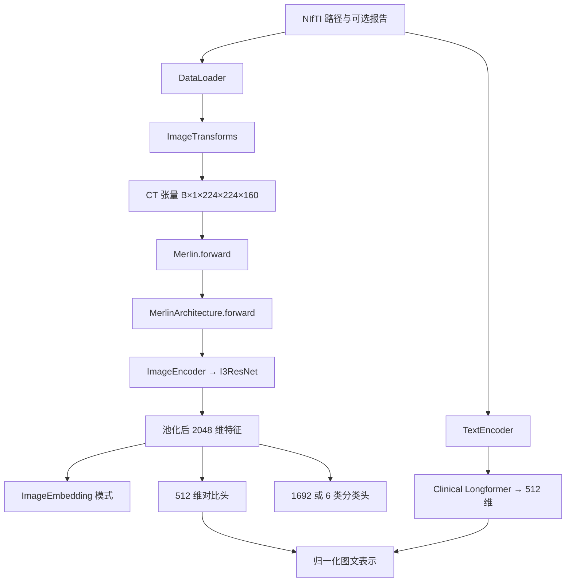

# Merlin 源码阅读笔记

阅读基准：官方提交 `e1552df771367aa2589ec7dcfd3151dc91f8ce74`。以下从一个 CT 的流向解释代码；输出形状依据当前实现静态推导，尚未用实际权重运行验证。

## 先看调用链



报告生成走另一套 `Clip3DForTextGeneration`，并不经过图中的普通图文输出分支。

## 第一站 数据如何进入模型

先打开 [dataloaders.py](../upstream/merlin/data/dataloaders.py)，找到 `DataLoader.__init__`。输入是字典列表：

```python
datalist = [
    {"image": "/path/to/case.nii.gz", "text": "report text"}
]
```

纯图像任务不需要 `text`。这里的 `image` 首先是文件路径，经过 `CTPersistentDataset` 和变换后才成为张量。`batchsize` 是这个包装器自己的参数名，内部才传给 MONAI 的 `batch_size`。

`CTPersistentDataset._cachecheck` 只缓存变换后的图像，再把其他字段保留在样本字典中。缓存标识基于 `{"image": 路径}` 生成，并未在这段代码中加入变换配置或原文件内容哈希。因此，改变预处理或替换同路径文件时，应该使用新的缓存目录，避免继续读取旧结果。

## 第二站 预处理规定了模型看见什么

打开 [monai_transforms.py](../upstream/merlin/data/monai_transforms.py)，逐行读 `ImageTransforms`：

| 步骤 | 当前实现 | 阅读时要问的问题 |
| --- | --- | --- |
| 读入体积 | `LoadImaged` | 输入是不是包含正确空间信息的 CT？ |
| 增加通道 | `EnsureChannelFirstd` | 是否得到单通道 `C×H×W×D`？ |
| 统一方向 | `Orientationd(axcodes="RAS")` | 左右与空间方向是否一致？ |
| 重采样 | `pixdim=(1.5, 1.5, 3)` mm | 层间细小结构会损失多少？ |
| 强度变换 | 截断到 `[-1000, 1000]` 并映射至 `[0, 1]` | 输入是否保留了正确 HU？ |
| 补齐和裁剪 | `224×224×160`，中心裁剪 | 心脏与目标血管是否仍在视野内？ |
| 转为张量 | `ToTensord` | 批量后形状是否符合网络入口？ |

完成后，通常是 `[B, 1, 224, 224, 160]`。物理覆盖范围、图像方向和裁剪位置比“张量能否跑通”更先决定这个输入是否适合目标任务。

## 第三站 Merlin 是加载器和模式选择器

打开 [load.py](../upstream/merlin/models/load.py)：

1. `MODEL_CONFIGS` 保存模型构造器与对应权重文件名。
2. `Merlin.__init__` 根据开关选择任务。
3. `_load_model` 先下载权重，构造网络，再加载状态字典。
4. `forward` 把实际计算交给 `self.model`。

默认、图像特征和表型分类使用默认配置；五年疾病预测使用独立 checkpoint，且只把状态字典加载到图像骨干。报告生成有两个配置开关，不能仅凭文件名里的 `gpt2` 判断实际解码器架构。

权重默认保存到 `upstream/merlin/models/checkpoints/`。初始化还可能通过 torchvision 下载 ImageNet ResNet-152，通过 Transformers 下载 Clinical Longformer。报告生成另外需要 RadLLaMA。

**一个容易误解的点**：`ImageEmbedding=True` 并不会避免 `TextEncoder()` 的构造，因为 `MerlinArchitecture.__init__` 无条件创建它。它只在前向传播时跳过文本计算。因此，纯图像模式第一次启动时仍可能需要网络和文本模型缓存。

## 第四站 二维 ResNet 怎样变成三维网络

依次读 [ImageEncoder](../upstream/merlin/models/build.py)、[I3ResNet](../upstream/merlin/models/i3res.py)、[inflate_conv](../upstream/merlin/models/inflate.py)。

`ImageEncoder` 先创建 `torchvision.models.resnet152(pretrained=True)`，再交给 `I3ResNet`。前向传播入口把 `[B,1,H,W,D]` 排列为 `[B,1,D,H,W]`，随后将同一灰度通道复制三份。三份通道没有增加影像信息，只是适配从 RGB 网络继承的输入结构。

卷积膨胀使用 `center=True`：在新增加的深度维上，中心平面复制二维权重，其余位置初始化为零。首层的实际卷积核为 `3×7×7`、步幅为 `1×2×2`。这说明它不是每层都在三个空间方向使用完全相同的下采样。

`layer1` 至 `layer4` 沿用 ResNet 的残差层结构。`checkpoint.checkpoint` 是减少训练激活内存的技术，不是这里的“加载模型 checkpoint”；这两个同名术语用途不同。

## 第五站 输出到底是什么

以 `B` 表示 batch size，以下对应 `conv_class=True` 和上述标准体积输入：

| 模式 | 实际返回 | 解释 |
| --- | --- | --- |
| `Merlin()` | 三元素 tuple | 依次是图像对比特征、表型 logits、文本对比特征 |
| 默认模式第一项 | `[B,512]` | 已做 L2 归一化 |
| 默认模式第二项 | `[B,1692]` | **logits**，该分支没有 sigmoid |
| 默认模式第三项 | `[B,512]` | 已做 L2 归一化 |
| `ImageEmbedding=True` | Tensor，`[1,B,2048]` | `I3ResNet` 的 `unsqueeze(0)` 添加了最前面一维 |
| `PhenotypeCls=True` | Tensor，`[B,1692]` | 该分支明确调用 sigmoid |
| `FiveYearPred=True` | Tensor，`[B,6]` | 使用六类输出头与另一份权重，调用 sigmoid |

官方说明把纯图像输出描述为 tuple；当前代码实际返回 Tensor。官方示例中的 `model(images)[0]` 在这里取掉的是额外的第一个维度，得到 `[B,2048]`，并不是从 tuple 里拿第一种输出。

这一区别可以沿 `I3ResNet.forward → ImageEncoder.forward → MerlinArchitecture.forward → Merlin.forward` 一直追踪。运行时应打印 `type(outputs)` 和 `outputs.shape` 再确认，不要把用于单例演示的形状直接写死在批处理代码里。

文本分支的首个 token 表示从 768 维映射到 512 维；默认模式最后对图文分别归一化。`logit_scale` 虽然注册为参数，但当前 `forward` 并没有用它返回相似度矩阵或计算损失。拿到特征后，还要自己明确相似度、正负提示、阈值和评价方式。

## 第六站 报告生成单独读

[radiology_report_generation.py](../upstream/merlin/models/radiology_report_generation.py) 保留视觉空间位置，把视觉特征展成 token 序列，经过 `Adapter(2048,4096)` 接到 RadLLaMA-7B。它不是把一个 2048 维全局向量直接变成整份报告。

先看 `ModifiedImageEncoder`，再看 `Adapter`，最后看 `TextDecoder.generate` 和 `Clip3DForTextGeneration.generate`。此时再阅读 [报告生成示例](../upstream/documentation/report_generation_demo.py)，才容易理解器官提示词如何使用。

如果准备训练，应额外审查 `Clip3DForTextGeneration.forward`：整个损失计算包在 `torch.no_grad()` 中，适配器与文本解码器也在其中。即使把模型切换为 `train()`，这个上下文仍然关闭梯度；不能直接据此声称报告训练已经可用。

## 第七站 当前没有完整的预训练循环

当前快照没有图文 InfoNCE 与 EHR BCE 的联合训练入口，也没有配套的 optimizer、反向传播和训练轮次管理。论文说明报告拆分、标签处理和训练策略，模型定义本身并不包含这些全部过程。

官方微调说明建议移除 `eval()` 等行，但真正的微调还需要：

- 明确哪些参数训练、哪些冻结，并使用正确的训练／验证模式。
- 给目标任务定义标签、损失、优化器和更新循环。
- 按患者划分数据，避免重复检查跨集合。
- 记录验证选模、独立测试和 checkpoint。

设备迁移和训练模式是两回事：`.cuda()` 或 `.to(device)` 不决定是否训练，`train()` 与 `eval()` 也不会自动创建优化过程。

## 一次阅读结束后应能回答

- [ ] `image` 在哪里从文件路径变成张量？
- [ ] 为什么先重采样，再补齐与中心裁剪？
- [ ] 2048 维和 512 维表示分别来自哪一层？
- [ ] 默认表型输出与 `PhenotypeCls=True` 的输出有什么差别？
- [ ] 纯图像模式为什么还会初始化文本编码器？
- [ ] 哪一部分是论文训练方法，哪一部分已经能在这份代码里找到？
