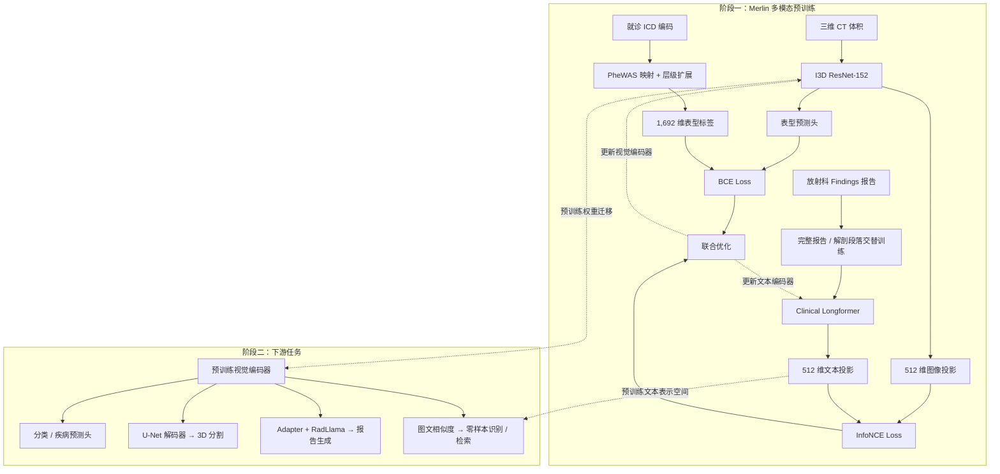

# Merlin: A Computed Tomography Vision-Language Foundation Model and Dataset

> **版本范围**：本篇精读按 arXiv v2 原文整理。官方项目现引用 Nature 2026 论文（[DOI](https://doi.org/10.1038/s41586-026-10181-8)）；以下页码和结果仍按 v2，不混用正式版页码。
> **代码配套**：[源码阅读笔记](02-code-reading.md) · [如何开始](03-getting-started.md)

> **原文标题**：Merlin: A Computed Tomography Vision-Language Foundation Model and Dataset\
> **作者**：Louis Blankemeier、Ashwin Kumar（共同第一作者），Joseph Paul Cohen、Jiaming Liu 等；通讯作者 Akshay S. Chaudhari\
> **期刊/会议**：本地文件为 arXiv 预印本 v2，首页日期 2026-03-04；不根据下载文件夹名称推定正式发表期刊\
> **标识**：arXiv:2406.06512v2；这份 PDF 首页未列出正式期刊 DOI\
> **全文入口**：[arXiv v2 PDF](https://arxiv.org/pdf/2406.06512v2)
> **页数**：51 页，含正文、参考文献和补充材料；下文页码均指本地 PDF 页码，与印刷页码一致\
> **原文所列代码入口**：[StanfordMIMI/Merlin](https://github.com/StanfordMIMI/Merlin)（2026-10-20 已核验并收录固定源码；见 [项目入口](../README.md)）\
> **阅读范围**：正文 Sections 1–4、关键图表、补充材料 A–C；核心结果表和公式所在页面已对照页面图像核读

## 摘要

> **来源**：Abstract, pp.1–2；贡献列表与训练耗时，p.3。

Merlin 用医院日常产生的三类信息预训练三维 CT 编码器：**完整 CT 体积、放射学报告、电子病历中的诊断编码**。图像与报告通过对比学习对齐，诊断编码经 PheWAS 映射后提供多标签表型监督。模型采用由二维 ImageNet 权重膨胀得到的三维 ResNet152 和 Clinical Longformer，可直接处理一个预处理后的 CT 体积及长报告。

预训练使用 15,331 个 CT、约 639 万张切片、约 604 万个报告 token 和约 184 万条 ICD 编码。作者以六类任务、合计 752 项任务说明表征的通用性：零样本影像发现分类、表型分类、跨模态检索、未来五年疾病预测、报告生成和器官分割。论文报告单张 A6000 训练约 160 小时。

最值得迁移的是**整卷三维表征、报告按解剖部位拆分与完整文本交替训练、结构化诊断与文本联合监督、按下游任务分别评估迁移效果**。其结果同时表明：报告拆分有任务取舍；仅报告训练已贡献大部分增益；在全量分割标注条件下，Merlin 并未超过 nnUNet。

## 1. Main

> **来源**：Section 1, pp.2–3；Fig.1, p.4。

### 研究问题与贡献

腹部 CT 一次检查包含大量切片及多个器官，依靠逐任务人工标注训练模型成本高。已有医学视觉语言模型多面向二维影像，面对三维体积和长报告时有两类困难：切片级汇聚不充分利用三维关系，文本截断则丢失器官和病变描述。

作者提出的解决思路是把临床常规数据变成可复用的预训练监督：

1. 用三维编码器直接学习体积级表征。
2. 用报告的 Findings（影像所见）学习细粒度影像语义。
3. 用就诊期间的 ICD 编码学习较粗的健康状态与表型。
4. 用多类任务和外部队列检验同一表征，而不是只报告一个分类任务。

下面按 Fig.1 和 Methods 重绘信息流：

**概念区分**：“无需额外人工标注”指预训练可利用已有报告和诊断编码，不意味着没有监督信号。表型分类用到预训练期间学过的标签；未来疾病预测、报告生成、分割均另有适配训练，不能统一称为零样本任务。

## 2. Results

> **来源**：Section 2, pp.3–8；Figs.2–9, pp.18–25。

### 2.1 Zero-shot Findings Classification

> **来源**：Section 2.1, pp.4–5；Fig.2, p.18；Tables 4–5, p.35。

针对每种影像发现，分别准备描述“存在”和“不存在”的多条文本提示，比较 CT 与两组文本的平均余弦相似度。腹部测试包含 30 种发现，另在 VerSe 上评价椎体骨折；这是正文所称 31 项零样本发现任务的来源。

| 测试任务 | Merlin 平均 F1 | 95% CI | 数据出处 |
| --- | ---: | --- | --- |
| 内部腹部 30 项发现 | 0.741 | [0.727, 0.755] | Table 4 |
| 原外部临床队列 30 项发现 | 0.647 | [0.607, 0.678] | Table 4 |
| VerSe 椎体骨折 | 0.767 | [0.630, 0.867] | Table 4；正文下界另写 0.623 |

这里的 0.647 属于原外部队列实验，不能用作新增三个外部中心、全部 44,098 个 CT 的统一平均表现。

粗大或明显的异常较容易识别，例如胸腔积液、脾大、腹水和胆囊术后缺如；细微或复杂异常，例如阑尾炎、转移、淋巴结病及游离气体，表现相对较弱。

**消融的核心证据：**

| 初始化 | 监督方式 | 报告拆分 | F1 |
| --- | --- | --- | ---: |
| I3D | 仅报告 | 是 | 0.730 |
| I3D | EHR 后报告的分阶段训练 | 否 | 0.669 |
| I3D | EHR 后报告的分阶段训练 | 是 | 0.735 |
| I3D | EHR＋报告多任务 | 否 | 0.656 |
| 随机 | EHR＋报告多任务 | 是 | 0.698 |
| I3D | EHR＋报告多任务 | 是 | **0.741** |

按 Table 5 两个多任务配置直接相减，报告拆分的绝对差为 **0.085，即 8.5 个 F1 百分点**；加入 EHR 相对仅报告的差为 **0.011**。正文另有“平均 7.9 F1 points”的概括，与这组直接配对差值不是同一数值。对缺乏 EHR 的应用，0.730 的仅报告方案是很有价值的参照。

### 2.2 Phenotype Classification

> **来源**：Section 2.2, p.5；Section 4.4, p.13；Fig.3, p.19；Tables 6–7, p.37。

模型根据 CT 预测与这次就诊关联的 PheWAS 表型，评估只纳入测试集中阳性超过 20 例的表型。正文写 692 类，Table 6/7 写 691 类，二者存在版本内差异。

正文报告宏平均 AUROC **0.812**，95% CI [0.808, 0.816]；Table 6 对应 AUPRC **0.142**，平均患病率约 3.1%。低患病率表型即便 AUROC 较高，阳性预测仍可能困难，不能只看 AUROC。

架构实验支持以下判断：

- 在所比较的模型与预算下，ResNet 表现优于 ConvNeXt 和 Swin 配置；并不能据此推断所有三维 Transformer 都不适合该任务。
- 减小层间方向的卷积核与早期步幅有利于表型分类。最终 Merlin 的 stem 层间卷积核/步幅为 **3/1**。
- 表型分类与零样本发现分类的最优配置不同：Table 7 中不拆报告的多任务版本 AUROC/AUPRC 为 **0.814/0.153**，拆分版本为 **0.812/0.142**。

### 2.3 Zero-shot Cross-Modal Retrieval

> **来源**：Section 2.3, pp.5–6；Fig.4, p.20；Tables 8–9, p.40；Fig.12, p.41。

测试四个方向：CT→Findings、Findings→CT、CT→Impressions、Impressions→CT。训练只使用 Findings，因此与 Impressions（诊断印象）的匹配检验了对另一种报告文本分布的泛化。

| Merlin 检索方向 | Recall@1，候选池 N=64 | Recall@8，候选池 N=64 |
| --- | ---: | ---: |
| CT→Findings | 0.696 | 0.968 |
| Findings→CT | 0.687 | 0.965 |
| CT→Impressions | 0.253 | 0.663 |
| Impressions→CT | 0.277 | 0.706 |

上述数值来自 Table 8，属于指定候选池规模下的检索，不是全库检索准确率。随着候选池扩大，Recall@1 会下降，例如 CT→Findings 从 N=32 的 0.780 降至 N=128 的 0.608。

**与分类形成取舍**：Table 9 中，不拆报告的 I3D＋多任务模型在 N=64 的 CT→Findings Recall@1 为 **0.726**，高于拆分版本的 **0.696**。完整报告训练更接近检索时的完整报告输入，而短解剖段落更接近零样本分类提示。

### 2.4 Multi-Disease 5-Year Prediction

> **来源**：Section 2.4, p.6；Fig.5, p.21；Table 10, p.42。

预测 CT 检查时尚未诊断的六种疾病在随后五年内是否被诊断：慢性肾病、糖尿病、高血压、缺血性心脏病、动脉粥样硬化性心血管病、骨质疏松。

| 下游标签用量 | Merlin 平均 AUROC | 95% CI | ImageNet/I3D 基线，Table 10 的两位小数 |
| --- | ---: | --- | ---: |
| 10% | 0.708 | [0.692, 0.723] | 0.68 |
| 100% | 0.757 | [0.743, 0.772] | 0.71 |

少标签训练时，各病种仅约 9–20 个阳性训练样本。Merlin 的主要价值是改善低标签条件下的表征起点；不同病种不一定都获益，例如 Table 10 中糖尿病的最佳结果并不总属于 Merlin。

“检查时健康”在此应理解为**尚未被诊断为当前要预测的那一种疾病**，不代表患者没有其他疾病。结局来自 EHR 诊断记录，模型预测的也不是未经验证的真实生物学起病时刻。

### 2.5 Radiology Report Generation

> **来源**：Section 2.5, p.6；Fig.6, p.22；Table 11, p.42；Fig.13, p.43。

Merlin 提取空间视觉特征，经线性适配器输入 RadLlama-7B，按器官系统逐段生成 Findings。对完整 Findings 的比较如下：

| 指标 | RadFM | Merlin |
| --- | ---: | ---: |
| BLEU | 0.000 | 0.102 |
| ROUGE-2 | 0.011 | 0.262 |
| BERT Score | 0.224 | 0.588 |
| RadGraph-F1 | 0.008 | 0.293 |

这些指标是报告生成的自动评价，不是临床诊断准确率。作者的逐句分析显示，模型能把描述放到正确器官段落，但**容易漏报阳性发现**。例如正文病例中漏掉胆石症；因此“生成流畅的报告”与“完整识别异常”必须分别评价。

### 2.6 3D Semantic Segmentation

> **来源**：Section 2.6, pp.6–7；Fig.7, p.23；Section 4.5, pp.14–15。

在 Merlin 编码器上增加 UNet 解码器与跳跃连接，并将不同架构放在 nnUNet 框架内使用统一流程训练。任务为 TotalSegmentator 中 20 类腹部相关结构分割。

| 训练标注比例 | Merlin Dice，Fig.7 约数 | nnUNet Dice，Fig.7 约数 | 正文结论 |
| --- | ---: | ---: | --- |
| 10% | 0.92 | 0.88 | Merlin 平均 Dice 相对提高约 4.7% |
| 100% | 0.91 | 0.92 | nnUNet 略好，精确差约 0.006 |

图中只保留两位小数，不能用这些约数反推精确增幅。图示 10% 训练样本为 28 例，100% 为 293 例。

少样本条件下，Merlin 在 **12/20** 个器官上优于 nnUNet，前列腺相对改善较大。结论应落在**标注较少时的初始化价值**，而不是把 Merlin 视为普遍优于 nnUNet 的分割器。该实验也没有评价细小血管拓扑或先天性心脏病结构。

### 2.7 Alternative Architecture Experiments

> **来源**：Section 2.7, pp.7–8；Fig.8, p.24；Sections 4.6–4.7, pp.15–16；Supplement C.1, pp.44–47。

对照组覆盖四条路线：

| 路线 | 代表模型/处理方式 | 比较目的 |
| --- | --- | --- |
| 二维视觉语言 | OpenCLIP、BiomedCLIP、ResnetCLIP | 观察二维图文预训练迁移到体积任务的效果 |
| 二维提升到三维 | 切片特征＋可学习投影层 | 检查学习式汇聚能否弥补逐片编码的不足 |
| 三维纯视觉 | I3D ResNet、Swin UNETR，含自监督变体 | 分离三维架构与语言监督的贡献 |
| 现成嵌入模型 | MedImageInsight、Google CT Foundation | 比较冻结表征的可用性 |

正文主要以**冻结图像编码器＋新训练的线性探针**评价表征；补充材料增加全量微调和 MLP 探针。Merlin 在该实验设置下总体占优，但不同组的预训练轮数、批量大小、可见切片信息及部分模型接口不同，比较不等价于“只改变一个因素”的严格架构消融。

### 2.8 External Validation Experiments

> **来源**：Section 2.8, p.8；Fig.9, p.25；Section 4.8, p.16；Table 12, p.50。

正文汇总为 **44,098** 个外部 CT，其中腹部 **37,855**、胸部 **6,243**。三处外部中心包括不同扫描设备、层厚、患者分布及报告风格。

腹部外部实验使用零样本提示分类；胸部实验则用 **57,468** 个胸部 CT 训练冻结 Merlin 编码器上的逻辑回归探针，在 **6,243** 个胸部 CT 上测试 24 种发现。因此胸部结果支持**跨解剖部位的表征迁移**，不能表述为直接零样本胸部诊断。

作者称 Merlin 在胸部探针实验中优于 CT-CLIP、M3FM，与 CT-FM 表现相当。部分外部标签由正则或 Qwen3-30B 从报告抽取，结果同时受影像表征、报告记录和标签抽取质量影响。不同段落的外部数量有出入，详见文末“原文口径差异”。

## 3. Discussion

> **来源**：Section 3, pp.8–10。

论文的主要解释是：直接以诊断与语言塑造潜在表征，能够形成对多类下游任务有用的语义空间。单纯图像重建可能更强调几何信息，但作者对此的解释属于机制假设，实验没有证明所有重建式自监督都不如图文学习。

对实际迁移最有价值的三个判断：

1. **文本本身已提供大部分增益。** EHR 能补充信息，但整理 EHR 的成本与约 0.011 的零样本 F1 额外增益需要一起考虑。
2. **预训练文本粒度应接近下游输入。** 分类用短提示、检索用完整报告，两者的最优训练策略不完全相同。
3. **任务通用性来自适配能力，不意味着一套权重无需改动即可完成所有任务。** 分割和生成需要不同解码器，预测任务需要专门标签和训练。

作者提出的后续方向包括增加数据量、提高有效输入分辨率、扩大对比学习批量、扩展解剖部位与模态。其限制包括单 GPU 预算、腹部 CT 基线有限，以及报告生成和分割适配尚未充分优化。

### 可深入点

报告拆分后的短文本仍与**整卷 CT**配对，并没有显式指定器官区域。模型究竟学到了局部定位，还是主要利用器官间共现与全局健康状态？这个问题与后续器官裁剪、局部图文对齐和解释性评价直接相关。

## 4. Methods

> **来源**：Section 4, pp.10–16。

### 4.1 Datasets: Paired CT Scan, Unstructured Radiology Report, and Structured EHR

> **来源**：Section 4.1, pp.10–11；Table 1, p.33；Tables 2–3, p.34。

内部数据来自 2012 年 12 月至 2018 年 10 月的连续腹部 CT 检查，共 **18,321** 名患者、**25,528** 个 CT。每次检查选择轴位切片数最多的序列，并收集对应报告和该次就诊 ICD 编码。

| 划分 | CT 数 | 患者数 | 二维切片数 | Findings token 数 |
| --- | ---: | ---: | ---: | ---: |
| 训练 | 15,331 | 11,010 | 6,387,231 | 6,036,645 |
| 验证 | 5,060 | 3,644 | 2,099,217 | 1,985,925 |
| 测试 | 5,137 | 3,667 | 2,142,061 | 2,029,001 |
| 合计 | 25,528 | 18,321 | 10,628,509 | 10,051,571 |

全数据 ICD-9/10 编码约 300 万条，包含 **16,553** 个唯一编码值；映射后得到 **1,692** 个层级表型。训练集与全数据集的样本量、切片数和编码数不可混用。

选中的序列约 97% 为门静脉期，内部患者平均年龄为 53.8±19.5 岁。数据主要反映成人腹部 CT；对心脏、儿童及不同增强时相的适用性需要单独验证。首个外部人口学表为 5,804 名患者，与约 7,000 个 CT 的检查数也不是同一单位。

### 4.2 Vision-Language-EHR Model

> **来源**：Section 4.2, pp.11–12；Fig.1, p.4；Table 6, p.37。

#### CT 预处理

1. 统一方向：轴顺序分别朝左→右、后→前、下→上，对应 RAS 方向。
2. 重采样至 **1.5×1.5×3 mm**。
3. 将 HU 截断至 **[-1000, 1000]**，线性映射至 [0,1]。
4. 填充并中心裁剪为 **224×224×160**。

“整卷处理”指一次处理这个标准化体积，仍包含重采样和中心裁剪；不是保留原始扫描所有体素及原始分辨率。

#### EHR 预处理

把 ICD 映射到 PheWAS 表型。如果某个更具体的子表型为阳性，则将其祖先表型也标为阳性。每个 CT 对应一个 1,692 维二值标签向量。

这些标签反映就诊健康状态，部分疾病未必在腹部 CT 上直接可见；原文因此将其视为弱监督。标签为零表示未记录该表型，不能直接解释为经过影像确认不存在。

#### 报告拆分

正则提取 Findings，并拆分为下胸部、肝胆、胆囊、脾、胰腺、肾上腺、肾及输尿管、胃肠道、腹膜腔、盆腔、血管及淋巴结、肌骨等解剖段落。

- 完整 Findings 与单个解剖段落在训练步骤间交替出现。
- 使用段落的步骤中，一个 batch 对应同一解剖区域，以便比较同一器官的不同描述。
- 各解剖区域轮换；某报告的某区域无法解析时回退到完整报告。
- **拆分的是文本，输入图像仍为整个预处理 CT 体积。**

#### 编码器与训练目标

图像编码器为 I3D ResNet152；二维预训练卷积权重沿第三维扩展。文本编码器为 Clinical Longformer，上下文长度 **4,096 token**，可覆盖大部分长报告。作者发现 21% 的 Findings 超过 512 token。用于图文对比的投影嵌入为 **512 维**，与下游使用的 **2,048 维**视觉特征不同。

原文给出 BCE 与 InfoNCE 的损失名称，没有在正文展开编号公式。下面是便于理解的标准写法，**不冒充原文公式，也不据此确定实现中的权重、温度和归一化细节**。

设 $y_{ik}$ 是第 $i$ 个 CT 的第 $k$ 个表型标签，$\hat y_{ik}$ 为预测概率，则：

$$
\mathcal L_{\mathrm{EHR}}
=-\frac{1}{BK}\sum_{i=1}^{B}\sum_{k=1}^{K}
\left[
y_{ik}\log\hat y_{ik}+(1-y_{ik})\log(1-\hat y_{ik})
\right],\qquad K=1692.
$$

它让共享图像编码器同时预测多个表型，而不是把病人只归为一种疾病。

令图像、文本的归一化投影为 $u_i,v_i$，相似度 $s_{ij}=u_i^\top v_j/\tau$，一个常用的对称图文 InfoNCE 写法为：

$$
\mathcal L_{\mathrm{I\to T}}
=-\frac1B\sum_i\log
\frac{\exp(s_{ii})}{\sum_j\exp(s_{ij})},
\qquad
\mathcal L_{\mathrm{T\to I}}
=-\frac1B\sum_i\log
\frac{\exp(s_{ii})}{\sum_j\exp(s_{ji})},
$$

$$
\mathcal L_{\mathrm{contrast}}
=\tfrac12\left(\mathcal L_{\mathrm{I\to T}}+
\mathcal L_{\mathrm{T\to I}}\right).
$$

它提高配对 CT 与报告的相似度，并降低同一批次内不配对图文的相似度。联合目标可概括成两类损失的加权组合，但本文文字没有充分列明所有权重设置，复现时应核对代码。

#### 联合训练与分阶段训练

| 项目 | 多任务训练 | 分阶段训练 |
| --- | --- | --- |
| 监督顺序 | EHR 与报告同时训练 | 先 EHR，再报告对比学习 |
| 防遗忘 | 同时保留两种监督 | 第二阶段仍保留较低权重 EHR 损失 |
| 优化器 | AdamW，β=(0.9,0.999) | 相同 |
| 初始学习率 | $10^{-5}$ | 第一阶段 $10^{-4}$；第二阶段同多任务 |
| 调度 | 余弦学习率，衰减周期设置为 300 epochs | 第一阶段指数衰减 γ=0.99 |
| 单卡 batch | 18 | 第一阶段 22 |

图像与文本编码器均使用梯度检查点和 FP16 混合精度，硬件为 **48GB NVIDIA A6000**。p.3 报告训练约 160 小时；补充 C.2 说主模型与增广对照均训练 100 epochs。**300 epochs 是调度器设置，不应直接写成主模型实际训练 300 轮。**

划分比例约为 60/20/20。原文 p.12 关于同一患者多次检查不跨集合的句子表述不清；Table 1 分别列出患者计数，复现时仍应显式核对 patient ID 交集。

### 4.3 Evaluations

> **来源**：Section 4.3, p.12；Fig.1, p.4。

| 类型 | 任务 | 是否追加任务训练 |
| --- | --- | --- |
| Non-adapted | 零样本发现分类 | 不训练新分类头，比较图文相似度 |
| Non-adapted | 表型分类 | 直接使用预训练表型头；不是未见标签的零样本分类 |
| Non-adapted | 图文检索 | 按余弦相似度排序 |
| Adapted | 五年疾病预测 | 训练疾病预测头并微调 |
| Adapted | 报告生成 | 训练视觉适配器及语言模型 LoRA |
| Adapted | 三维分割 | 增加解码器与跳跃连接并训练 |

### 4.4 Non-Adapted Tasks

> **来源**：Section 4.4, pp.12–13；Fig.2a, p.18。

**发现分类标签**：三名放射科医生确定 30 种发现，准备正负短语，以报告检索候选正负样本，再进行人工复核。每种发现平衡正负例数量，这会影响 F1 的实际解释范围。

对某一发现，设正提示集为 $P_+$、负提示集为 $P_-$，可将原文推断过程写成：

$$
\bar s_+(x)=\frac1{|P_+|}\sum_{p\in P_+}
\cos(f(x),g(p)),\quad
\bar s_-(x)=\frac1{|P_-|}\sum_{p\in P_-}
\cos(f(x),g(p)),
$$

$$
\hat y(x)=\mathbf1\{\bar s_+(x)>\bar s_-(x)\}.
$$

这是对原文操作的数学转述，不是论文中的编号公式。它说明分类依赖正负提示集，未直接给出校准后的疾病概率。

**VerSe 骨折**：阳性体积根据骨折分级标注构造采样概率，选取包含骨折的代表性子体积；阴性体积中心裁剪。因此这里的“零样本”针对分类器，而输入准备使用了已知骨折位置相关标注，不能直接等同于未知病变位置的全流程筛查。

**检索**：把测试集分成不重叠候选池，每池内计算图文相似度、排序，再平均得到 Recall@k。报告中 Findings 与 Impressions 分别评价；池大小必须随结果一并报告。

### 4.5 Adapted Tasks

> **来源**：Section 4.5, pp.13–15。

#### 五年疾病预测的时间逻辑

设扫描时点为 $t_s$，五年截止时点为 $t_s+5\text{年}$。下列写法将原文的窗口说明显式化：

| 原文类别 | 含义 | 是否用于当前病种二分类 |
| --- | --- | --- |
| 0 Healthy | 扫描前及随后五年未诊断该病，且有足够随访 | 阴性 |
| 1 Progressors | 扫描前无该病，随后五年内诊断 | 阳性 |
| 2 Already Progressed | 扫描前已诊断 | 屏蔽 |
| 3 Censored | 随访不足五年，且未见阳性诊断 | 屏蔽 |

每个疾病一个预测头；某个样本在某一病种标签不可用时，仅屏蔽该病种损失。使用 BCE、AdamW、学习率 $10^{-5}$、指数衰减 γ=0.8、batch=8。疾病预测的训练、验证和测试数据均与预训练训练/验证数据隔离；下游再按 60/20/20 划分。

该设计避免直接把随访不足当作阴性，但并不是完整处理删失的生存分析；随访充分者的选择偏差仍需考虑。

#### 报告生成的连接方式

- 取 Merlin 最后隐层空间特征：**7×7×10** 个位置，每个位置 **2,048 维**。
- 用线性层映射至 **4,096 维**，与 RadLlama-7B 输入维度对齐。
- 图像编码器按 Fig.1/6 示意冻结，训练适配层与 RadLlama-7B 的 LoRA 参数；原文称约 5% 的语言模型参数参与训练。
- 每个器官系统单独提示，最后组成完整 Findings。
- 本地 batch=6，梯度累积 8 次，有效 batch=48；学习率 $10^{-4}$，500 warmup steps，余弦调度设置为 500 epochs。

评价同时考虑词面重合、语义相似、医学实体关系，以及人工标注的误描述、假阳性和假阴性。

#### 分割的适配与公平比较

在编码器各 ResNet block 与解码器之间添加跳跃连接；解码器含三维转置卷积、三维卷积、BatchNorm 和 ReLU。使用完整标准化体积，采用 nnUNet 训练流程与默认增广，1000 epochs、多项式学习率调度。

筛选 TotalSegmentator 得到 **401** 个 CT，其中测试 **34**、训练 **293**、验证 **74**。分割肝、脾、胆囊、胰腺、双肾、胃肠道、膀胱、前列腺及若干椎体/骨性结构，共 20 类。比较同一 ResNet 编解码器的随机、ImageNet 和 Merlin 初始化，以及 nnUNet、Swin UNETR。

### 4.6 Alternative Architecture Experiments

> **来源**：Section 4.6, p.15。

- **二维 VLM**：每个体积随机抽一张切片训练，报告＋EHR 多任务，batch=128，100 epochs。
- **二维提升到三维 VLM**：逐片编码 160 张切片，再通过学习式投影将切片维度从 160 压到 64，最后形成 512 维体积嵌入；训练 10 epochs，不同架构可用 batch 分别为 2、8、16。
- **三维纯视觉自监督**：采用子体积裁剪、遮挡、旋转等，结合修复、对比与旋转预测任务；Swin UNETR 和 I3D ResNet 使用 50K 训练步。

### 4.7 Alternative Architecture Evaluation

> **来源**：Section 4.7, pp.15–16。

将 30 种发现转换为多标签监督任务，报告没有明确记录的标签在损失中屏蔽，而不是统一当阴性。冻结编码器，训练新的线性头；另以 1,692 维输出做表型探针。

探针统一从头初始化，使用 AdamW、初始学习率 $10^{-5}$、BCE，训练 10 epochs，分别使用 10% 与 100% 标签。不同模型原始嵌入维度不同，因此相同探针类型不代表完全相同参数量。补充全量微调实验需与这里的冻结探针区分。

### 4.8 External Validation Experiments

> **来源**：Section 4.8, p.16。

腹部外部标签沿用内部提示，通过正则匹配报告正负描述；第三中心还使用 Qwen3-30B 抽取标签。胸部 24 种发现标签同样从报告提取。

胸部实验为每个模型和每个发现分别训练带类别平衡的逻辑回归，保持编码器冻结，不做显式重采样。必须分别报告腹部零样本实验与胸部监督探针实验。

### 4.9 Statistical Analysis

> **来源**：Section 4.9, p.16。

除检索以外，95% 置信区间通过 **1,000 次有放回 bootstrap** 估计；检索的区间来自各候选池得分分布。文中报告的 p 值均为**单侧检验**。

阅读时应区分相对改善、绝对百分点与图上四舍五入结果。原文未在这一节充分交代所有患者内重复检查的重采样处理及多重比较校正，不能自行补成已完成。

### 4.10 External Validation Methods

> **来源**：Section 4.10 标题及其后正文，pp.16–17。

该标题后直接进入 Acknowledgements 与 Contributions，没有独立的方法内容。外部验证的实质方法见 4.8 和补充 C.3；不把致谢误作方法。

## A. Extended Methods

> **来源**：Supplement A.1, pp.33–34；Tables 1–3。

补充材料列出预训练各划分的 CT、患者、切片、报告 token 和 ICD 数量，以及内部和原外部队列的人口学特征。关键数据已整理在 4.1。

表格强调了三个不能混淆的单位：**患者、CT 检查/体积、二维切片**。15,331 是预训练 CT 数，不是患者数，也不是切片数；25,528 是内部全队列 CT 数，不是全部都用于预训练。

## B. Extended Results

> **来源**：Supplement B.1–B.5, pp.35–43。

### B.1 Zero-shot Classification：基线与经验缩放关系

> **来源**：Supplement B.1, pp.35–36；Tables 4–5；Fig.10。

二维基线的汇聚方式影响很大。未微调模型使用 top-k 汇聚优于简单均值；经过二维腹部 CT 微调后，平均汇聚反而更好。正文 Fig.2 使用的是更新后的基线组合，不能把它与 Table 4 中较早/不同配置的数字直接拼成同一比较。

作者在 1%、10%、20%、40%、100% 预训练数据上拟合零样本平均 F1 的经验关系：

$$
\overline{F1}=0.458D^{0.0524}.
$$

$D$ 为配对 CT–报告样本数。这是当前数据、模型与实验范围内的拟合，不是可无界外推的理论规律；F1 有上界，医院、病种、标注和分辨率变化也会改变关系。

### B.2 Phenotype Classification：缩放关系与反事实解释

> **来源**：Supplement B.2, pp.37–39；Tables 6–7；Fig.11。

原文给出：

$$
\overline{\mathrm{AUROC}}=0.479D^{0.0568},
\qquad
\overline{\mathrm{AUPRC}}=0.0157x^{0.239}.
$$

**记号说明**：第二式原文确实使用 $x$，随后文字却只定义 $D$ 为配对样本数；这里保留原文记号，不能当作作者已给出了另一自变量。若按上下文把 $x$ 理解为样本数，需要标明这是阅读解释。

反事实分析采用 **Latent Shift**：先用潜变量模型重构 CT，再根据 Merlin 分类输出对潜变量求梯度，修改潜变量使目标预测下降，最后观察重构图像的变化。胸腔积液与脾大示例中，积液减少或脾体积变小与预测下降相对应。

这类图示提供模型使用合理特征的定性证据，但不能仅凭少数示例证明因果机制、排除所有捷径或保证对其他疾病同样可靠。若将其迁移到解剖结构任务，还要检查反事实是否产生不合理解剖。

### B.3 Cross-modal Retrieval

> **来源**：Supplement B.3, pp.40–41；Tables 8–9；Fig.12。

Table 8/9 列出 N=32/64/128 候选池的 Recall@1 与 Recall@8；Fig.12 进一步扩展到 N=64/256/1024，并加入其他架构。复现时至少同时记录候选池规模、检索方向、使用 Findings 还是 Impressions、是否拆分报告训练，以及内部/外部数据来源。

### B.4 Future Disease Prediction

> **来源**：Supplement B.4, p.42；Table 10。

Table 10 给出六种疾病的单病种 AUROC、置信区间与训练阳性/阴性数量。按表内两位小数，100% 标签的 Merlin 六病种 AUROC 依次为 CKD **0.77**、DM **0.72**、HTN **0.75**、IHD **0.76**、CVD **0.74**、OST **0.80**。

应保留疾病间差异，并核对标签缺失与随访筛选。正文写全量训练阳性数为 69–136，Table 10 的 OST 列为 68 例，是一个很小但应保留出处的差异。

### B.5 Report Generation

> **来源**：Supplement B.5, pp.42–43；Table 11；Fig.13。

器官级指标差异明显：例如 Merlin 的 RadGraph-F1 在肾上腺段落为 0.879，在胃肠道段落为 0.167，完整 Findings 为 0.293。器官段落常见的正常模板和病变复杂程度会影响分数，因此不能拿高分段落代表整份报告可靠性。

人工示例采用正确、误描述、假阳性、假阴性等标注；这对检查“遗漏重要异常”比单看 BLEU 更有信息。

## C. Additional Comparisons

> **来源**：Supplement C.1–C.3, pp.44–51。

### C.1 Additional Alternative Architecture Comparison

> **来源**：Supplement C.1, pp.44–47；Figs.14–15。

补充的全量微调实验同时训练编码器与分类头，以检验正文冻结探针的结论是否依赖评价方式。作者还用同样超参数的轻量 MLP 比较 Merlin 与 Google CT Foundation 的嵌入。

其中 Merlin 特征为 2,048 维，Google CT Foundation 为 1,408 维。论文称后者当时通过 API 获取，权重、训练和预处理细节有限；因此结果应表述为**在作者能获得的接口、预处理及下游评价条件下的比较**。

MedImageInsight 采用逐切片编码后中位数汇聚成体积表征。这也提示：比较一个三维任务时，应把体积输入与汇聚规则一起记录，而不能只列模型名字。

### C.2 Image Data Augmentation

> **来源**：Supplement C.2, p.48；Fig.16, p.49。

作者比较不做图像增广、弱增广和强增广：

| 方案 | 主要操作 |
| --- | --- |
| 弱增广 | 缩放 0.8–1.2、较弱高斯噪声、gamma 调整 |
| 强增广 | 最高 15° 旋转、缩放 0.6–1.4、更强噪声、gamma、水平翻转 |

该实验中，增广降低了零样本分类效果。作者解释为图像变化可能破坏图文对应，尤其在较小的医学数据规模下。这一机制解释尚不是单独验证的因果结论，也不能外推为“医学影像不应增广”。

与分割实验的区别是：此处考察**图文预训练增广**，4.5 中分割仍使用 nnUNet 默认增广。包含左右、尺寸、局部异常描述的报告，需要特别检查增广是否保持语义。

### C.3 External Validation Experiments

> **来源**：Supplement C.3, pp.48–51；Table 12；Fig.17。

外部差异来自患者年龄、层厚、设备厂商和报告风格。例如外部中心 1 绝大多数扫描层厚超过 3 mm；中心 2 的 Canon 扫描占比约 95.7%；内部多为 GE 与 Siemens。这些变化共同构成分布漂移。

作者把各中心差异与设备和报告风格联系起来，但这些因素同时变化，尚不能精确归因某一种因素。用于新数据时，应按中心、设备、层厚和病种分别观察性能，而不是只复述外部平均分。

## 阅读核对：原文口径差异与解释边界

> **来源**：下表逐项列出的正文、图及附表；这是对当前本地 v2 文件的核对记录，不是作者勘误。

| 项目 | 原文差异/容易误读之处 | 本笔记的处理 |
| --- | --- | --- |
| 论文版本与发表身份 | 文件夹写“顶刊与会议”，但 PDF 首页是 arXiv v2 | 只登记本地版本，不补猜期刊 |
| 内部队列与公开数据 | p.3 公开数据写 25,494；Methods/Table 1 内部队列为 25,528 | 分别记录，不合并为一个总数 |
| 发现类别 | 总述 31，腹部表格 30 | 区分 30 项腹部发现与另一个 VerSe 骨折任务 |
| 表型类别与高 AUC 数量 | p.5 写 692 类、258 类>0.85、102 类>0.9；Table 6 写 691、259、93 | 核心均值标出来源，不混拼类别计数 |
| 外部 CT 数量 | p.8/16 总述腹部 37,855，胸部 6,243，总计 44,098；p.16 各腹部中心 6,997＋25,986＋4,872，实际相加也是 37,855 | 总述按 4.8；p.12 中心 2 另写 25,997，Fig.17 又写腹部 37,885，均保留为文本差异 |
| 内部训练/验证 CT 总数 | Table 1 的 15,331＋5,060=20,391；Table 12 写 20,332 | 未说明筛选原因，不推断为同一统计口径 |
| 二维零样本基线 | Fig.2 使用 OpenCLIP top-1 与微调 BiomedCLIP，约 0.36/0.43；Table 4 为 0.276/0.285 | 不将两组配置视为完全相同 |
| 报告拆分增益 | Table 5 多任务拆分/不拆分为 0.741/0.656；正文概括平均 7.9 F1 points | 表内直接差为 8.5 点，单独注明 |
| VerSe 区间 | 正文下界 0.623，Table 4 为 0.630 | 结果表采用 Table 4，并保留差异 |
| 训练轮数 | Methods 的学习率衰减设置为 300 epochs；C.2 称实际模型训练 100 epochs | 区分调度器设置和实际训练轮数 |
| 分割“全部器官”表述 | p.7 前段笼统说在 20 个器官上占优，后段明确按器官为 12/20 | 采用平均性能与 12/20 的精确表述 |

这些差异不否定文章的整体贡献，但说明引用数值时应明确图表、配置和样本口径；复现前还需要与对应版本代码及数据清单对照。

## 可迁移方法与本地阅读关联

> **来源基础**：Sections 3–4、Supplement B–C；以下为阅读者根据论文提出的迁移判断，**不是原文完成的心脏 CT 实验，也不是当前项目实施计划**。

| 可迁移点 | 能借鉴什么 | 仍需验证什么 |
| --- | --- | --- |
| CT＋报告预训练 | 用已有报告学习病例级三维语义，缺 EHR 时先考虑仅报告基线 | 报告质量、检查与报告一一对应、外部中心迁移 |
| 解剖段落交替训练 | 完整描述与局部语义同时学习，比较同一解剖区域的不同描述 | 小结构是否被全卷特征忽略，是否需要器官区域输入 |
| ICD 层级扩展 | 在编码稀疏时共享上位表型信息 | 历史诊断与当前影像是否一致，标签噪声是否增加 |
| 初始化与少样本迁移 | 比较随机、ImageNet/I3D、Merlin 初始化的低标签学习曲线 | 对目标结构、年龄、增强时相与分辨率的适用性 |
| 解释性核查 | 用反事实变化检查模型依赖是否符合预期 | 反事实的解剖有效性与局部病变真实性 |

对先心或血管 CT，不能直接把这篇腹部模型的平均结果当作验证证据。尤其是 **3 mm 层间重采样、中心裁剪、成人腹部门静脉期预训练**，与细小血管、异常连接、冠脉开口和儿童影像之间存在明显差异。可以迁移预训练组织方式与对照设计；是否迁移其输入分辨率和权重，需要目标任务实验回答。

相关文献（下列其他论文的本地笔记未打包到本项目）：

- 医学影像基础模型综述：把 Merlin 放到图文基础模型谱系中。
- 先心 CT 结构特征与诊断系统：对照通用表征与结构化解剖推理的差别。
- Deep Closing 管状结构连通性：补充 Merlin 器官 Dice 评价未覆盖的拓扑问题。
- 病理基础模型与概念学习：对照弱表型监督、概念解释和下游评价。

## PDF 批注阅读定位

> **来源**：对应 PDF 页面；这是便于回到原文的定位清单，可在自己的 PDF 阅读器中按页码定位。

| PDF 页码 | 建议关注位置 | 阅读问题 |
| --- | --- | --- |
| p.4 | Fig.1 | 哪些任务直接使用预训练模型，哪些需要适配？ |
| pp.11–12 | CT/报告/EHR 预处理和训练 | 全卷输入损失了多少原始分辨率？报告拆分是否真的提供局部监督？ |
| p.18 | Fig.2 | 零样本正负提示、基线汇聚与拆分消融分别比较什么？ |
| p.23 | Fig.7 | 少样本与全量标注下，Merlin 相对 nnUNet 的排序如何变化？ |
| p.35 | Table 5、缩放公式 | 最大增益来自报告粒度、EHR，还是初始化？ |
| p.37 | Tables 6–7、Latent Shift | AUROC 与 AUPRC 的结论是否一致？反事实证据有多强？ |
| p.40 | Table 9 | 为什么检索最优配置不拆分报告？ |
| p.42 | Tables 10–11 | 单疾病、单器官段落的差异是否被平均分掩盖？ |
| pp.48–50 | 增广和外部数据表 | 图文语义保持、设备漂移与报告风格如何影响结果？ |
