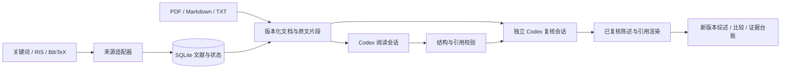

# V1 架构

`models.py` 定义 Work、Document、Evidence、Claim、ReviewReport；来源适配器保存原始响应，检索元数据不代表全文证据。Store 负责保守身份合并、不可变哈希文件、事务与预算；LangGraph 负责阶段检查点，两者职责分开。

原文与结果先写临时文件并同步，以内容哈希落入 artifacts，再在 SQLite 检查 attempt、lease、过期时间、取消状态和项目修订号。完整领域对象验证后才提交成功，随后推进图检查点。崩溃可能留下未登记文件，不会把半个文件作为完成结果。

每个数据库操作独立连接。模型并发使用独立验证上下文，预算预留在同一事务完成。缓存包含输入、文档版本、任务类型、后端及模型；原文或研究配置变更后恢复会重新经过必要阶段。

导出只接受当前纳入文献、当前文档、有效证据与 supported 复核，已知撤稿排除。来源摘要派生文档更新时旧卡失效，手动附加的全文不被摘要覆盖。无证据格子留空，摘要及出版状态未知明确显示。快照包含研究配置指纹；发布版本目录和 latest.json 前核对快照，后续更改文档或题目不删除历史，status 指出导出是否过期。

研究工作流显式关闭 LangSmith tracing，不继承环境中可能开启的日志上传设置；故障异常仅包含失败条目的必要信息。来源故障保留成功文献并暂停，可由 run/resume 重试；健康的成功/空结果以及有效模型结果继续缓存。

精确匹配证明引用来自该位置；独立模型复核检查语义。两者都不等同于人工审稿或创新性证明。
