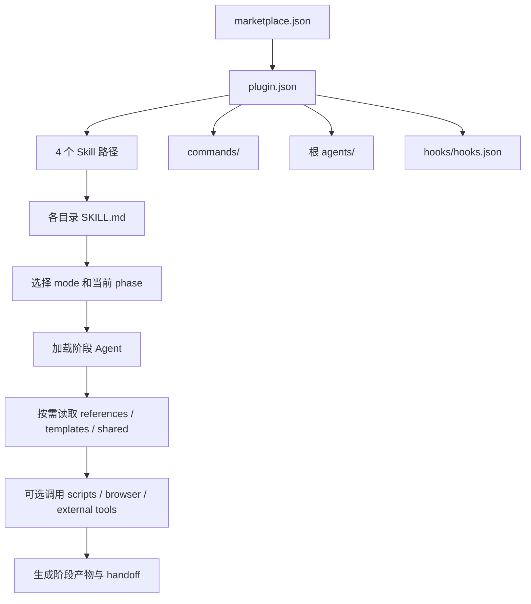
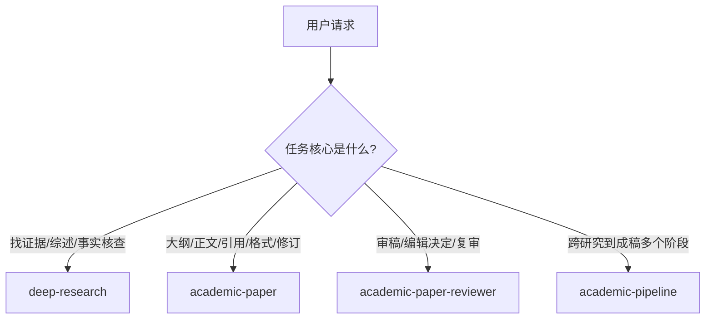
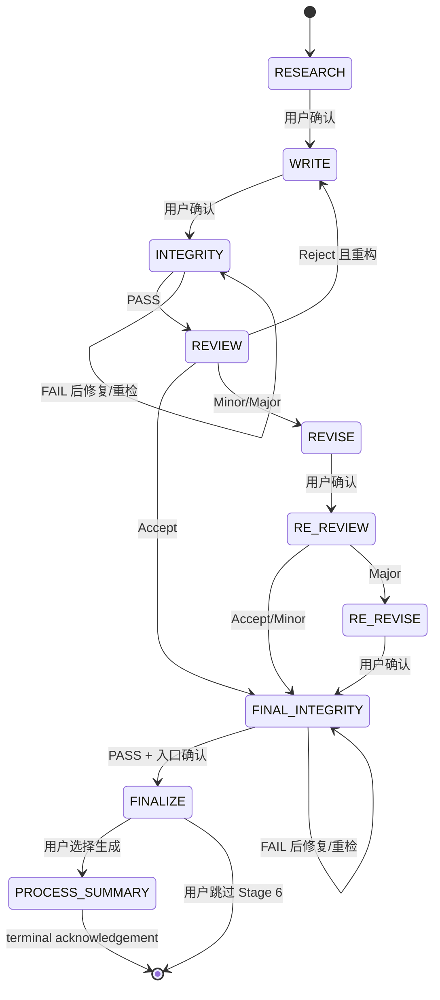
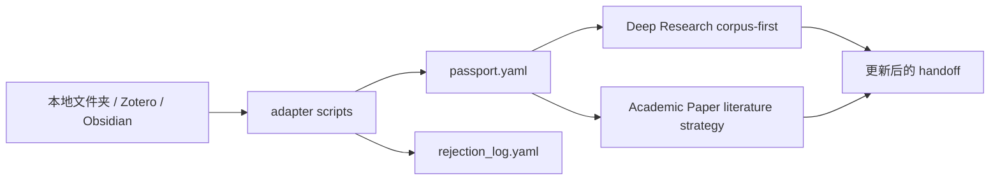

# 加载流程与模块协作

> 版本说明（2026-10-19）：源码已更新；正文保留此前整理的指南，功能与安装入口以当前上游 README 为准。见[本次更新记录](../../../../UPDATE-2026-10-19.md)。

## 1. 从宿主发现到 Skill 执行

完整插件模式下，Claude Code 通过插件元数据发现 ARS：



### 元数据各自负责什么

- `.claude-plugin/marketplace.json`：声明可安装的插件和四个 Skill 的路径；
- `.claude-plugin/plugin.json`：保存插件名称、版本、作者、许可证和描述；
- `SKILL.md` frontmatter：供宿主做能力匹配；
- `SKILL.md` 正文：定义该 Skill 的运行协议；
- `commands/*.md`：把 `/ars-*` 映射到某个 Skill 和 mode；
- `hooks/hooks.json`：注册会话和工具调用事件。

直接读取本地 `SKILL.md` 时，可以使用工作流正文，但不会自动启用插件 commands、公开 Agents 和 hooks。详见[新手项目级使用](05-新手使用与扩展.md#仅在当前项目使用不进行全局安装)。

## 2. 请求路由

### 2.1 基本决策



| 用户目标 | 推荐入口 | 不推荐做法 |
|---|---|---|
| 收敛研究问题 | `deep-research` 的 `socratic` | 直接生成完整论文大纲 |
| 快速研究简报 | `deep-research` 的 `quick` | 启动十阶段 pipeline |
| 系统综述或 Meta-analysis | `deep-research` 的 `systematic-review` | 只用普通写作 mode |
| 论文大纲 | `academic-paper` 的 `outline-only` | 先跑完整研究流程 |
| 完整论文起草 | `academic-paper` 的 `full` | 未确认事实却自动补齐 |
| 独立审稿 | `academic-paper-reviewer` 的 `full` | 让写作 Agent 自评后直接接受 |
| 验证修改是否响应评审 | reviewer 的 `re-review` | 重复首轮完整评审而不比较差异 |
| 从主题到最终稿 | `academic-pipeline` | 手工在四个 Skill 间丢失状态 |

### 2.2 跨阶段材料

如果输入同时含有稿件、文献、结果和审稿意见，但用户没有说明目标，`.claude/CLAUDE.md` 的 Routing Discipline 要求先澄清，而不是凭材料数量猜阶段。

示例：

```text
你希望我现在：
A. 补充研究和文献
B. 修改论文正文
C. 模拟同行评审
D. 运行完整 pipeline 并检测入口阶段
```

`[direct-mode]` 可以跳过跨阶段澄清，但不能跳过基本 Skill 判定，更不能绕过完整性和人工确认门禁。

## 3. Command 与 Mode

`commands/` 中的 `/ars-*` 文件是**薄包装**。它们不复制完整工作流，而是指定目标 Skill、mode 和必要输入，然后回到对应 `SKILL.md`。

```text
/ars-outline
→ commands/ars-outline.md
→ academic-paper/SKILL.md
→ outline-only mode
→ structure_architect_agent
→ outline / evidence map
```

代表性命令：

| Command | Skill / Mode | 用途 |
|---|---|---|
| `/ars-full` | `academic-pipeline` | 端到端流程 |
| `/ars-plan` | `academic-paper: plan` | 论文规划和缺口识别 |
| `/ars-outline` | `academic-paper: outline-only` | 只生成结构 |
| `/ars-abstract` | `academic-paper: abstract-only` | 摘要生成或改写 |
| `/ars-lit-review` | paper 或 deep-research | 依任务是写综述还是发现/综合来源 |
| `/ars-citation-check` | `academic-paper: citation-check` | 引用格式和来源状态 |
| `/ars-reviewer` | reviewer | 完整同行评审 |
| `/ars-revision` | `academic-paper: revision` | 根据反馈修订 |
| `/ars-rebuttal-audit` | paper | 审计回复信和改动对应 |
| `/ars-format-convert` | paper | 格式转换 |

`MODE_REGISTRY.md` 是 4 个 Skill、27 个 mode 的统一注册表。新增或修改 mode 时不能只改 command；必须同步注册表、`SKILL.md` 和相关检查。

## 4. Pipeline 十阶段协作

### 4.1 阶段总览

| 阶段 | 执行者 | 主要输入 | 主要产物 | 下一门禁 |
|---|---|---|---|---|
| 1 RESEARCH | `deep-research` | 主题/RQ/已有材料 | RQ Brief、方法蓝图、书目、综合 | 用户确认 |
| 2 WRITE | `academic-paper` | 研究 handoff、结果、要求 | 完整草稿、论证图、引用列表 | 用户确认 |
| 2.5 INTEGRITY | integrity Agent + gates | 未审稿草稿、Passport | 完整性报告、修正版 | **必须 PASS/处置** |
| 3 REVIEW | reviewer | 经检查稿件 | 5 份报告、编辑决定、修改路线 | **必须作出决定** |
| 4 REVISE | `academic-paper` | 稿件、roadmap、作者裁定 | 修订稿、回复信、delta | 用户确认 |
| 3' RE-REVIEW | reviewer re-review | 原稿、修订稿、roadmap、证据 | 响应核对和残余问题 | **必须作出决定** |
| 4' RE-REVISE | paper revision | 残余重大问题 | 第二修订稿 | 用户确认 |
| 4.5 FINAL INTEGRITY | integrity Agent + gates | 冻结的最终稿 | fresh 完整性报告 | **必须 PASS/处置** |
| 5 FINALIZE | paper formatter | 经核验稿件、格式决策 | MD/DOCX/LaTeX/PDF | FULL 接收确认 |
| 6 PROCESS SUMMARY | orchestrator | 全流程记录 | Process Record MD/PDF | 终止确认 |

### 4.2 状态机



### 4.3 禁止跳转

状态机明确禁止：

- Stage 2 直接进入 Stage 3，跳过 2.5；
- Stage 4 直接进入 Stage 5，跳过 re-review；
- Stage 3' 直接进入 Stage 5，跳过 4.5；
- Stage 4' 返回 3' 形成无限复审循环；
- Stage 5 回退到 Stage 3；
- 已完成状态无记录地重新启动。

这类约束是为了保留证据链和审查边界，而不是制造形式步骤。

## 5. Checkpoint 协作

Pipeline 使用三类 checkpoint：

| 类型 | 用途 | 能否自动跳过 |
|---|---|---|
| FULL | 首次、重要边界、Stage 5 完成 | 否，需要明确继续/暂停 |
| SLIM | 连续多次继续后的非关键阶段 | 仍需明确响应 |
| MANDATORY | integrity FAIL、review decision、Stage 5 入口 | **绝对不能跳过** |

`collaboration_depth_agent` 是 advisory observer，可在普通 checkpoint 记录人机协作深度，但不会阻断流程。完整性和审稿门禁不会因为 observer 给出高分而自动通过。

## 6. Material Passport 与 Handoff

### 6.1 Material Passport 的作用

Material Passport 是跨阶段状态载体，常见字段包括：

- `origin_skill`、`mode`、日期；
- `verification_status` 和版本标签；
- 内容 hash 和上游来源；
- literature corpus；
- read-scope ledger；
- experiment provenance / reproducibility lock；
- claim audit；
- reset boundary 和恢复记录。

它不是论文正文，也不自动证明内容真实。它用于回答：材料从哪里来、经过什么阶段、哪些字段验证过、哪些仍未知。

### 6.2 用户语料适配



Adapter 即使没有接受任何条目，也应产生 rejection log。解析失败时应明确报告 corpus failure，再降级到外部来源，而不是假装已使用用户语料。

### 6.3 暂停与恢复

当启用 `ARS_PASSPORT_RESET=1` 时，FULL checkpoint 可以追加 reset boundary。新会话可使用：

```text
resume_from_passport=<hash>
```

恢复逻辑会查找尚未消费的 boundary，处理 pending decision，然后根据显式 `stage=`、记录的 option 或 `next` 决定入口。Boundary 是 append-only，不能重复消费。

## 7. 四个 Skill 的 handoff

```text
Deep Research
  RQ Brief
  Methodology Blueprint
  Bibliography
  Synthesis
        ↓
Academic Paper
  Configuration Record
  Outline / Argument Map
  Complete Draft
  Citation / Abstract / Figures
        ↓
Integrity
  Pre-review Integrity Report
  Verified/flagged Passport
        ↓
Reviewer
  5 Independent Reports
  Editorial Decision
  Revision Roadmap
        ↓
Academic Paper Revision
  Revised Draft
  Response to Reviewers
  Delta / Evidence / Patch chain
        ↓
Re-review + Final Integrity
        ↓
Final Paper + Process Record
```

Reviewer 默认只读稿件；修改由 Academic Paper revision 阶段完成。这样可以避免审稿角色一边评价一边偷偷重写被评价对象。

## 8. 脚本和外部服务在链路中的位置

脚本不会在所有任务中自动运行。它们仅在工作流或用户明确选择需要确定性检查时参与：

- corpus adapter：将用户材料转成结构化 Passport；
- verification gate：查询引用存在性和污染信号；
- claim audit：抽样检查 claim 与 reference 对齐；
- revision tools：应用 patch、检查 token/claim-strength 守恒；
- format tools：辅助 DOCX/PDF/LaTeX 输出；
- cross-model：仅在配置并获得当前会话同意后发送材料。

配置存在不等于授权；API key 存在也不代表可以把稿件发送到外部服务。

## 9. 新手如何观察当前流程

在任何 pipeline 阶段，都应要求输出：

```text
Current stage:
Required inputs:
Artifacts produced:
Unverified or blocked items:
Next stage:
Next gate type:
Does the next gate require explicit confirmation?
```

如果输出没有说明当前阶段、产物和下一门禁，不要直接继续十阶段流程，应先补齐状态摘要。
