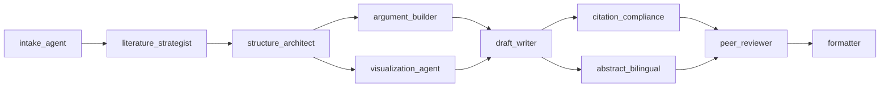

# 核心模块源码解析

> 版本说明（2026-10-19）：源码已更新；正文保留此前整理的指南，功能与安装入口以当前上游 README 为准。见[本次更新记录](../../../../UPDATE-2026-10-19.md)。

本文不逐行翻译全部 Markdown，而是解释最影响系统行为的模块：入口协议、状态机、Agent 链、hooks、确定性 gate 和跨阶段 contracts。阅读时应把 Markdown prompt 视为**运行协议源码**，把 Python/Shell 视为**可重放执行源码**。

## 1. 怎样阅读一个 `SKILL.md`

四个顶层 `SKILL.md` 具有相似结构：

```yaml
---
name: academic-pipeline
description: ...
metadata:
  version: "3.21.1"
  last_updated: "2026-08-24"
  depends_on: "deep-research, academic-paper, academic-paper-reviewer"
  status: active
  data_access_level: raw
  task_type: open-ended
  related_skills:
    - deep-research
    - academic-paper
    - academic-paper-reviewer
---
```

### 字段解释

| 字段 | 作用 | 常见误解 |
|---|---|---|
| `name` | 宿主识别 Skill 的稳定名称 | 不是命令名 |
| `description` | 匹配用户意图和触发条件 | 不是完整实现说明 |
| `metadata.version` | 当前工作流协议版本 | 不一定等于插件发行版本 |
| `depends_on` | Pipeline 编排依赖 | 不表示宿主会自动后台并行加载 |
| `status` | 工作流维护状态 | 不保证每项外部能力可用 |
| `data_access_level` | 合法入口可能处理的最敏感输入等级 | **不是文件、网络或沙箱授权** |
| `task_type` | 任务是否开放式 | 不表示无限时间或无限工具权限 |
| `related_skills` | 路由和 handoff 相关能力 | 不代表每次都要加载全部 Skill |

frontmatter 之后的 Markdown 负责描述触发、mode、阶段、Agent、门禁和产物。新手阅读顺序：

1. Trigger / Non-trigger；
2. Quick Start；
3. Modes；
4. Phases / Stages；
5. Agent 表；
6. Gate 和 Output；
7. references 中的细化协议。

## 2. `academic-pipeline/SKILL.md`：顶层编排器

路径：[`academic-pipeline/SKILL.md`](../../../../skills/academic-research-skills/academic-pipeline/SKILL.md)

### 2.1 它解决什么问题

如果研究、写作、审稿和修订由用户手工切换，常见问题是：

- 下游不知道上游使用了哪些材料；
- 草稿未经完整性检查就送审；
- 修订后没有针对 reviewer comments 做验证；
- 文件版本和阶段状态丢失；
- 用户以为流程完成，但最终格式和过程记录尚未生成。

Pipeline 用状态机、handoff 和 checkpoint 解决这些问题。

### 2.2 源码中的关键段落

| 源码板块 | 作用 |
|---|---|
| Quick Start | 根据“从零、已有稿件、已有审稿意见”给出 mid-entry 示例 |
| Execution Flow | 定义检测材料、推荐 mode、调度和确认的基本循环 |
| Trigger Conditions | 防止单一任务误入完整 pipeline |
| Pipeline Stages | 把 Skill、mode、Agent 和产物绑定到阶段 |
| Pipeline State Machine | 定义合法/非法跳转和失败回路 |
| Adaptive Checkpoint | 定义 FULL、SLIM、MANDATORY 的使用条件 |
| Agent Team | 列出 orchestrator、state、integrity 和 advisory Agent |
| Orchestrator Workflow | 详细说明 intake、阶段识别、dispatch 和 handoff |
| Material Passport | 规定跨阶段状态、hash 和验证字段 |
| Finalization | 规定 MD/DOCX/LaTeX/PDF 与 Process Record 的结束条件 |

### 2.3 Pipeline 的主循环

```text
检查用户目标和已有材料
→ 决定入口阶段
→ 选择下游 Skill + mode
→ 组装该阶段 required inputs
→ 调度下游工作流
→ 检查 required artifacts
→ 运行该阶段 gate
→ 更新 state / Passport
→ 显示 checkpoint
→ 等待用户决定
```

Pipeline 不应直接生成研究综合或论文正文；它应将工作交给对应 Skill，再检查产物是否满足 handoff contract。

## 3. `pipeline_state_machine.md`：流程法律

路径：[`academic-pipeline/references/pipeline_state_machine.md`](../../../../skills/academic-research-skills/academic-pipeline/references/pipeline_state_machine.md)

`SKILL.md` 提供可读流程，状态机 reference 则定义更严格的合法转移。

### 3.1 两层状态

阶段状态：

```text
pending | in_progress | completed | skipped | blocked
```

Pipeline 全局状态：

```text
initializing | running | awaiting_confirmation | paused | completed | aborted
```

阶段完成不等于 Pipeline 完成。例如 Stage 5 已交付论文，但用户选择生成 Stage 6 Process Record 时，全局状态仍不应提前标记为 `completed`。

### 3.2 失败循环

Stage 2.5 和 4.5 的完整性检查允许 fix/re-verify，但有有限轮数。耗尽后必须把 unresolved items 和用户决定写入记录，不能：

- 自动将 FAIL 改成 PASS；
- 删除未知项；
- 静默降低门槛；
- 无限重试直到偶然得到通过文本。

### 3.3 Review 分支

```text
Accept       → Final Integrity
Minor/Major  → Revision
Reject       → Restructure at WRITE or Abort
```

Re-review 比较原稿、roadmap、作者裁定、修订稿和证据 bundle，重点是“有没有真实响应”，不是再写一份风格相同的首轮审稿报告。

## 4. Pipeline Agents

目录：[`academic-pipeline/agents/`](../../../../skills/academic-research-skills/academic-pipeline/agents/)

### 4.1 `pipeline_orchestrator_agent.md`

职责：

- 检测当前材料和目标；
- 确定入口阶段；
- 推荐下游 mode；
- 组装 handoff；
- 展示 checkpoint；
- 处理继续、暂停、回退和结束。

它是决策协调者，但不应吞并下游 Agent 的专业工作。

### 4.2 `state_tracker_agent.md`

职责：维护阶段状态、材料版本、checkpoint、revision loop 和 dialogue references。设计上它是 Pipeline 状态的唯一写者；其他 Agent 应提交更新请求，而不是各自修改状态。

这种单写者模式防止：

- 两个并行 Agent 把同一阶段写成不同状态；
- reviewer 修改稿件后又把状态标成已审；
- resume 时无法判断哪个记录可信。

### 4.3 `integrity_verification_agent.md`

负责 pre-review 和 final-check，检查范围包括：

- 引用和 reference 的已声明覆盖；
- registered claim 与证据；
- 报告数字与提供材料；
- reproducibility / experiment declaration；
- AI research failure modes。

输出必须暴露分母、unknown、out-of-scope 和 blocking verdict。它检查的是**已注册范围内的一致性**，不能证明原始数据本身真实。

### 4.4 `collaboration_depth_agent.md`

它是 advisory observer，用于记录人机协作是否只是连续“继续”，以及用户是否参与关键决定。它不会阻断 Pipeline，也不能替代 integrity gate。

### 4.5 `claim_ref_alignment_audit_agent.md`

仅在显式启用 claim audit 时参与。它对抽样 claim 生成：

- `claim_audit_results[]`；
- `claim_drifts[]`；
- `uncited_assertions[]`；
- `constraint_violations[]`。

严重类别可触发 formatter refusal。默认关闭的原因是需要先校准误报和覆盖范围。

## 5. Deep Research 核心源码链

入口：[`deep-research/SKILL.md`](../../../../skills/academic-research-skills/deep-research/SKILL.md)

### 5.1 基线角色链


| Agent | 输入 | 输出 | 核心边界 |
|---|---|---|---|
| Research Question | 主题、目标、约束 | RQ Brief | 不替用户静默决定最终问题 |
| Research Architect | RQ Brief | Methodology Blueprint | 不伪造已执行的方法 |
| Bibliography | 搜索策略、用户 corpus | 候选来源和书目 | 题名相似不等于已验证 |
| Source Verification | 候选来源 | 来源状态、grade、定位 | 不把摘要当全文 |
| Synthesis | 已筛材料 | themes、conflicts、gaps | 不新增输入中不存在的结论 |
| Report Compiler | 上游产物 | APA 风格报告 | 不掩盖 unknown 和局限 |

Systematic-review 分支还会加载 risk-of-bias 和 meta-analysis 相关 Agent；只有材料和统计条件满足时才能进入定量综合。

## 6. Academic Paper 核心源码链

入口：[`academic-paper/SKILL.md`](../../../../skills/academic-research-skills/academic-paper/SKILL.md)



### 6.1 角色分工

- Intake：识别已有材料、目标 venue、语言、citation style 和允许范围；
- Literature Strategist：整理来源和文献矩阵，不代替 Deep Research 的全面检索；
- Structure Architect：生成 outline、段落职责和 evidence map；
- Argument Builder：构建 Claim–Evidence–Reasoning；
- Draft Writer：只根据批准的结构和证据写正文；
- Citation Compliance：检查引用位置、格式和来源状态；
- Bilingual Abstract：生成摘要及对齐版本；
- Peer Reviewer：进行内部自审，不代替独立 reviewer Skill；
- Formatter：转换最终格式并执行 hard refusal；
- Visualization：根据 outline 的视觉计划准备图表，不能生成虚假结果图。

### 6.2 可选并行

Outline 包含视觉计划后，Argument Builder 和 Visualization 可以并行；Draft Writer 等待两者完成后再起草。并行是优化，不是必须条件，新手可使用顺序流程降低状态复杂度。

## 7. Reviewer 核心源码链

入口：[`academic-paper-reviewer/SKILL.md`](../../../../skills/academic-research-skills/academic-paper-reviewer/SKILL.md)

```text
field_analyst_agent
→ Journal-Fit / EIC seat
→ Methodology reviewer
→ Domain reviewer
→ Perspective reviewer
→ Devil's Advocate
→ editorial_synthesizer_agent
→ Editorial Decision + Revision Roadmap
```

### 为什么先独立、后综合

如果 synthesizer 在独立席位完成前介入，后续 reviewer 可能被已有结论锚定。源码因此强调：

- 各席位先独立输出；
- synthesis 后置；
- 少数意见和 Devil’s Advocate 不能被静默删除；
- roadmap 不应把所有意见压成不可追溯的总分；
- reviewer 默认只读稿件。

Re-review 使用 fenced phases 和确定性检查验证响应链，避免 round-1 synthesizer 直接覆盖修改后的证据比较。

## 8. Hooks 源码链

### 8.1 注册入口

[`hooks/hooks.json`](../../../../skills/academic-research-skills/hooks/hooks.json) 注册：

```text
SessionStart
→ scripts/announce-ars-loaded.sh

PreToolUse (Write/Edit/MultiEdit/Bash)
→ hooks/run_guard.sh
→ scripts/ars_write_scope_guard.py
```

### 8.2 SessionStart

`announce-ars-loaded.sh`：

- 在 startup/clear 给出较完整的可用命令提示；
- 在 resume/compact 给出较短提示；
- 可调用 `ars_update_check.sh` 做有界更新提醒；
- 更新检查失败时保持静默，不阻断研究。

### 8.3 PreToolUse Guard

`run_guard.sh` 负责跨平台和超时包装，再调用 Python guard 检查写入范围。无 Python、无 Git Bash、超时或 guard 故障时设计为 pass-through。

这意味着 hook 是可选硬化层，而不是安全沙箱。即使 hook 正常运行，用户仍应限制允许目录；即使 hook 失效，核心 Skill 仍可工作。

## 9. 引用验证与 Claim Gate

### 9.1 引用存在性客户端

仓库级脚本包括：

- `scripts/semantic_scholar_client.py`；
- `scripts/openalex_client.py`；
- `scripts/crossref_client.py`；
- `scripts/arxiv_client.py`；
- `scripts/contamination_signals.py`；
- `scripts/citation_verification_summary.py`；
- `scripts/verification_cache.py`。

它们用于构造 programmatic verification gate，典型结果包括：

```text
lookup_verified = true | false | unresolvable
```

**存在性不等于支持性。** 能在 Crossref 查到 DOI，只能说明记录可能存在，不能证明正文中的 claim 与论文结论一致。

### 9.2 Cache

`verification_cache.py` 使用本地 SQLite 保存查验结果，减少重复请求。Cache 结果有时间和来源边界；过期 advisory 不能替代当前来源。

### 9.3 Claim Audit

```text
claim_audit_pipeline.py
→ retrieval / judge（依赖注入）
→ claim_audit_finalizer.py
→ Passport claim arrays
→ formatter policy/refusal
```

Finalizer 固化审计结果，Formatter 只执行最终策略，不重新计算审计，避免同一 claim 在最后阶段得到另一套隐藏判定。

## 10. `shared/`：跨 Skill 协议中心

路径：[`shared/`](../../../../skills/academic-research-skills/shared/)

`shared/` 不是普通知识资料目录，它定义跨 Skill 共同语言：

- `handoff_schemas.md`：研究、论文、审稿和 Pipeline 的 handoff Schema；
- `contracts/`：Passport、Sprint Contract、能力矩阵等可机读契约；
- references：intent clarification、证据、review/writer/evaluator/re-review 协议；
- templates：跨阶段可复用产物结构。

### 为什么需要 Contracts

没有共享契约时，Deep Research 可能输出“参考文献列表”，而 Paper 期待“带验证状态和定位的 bibliography”；文件名相同，但语义不兼容。Schema 通过字段、枚举和必需项减少这种隐式错配。

## 11. 源码修改影响表

| 修改位置 | 可能影响 |
|---|---|
| `academic-pipeline/SKILL.md` | 路由、阶段、checkpoint、所有下游 handoff |
| `pipeline_state_machine.md` | 合法转移、恢复和结束语义 |
| 某 Skill 的 Agent | 对应 phase 的输出形状和判断方式 |
| `MODE_REGISTRY.md` | Commands、Skill mode、公告和文档一致性 |
| `shared/handoff_schemas.md` / contracts | 多个 Skill 的输入输出兼容性 |
| verification scripts | gate 结果、cache、审计和 formatter refusal |
| hooks | 会话提示或写入前辅助保护，不应改变研究语义 |
| 根 `agents/` 镜像 | 不应单独改；应从 Deep Research 真源同步 |
| generated capability docs | 不应直接改；应修改 JSON 真源并重新生成 |

修改核心门禁、Schema 或状态机前，必须先检查所有下游消费者和测试，而不能把它当作普通文字润色。
