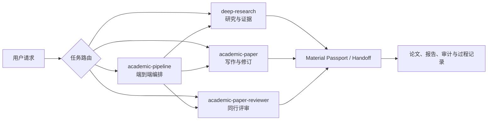

# Academic Research Skills 架构文档

> 版本说明（2026-10-19）：源码已更新；正文保留此前整理的指南，功能与安装入口以当前上游 README 为准。见[本次更新记录](../../../../UPDATE-2026-10-19.md)。

本目录面向第一次接触 Academic Research Skills（ARS）Claude Code 版的使用者和维护者。目标不是罗列文件，而是解释：项目如何组织、每个板块有什么用、请求怎样从入口流向工作流、怎样只在当前项目使用，以及扩展源码时应修改哪里。

> 本文档对应本地源码快照 `skills/academic-research-skills/`。ARS 是研究工作流和质量控制工具，不会替研究者验证原始数据、执行未发生的实验，也不保证论文录用。

## 建议阅读顺序

| 读者 | 建议顺序 | 能解决的问题 |
|---|---|---|
| 第一次使用 | 本页 → [系统概览](01-系统概览与源码目录.md) → [新手使用](05-新手使用与扩展.md) | 选哪个 Skill、怎样只在当前项目使用 |
| 想理解完整流程 | [加载与协作](02-加载流程与模块协作.md) → [核心源码](03-核心模块源码解析.md) | 请求怎样路由、十阶段怎样推进、Agent 怎样协作 |
| 负责环境和排错 | [运行环境](04-运行环境与构建验证.md) | 安装层级、依赖、hooks、测试和常见故障 |
| 想修改源码 | [核心源码](03-核心模块源码解析.md) → [新手使用与扩展](05-新手使用与扩展.md#扩展与二次开发) | canonical 文件在哪里、镜像和生成物如何维护 |

## 文档清单

1. [01-系统概览与源码目录](01-系统概览与源码目录.md)
   - 四个顶层 Skill 的职责；
   - 完整模块地图；
   - 每个目录何时参与、是否应该直接修改。
2. [02-加载流程与模块协作](02-加载流程与模块协作.md)
   - Claude Code 如何发现插件和 Skill；
   - 请求路由、Command 包装和十阶段 pipeline；
   - Material Passport、handoff 和产物流。
3. [03-核心模块源码解析](03-核心模块源码解析.md)
   - `academic-pipeline/SKILL.md`、状态机和 Agents；
   - Deep Research、Paper、Reviewer 的核心链；
   - hooks、引用验证、claim gate 和 shared contracts。
4. [04-运行环境与构建验证](04-运行环境与构建验证.md)
   - 最小与可选依赖；
   - 直接读取、项目级发现和插件安装的差别；
   - 构建、测试、CI、数据流和故障定位。
5. [05-新手使用与扩展](05-新手使用与扩展.md)
   - 不做全局安装的项目级使用方法；
   - 按任务选择入口；
   - 阅读源码、添加 mode/agent/reference/command/hook 的路径。

## 五分钟理解 ARS

核心原则：

- **四个 Skill，而不是一个大 Skill。** 单一任务直接选择对应 Skill；只有跨阶段任务才使用 pipeline。
- **Pipeline 是编排器。** 它检测当前阶段、调度下游 Skill、维护状态和检查点，本身不替下游执行研究、写作或评审。
- **Markdown 是主要源码。** `SKILL.md`、Agent prompt、references 和 contracts 定义行为；Python/Shell 脚本为需要可重放结果的检查提供确定性实现。
- **每阶段有人类检查点。** 完整性检查和审稿决定属于强制门禁，不能以“全自动”为由静默跳过。
- **声明与权限分开。** frontmatter 中的 `data_access_level: raw` 描述合法输入上限，不等于文件系统、网络或 API 的实际授权。

## 核心术语

| 术语 | 在本项目中的含义 |
|---|---|
| Skill | 由 `SKILL.md` 定义的顶层能力和工作流入口 |
| Mode | 同一个 Skill 内的具体运行方式，例如 `socratic`、`full`、`citation-check` |
| Agent | 某个阶段的角色提示和输入输出职责；不必然意味着独立后台进程 |
| Command | `/ars-*` 的薄包装，只负责选择 Skill 和 mode |
| Hook | Claude Code 会话或工具调用前后的辅助控制，不是研究工作流本身 |
| Gate | 必须满足或明确处置后才能继续的质量门 |
| Handoff | 一个阶段交给下一阶段的结构化材料 |
| Material Passport | 跨阶段记录来源、版本、验证状态、hash 和可选审计信息的交接载体 |
| Canonical source | 应当直接修改的源码真源；镜像和生成文件应由真源同步产生 |
| Advisory | 提醒或观测结果，不阻断流程 |
| Blocking | 未解决前阻止进入下一阶段的结果 |

## 权威源码入口

- 插件元数据：[`skills/academic-research-skills/.claude-plugin/plugin.json`](../../../../skills/academic-research-skills/.claude-plugin/plugin.json)
- 插件市场和四个 Skill 路径：[`skills/academic-research-skills/.claude-plugin/marketplace.json`](../../../../skills/academic-research-skills/.claude-plugin/marketplace.json)
- 模式注册表：[`skills/academic-research-skills/MODE_REGISTRY.md`](../../../../skills/academic-research-skills/MODE_REGISTRY.md)
- Pipeline 入口：[`skills/academic-research-skills/academic-pipeline/SKILL.md`](../../../../skills/academic-research-skills/academic-pipeline/SKILL.md)
- Pipeline 状态机：[`pipeline_state_machine.md`](../../../../skills/academic-research-skills/academic-pipeline/references/pipeline_state_machine.md)
- 架构说明：[`docs/ARCHITECTURE.md`](../../../../skills/academic-research-skills/docs/ARCHITECTURE.md)
- 安装与配置：[`docs/SETUP.md`](../../../../skills/academic-research-skills/docs/SETUP.md)
- 跨阶段 Schema：[`shared/handoff_schemas.md`](../../../../skills/academic-research-skills/shared/handoff_schemas.md)
- 数据流边界：[`docs/DATA_FLOWS.md`](../../../../skills/academic-research-skills/docs/DATA_FLOWS.md)

## 与同目录其他文档的关系

- [00-原始完整说明](../00-原始完整说明.md)：保留早期完整叙述、安装示例和操作细节；
- [01-功能说明](../01-功能说明.md)：快速了解能做什么；
- [02-详细使用指南](../02-详细使用指南.md)：按研究任务执行；
- 本架构文档：理解源码结构、模块协作和扩展位置；
- [04-本地使用指南](../04-本地使用指南.md)：简洁的当前项目使用边界；
- [05-验证与风险](../05-验证与风险.md)：结果和安全检查清单。
