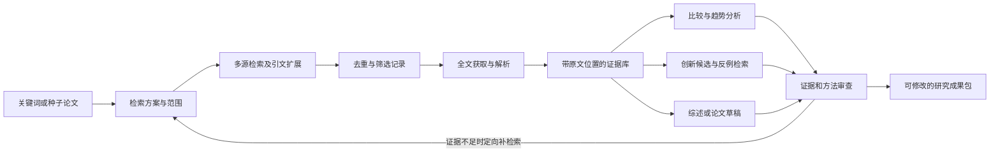

# 学术工作 Agent：架构方案与能力边界

日期：2026-09-07。版本：0.2，已按独立审查修订，供用户讨论的规划稿。

本轮交付是设计、建设顺序和查验记录；尚未实现或运行这个系统。默认先面向个人研究、Windows 本地使用、中英文文献、Markdown/Obsidian 产物，具体学科后续配置。推荐先完成“关键词检索 → 文献筛选 → 全文精读 → 有证据的综述”小闭环，再提升趋势分析、创新候选和论文写作。

配套文件：[建设计划](D:/code_project/academic_tools/docs/superpowers/plans/2026-09-07-academic-agent-roadmap.md)、[调研与查验记录](D:/code_project/academic_tools/docs/academic-agent/2026-09-07-research-and-review.md)。

## 1. 推荐路线与取舍

| 路线 | 优点 | 代价 | 判断 |
|---|---|---|---|
| Codex 加技能包 | 上手快，适合交互式研究 | 流程状态、跨批次去重和批量质量控制容易依赖会话 | 用作入口和方法库 |
| 本地研究内核 + 可替换 Codex/API 后端 | 数据、证据和流程归项目所有，可恢复、可评价、可扩展 | 需要建设一层稳定的数据与执行契约 | **推荐** |
| 直接改造完整开源平台 | 较快得到演示界面 | 常带入特定检索方式、模型、部署和论文类型假设 | 可比较验证，暂不整仓继承 |

产品定位是研究工作台：把“找到什么、读到了什么、据此可以说什么、还缺什么”持续保留下来。Agent 的职责由输入输出和可调用工具界定，数量随任务需要增长。

## 2. 用户看到的工作流程

用户输入关键词、种子论文或研究问题；系统建立一个研究项目并保存检索范围。第一次只要求主题；领域、年代、语言、文章类型和排除条件可以逐步补齐，缺失值明确显示为默认假设。

每一步可单独运行和恢复。用户可以保留或排除文章、纠正提取内容、改变主题边界；这些操作会生成新版本，并使依赖旧版本的分析或段落进入“需要更新”状态。界面首先呈现成果、原文依据、缺口和下一步建议。

## 3. 能力与具体产物

| 能力 | 产物 | 可信度要求 | 阶段 |
|---|---|---|---|
| 关键词理解与查询扩展 | 中英文同义词、检索式、来源和时间范围 | 保存用户原问题及扩展理由 | 第一版 |
| 多源检索与引文追踪 | 候选文献库、来源覆盖表、检索日志 | 区分来源失败、零命中、截断和完整分页 | 第一版 |
| 文献筛选 | 保留/排除/待判定清单与理由 | 记录规则版本，抽查被排除的文章 | 第一版 |
| 精读和论文总结 | 问题、方法、数据、结果、局限、作者贡献、复现条件 | 每个关键结论连接原文证据，说明读取范围 | 第一版 |
| 跨论文比较 | 研究问题 × 方法 × 数据 × 指标 × 条件矩阵 | 不直接比较不同数据集、单位或评价条件的数值 | 第一版基础版 |
| 文献问答和综述 | 带引用回答、综述大纲、相关工作草稿 | 找不到支持时保留缺口，限制主张强度 | 第一版 |
| 趋势分析 | 年度/主题变化、方法演化、证据覆盖图 | 必须披露语料边界、日期口径、样本量和缺失 | 第二版 |
| 创新分析 | 作者自述贡献表、研究空白与创新候选卡 | 自述、系统推断、已验证成果分开保存 | 第二版 |
| 实验或实证设计 | 假设、基线、数据可用性、识别假设、验证方案 | 每个创新候选都能导向可证伪的检验 | 第二版 |
| 写作与审稿 | 章节草稿、引用检查、论证审查、修改差异、审稿回复 | 实验结果只从真实研究产物进入正文 | 第三版 |
| 专题追踪 | 新文献增量、旧结论影响范围、专题简报 | 增量去重，撤稿或更正使依赖产物失效 | 第三版 |
| 学科特化 | 领域来源、术语、提取字段、评价准则和模板 | 用领域样例验收，不仅更换提示词 | 后续按题目 |

系统性综述、Meta 分析、自动实验执行分别作为专门扩展；普通文献综述不能自动标成系统性综述。有了数量统计也不代表满足系统性检索或定量合并的条件。

## 4. 文献来源与获取策略

| 来源 | 分工 | 接入策略 |
|---|---|---|
| OpenAlex | 跨学科发现、主题和引文元数据 | 第一版主要来源；按当前认证及预算规则接入 |
| Semantic Scholar | 发现、相关文献、引文扩展 | 第一版第二发现来源；明确共享限流和申请密钥的依赖 |
| Crossref | 书目信息、DOI 核对、出版后更新 | 第一版元数据校验和补充检索；不能作为主张语义核验器 |
| arXiv | 理工科预印本和版本信息 | 第一版可选来源；当前连接未通过，独立降级 |
| 本地 PDF、RIS/BibTeX、Zotero 导出 | 用户已有论文、机构许可取得的全文 | 第一版文件导入；直接连接 Zotero 放在后续 |
| Unpaywall | 查找 DOI 对应的开放获取位置 | 获取模块的可选补充；需要用户提供联系邮箱 |
| PubMed/Europe PMC、OpenReview、领域数据库 | 学科覆盖 | 选题后按需要增加，逐一验证接口与使用条件 |
| 知网、万方、WoS、Scopus 等 | 中文和机构数据库补充 | 先支持用户导出文件；正式连接器以可用授权接口为前提 |
| 普通网页搜索 | 同义词、论文主页、代码和数据仓库线索 | 线索进入正式文献校验；网页摘要不能当论文全文 |

OpenAlex 官方现行文档允许少量无密钥查询，规模使用建议免费密钥；限额和分页规则由适配器配置，不沿用旧教程中的固定值。[OpenAlex 认证文档](https://help.openalex.org/api/authentication/)

Crossref 提供书目元数据和出版后更新；DOI 存在不能证明某句话受到该论文支持。[Crossref REST API](https://www.crossref.org/documentation/retrieve-metadata/rest-api/)

arXiv 接口返回 Atom/XML，保留预印本版本，并遵循其连续请求延迟建议。[arXiv 官方手册](https://github.com/arXiv/arxiv-docs/blob/develop/source/help/api/user-manual.md)

全文依次尝试用户文件、开放获取链接、用户已有授权渠道。未获得全文时保留书目记录，标记 `abstract_only` 或 `metadata_only`；不能补写实验细节、表格数值和全文阅读结论。下载来源、许可信息、时间、文件哈希和访问状态随原文保存。[Unpaywall API](https://unpaywall.org/api/v2)

## 5. 研究内核与后端边界

建议核心使用独立 Python 3.12 环境；该版本是工程基线候选，依赖兼容性在 M0 实测后锁定。本机默认 Python 为 3.14，不能据此假定科学工具依赖都已适配。

| 层 | 选型或接口 | 职责 |
|---|---|---|
| 交互入口 | Codex 项目技能 + CLI；以后加网页 | 接收意图、展示产物和人工修订 |
| 工作流 | LangGraph 的本地检查点能力 | 阶段、分支、暂停、恢复、有限重试 |
| 领域内核 | Python 数据契约和确定性工具 | 规范化、去重、证据登记、校验、统计、导出 |
| 模型后端 | `CodexBackend` / `APIBackend` | 结构化模型任务、能力探测、取消、预算和错误 |
| 学术方法模块 | 有版本的技能包、模板、评价规则 | 总结、比较、创新分析、写作等专门指令 |
| 存储 | SQLite + 本地文件 | 文献、证据、任务、版本与引用的权威记录 |
| 检索索引 | 先全文索引，语义检索按收益增加 | 可重建的派生索引，不承担原始证据存储 |
| PDF 解析 | 文本层优先；Docling 处理复杂版式/OCR | 保留段落、页码或结构定位及解析质量 |

LangGraph 提供持久状态和恢复基础；工具执行的幂等和外部副作用仍需项目自己控制。无需第一版引入云部署或云端追踪。[LangGraph](https://github.com/langchain-ai/langgraph)、[持久化文档](https://docs.langchain.com/oss/python/langgraph/persistence)

Docling 文档列出 PDF 版式、表格、OCR、结构化导出及本地运行；选为可替换解析器候选。数字、公式和表格位置仍需用实际论文样本核查。[Docling](https://github.com/docling-project/docling)

### Codex 路径

第一版优先验证官方 Python SDK `openai-codex` 的结构化任务和恢复能力；官方当前文档说明它通过本地 app-server 通信，并提供稳定发布及配套运行时。也有 TypeScript SDK，但 Python 内核不必因此增加 Node 桥接。[Codex SDK](https://learn.chatgpt.com/docs/codex-sdk)

保留 `codex exec --json` / `--output-schema` 作为独立进程适配路径；实际选哪一个以 M0 的权限、结构化结果、取消和恢复实测为准。SDK 恢复会话与研究项目恢复是两件事，后者依靠本地研究数据。[非交互模式](https://learn.chatgpt.com/docs/non-interactive-mode)

当前桌面会话中的浏览器、连接器、插件和登录状态，不能假定会自动出现在独立 SDK 进程里。研究内核须暴露自己的受控工具；需要 MCP 时运行项目工具服务器。官方当前已把 `codex mcp-server` 标为弃用，它不作为新系统底座。[Codex SDK](https://learn.chatgpt.com/docs/codex-sdk)

### API 路径

同一任务契约可由 OpenAI API 或其他供应商执行。按后端声明区分结构化输出、工具调用、图像输入和流式支持，不能把“OpenAI-compatible”当成所有能力相同。无原生结构化输出时最多一次格式修复，再失败则标记任务失败。

选择一个顶层流程负责人：LangGraph 管研究阶段；API 的局部推理可以使用普通 API 客户端，复杂工具循环才考虑 Agents SDK。避免两个框架同时负责整个研究流程。官方区分了自管循环的 Responses API 和管理 agent 循环的 Agents SDK。[Agents SDK](https://developers.openai.com/api/docs/guides/agents)

Codex 登录模式和独立 API 的访问条件、配额和费用分别探测。计划阶段不读取密钥、不调用付费模型。模型名称、价格及数据外发范围在具体接入时配置并核实，不写死到业务逻辑。

## 6. 必须稳定的数据契约

下列对象是设计要求，尚无实现；全部包含 `schema_version`，引用由稳定 ID 连接。

| 对象 | 最少字段及语义 |
|---|---|
| `ResearchProject` | 项目 ID、问题、领域、语言、时间窗、纳排规则、预算、配置版本 |
| `SearchRun` | 原问题、来源专用检索式、来源、执行时间、分页游标、实际返回数、总数是否可知、截断原因、错误和原响应引用 |
| `Work` | 内部 ID、各数据库 ID、规范书目字段、每字段来源、版本关系、人工合并/拆分记录、出版状态及状态来源/检查时间 |
| `StudyFamily` | 预印本、会议版、期刊版及同一研究的关联；关系不确定时保留候选，不强制合并 |
| `DocumentVersion` | 文献 ID、文件哈希、来源、访问状态、许可线索、解析器及其版本、解析产物引用 |
| `EvidenceSpan` | 文档版本、原文片段、页码/章节/段落或表格位置、文本偏移、定位状态、读取范围 |
| `ComputationRecord` | 冻结语料与输入记录 ID、代码/公式及版本、参数、输出数据表、哈希、运行诊断；用于统计等派生证据 |
| `Claim` | 原子主张、类型、支持/反驳证据 ID、研究条件、检查状态及理由、检查者、依赖版本 |
| `AnalysisArtifact` | 类型、语料快照 ID、参数、代码或模块版本、输入 ID、输出路径、局限和质量状态 |
| `DraftVersion` | 正文版本、段落 ID、主张 ID、稳定引用键、人工修改及来源、失效状态 |
| `Run/Job` | 输入哈希、后端/模型/技能版本、状态、尝试次数、预算占用、错误、产物、父子依赖 |

`Claim.type` 至少区分：作者自述、原文结果、跨文献归纳、系统假设。检查状态至少区分：支持、部分支持、冲突、证据不足、未检查。定位失败不能被高模型置信度覆盖。

原文类主张关联 `EvidenceSpan`；计量等派生主张关联 `ComputationRecord`，后者继续连接可追溯的输入记录。不能强行给一个年度计数找单篇论文摘录作为支持，也不能让计算结果脱离输入快照成为新事实。

不能仅用题目生成唯一 ID；先按 DOI、arXiv 等规范化 ID，再用标题、作者、年份辅助匹配。预印本版本保留，期刊版本通过关系连接。涉及不同实验的后续文章不自动归并成同一研究；相同研究重复发表也不被视为独立重复验证。

引用键一旦分配不因标题修正而改变。缺 DOI 的论文用来源 ID 和已验证的书目记录，不能为了导出而虚构 DOI。

首次入库就检查可获得的撤稿、更正和版本状态，保存检查来源及时间；MVP 导出前重新检查引用文献的出版状态。来源不可用时显示最后已知状态及过期标记，没有信息时为“未知”。已知撤稿默认不得作为一般结论的支持证据，可在明确讨论撤稿本身时引用；更正影响相关主张时重新核验。定期自动追踪属于 M4，但这两次检查属于 M1/M2。

## 7. 多 Agent 如何协作

| 角色 | 输入 | 产物 | 限制 |
|---|---|---|---|
| 研究协调者 | 项目问题、预算、当前缺口 | 检索/分析任务和停止理由 | 单一顶层调度者 |
| 检索与筛选工作者 | 检索方案和纳排规则 | 候选记录、相关性及排除理由 | 来源调度、去重由确定性工具执行 |
| 阅读工作者 | 一个确定版本的论文和阅读问题 | 证据片段、结构化阅读卡 | 只能声称读取了实际给定内容 |
| 分析工作者 | 冻结语料及证据 | 比较表、趋势、创新候选 | 数值来自统计工具；推断明确标识 |
| 写作工作者 | 大纲、经过检查的主张和证据 | 可追溯草稿 | 无权把假设升级为实验结果 |
| 审查工作者 | 原文、候选主张或草稿 | 缺陷、反证、修订建议 | 独立上下文；意见必须给依据 |

第一版只启用协调、阅读/综合、审查等必要角色；检索 API 请求和元数据处理不消耗 agent 对话。并行用于独立来源和独立论文，跨文献归纳、最终筛选裁决与写作在依赖完成后进行。角色数量不等于常驻模型进程数量。

工作者只读指定输入并向独立任务目录提交候选产物；由唯一提交者校验并写入权威数据库。模型聊天历史不是证据交换格式。审查者除了收到证据片段，还能按确定的文档版本，通过只读取文工具独立检索邻近段落、方法、结果和局限章节；记录实际检查范围。无法取得必要上下文时保持证据不足。多模型一致意见也不能替代原文依据或研究者判断。

## 8. 三项困难功能的质量设计

### 8.1 论文总结

精读卡同时记录：论文解决的问题、已有工作、方法和假设、数据及样本、指标和关键结果、对照、局限、作者贡献、复现材料。每一项允许“文中未报告”；摘要级总结不能进入全文级方法比较。

每个经验性主张至少有一个可解析到确定文档版本的证据位置。关键数值需保留单位、分母、样本、统计量和原表格上下文。图表/OCR不可靠则明确待核，不自动填充。

### 8.2 趋势分析

维护两个集合：发现候选集用于推荐与精读；冻结的分析语料用于计量。快照同时固定文档版本、纳排决定、家族关系裁决、日期口径和标签版本，关系修订生成新快照。不能用相关度排序的前 100 篇推断整个领域增长。

计量报告必须包含检索时间、数据库、查询规则、年代、分页是否完整、纳排标准、去重策略、年份缺失率、预印本占比及年度样本量。日期统一选首次公开年份或正式出版年份，并保存另一种日期用于敏感性分析；当前未结束年份单独标注。

先做可复现的年度计数和方法标签分布，再增加聚类/引文网络。报告原始数量和语料内占比；语料内占比不是学科全体占比。主题标签和嵌入模型有版本，同义词合并可审查。检索范围或来源覆盖变化时重新计算，并解释差异。

默认计数单位是“去重文献组”，只有经过确认的记录才能另报“研究家族”；两者都不自动代表统计独立的研究。一篇论文可含多个实验，多篇论文也可能共享样本。疑似重复单列，并比较合并/不合并两种计数。

不足 50 个去重文献组，或主要比较年份每年不足 10 组时，默认只提供描述性图表；这些是产品的保守提示阈值，并非统计充分性的证明。聚类趋势需先在整段冻结语料上形成一致主题定义，再按年份统计。

### 8.3 创新候选

分别回答“作者说自己的新意是什么”和“现有证据提示还可以研究什么”。后者每张卡包含：问题、最接近的已有工作、具体差异、支持证据、反例或已被解决的可能、可证伪假设、最低验证方案、数据/算力条件、风险和检索截止日期。

创新候选要经过定向反例检索及基线对比。未检索到同类文章只可表述为“在本次范围内未发现”；不能证明全球首次。输出阶段使用“候选”而非“已证明创新”。候选评估分开给新颖性线索、价值、可行性和证据强度，不拼成无依据的统一分数。

## 9. 写作闭环

顺序为问题与大纲 → 论证关系 → 证据配置 → 段落草稿 → 引用/数值核对 → 反例和论证审查 → 修订版本。首版只产出文献综述和相关工作；具体论文的结果章节以用户的实验/实证产物为前提。

引用检查分四层：文献身份真实、原文实际可访问、引用位置可定位、原文在给定条件下支持句子。语义检查的歧义进入人工复核清单；不把 DOI 返回 200 视作四层全通过。

人工修改正文后，涉及主张或数值的修改须重新检查。更换论文版本、修正文献合并、发现更正或撤稿时，沿依赖关系使相关段落进入失效状态。默认导出 Markdown、BibTeX、证据附表和检查报告；Word/LaTeX 模板在后续阶段加入。

## 10. 可靠执行与成本

任务状态：`pending → running → succeeded | failed | needs_input | cancelled`，长任务可以进入 `paused`。每次尝试独立记录。进程异常后回收过期任务租约，恢复仍有效的已完成产物。

幂等键包含项目、任务类型、输入哈希、相关配置版本、工具/模型/提示词版本。发现同一幂等键的成功产物时复用；论文内容、筛选标准或模型策略改变则生成新任务。

SQLite 是领域记录的权威来源；LangGraph 检查点保存阶段及已提交产物 ID。产物先写临时文件，校验完整性和哈希后改为不可变文件，再在数据库事务中登记引用，最后推进阶段。提交者必须比较有效 `attempt_id`、租约、任务状态、输入快照及项目修订号；取消、过期租约或输入已经变化的迟到结果只进入隔离记录，不能成为当前成果。

崩溃恢复分别处理“文件存在但数据库未登记”和“数据库已登记但检查点未推进”；前者在核对任务身份和哈希后重用或隔离，后者以已提交记录推进。既有有效产物不被清理，未引用文件的清理另按保留策略执行。外部模型调用不能一概承诺恰好执行一次，超时后先对账，未知计费标为未知。

每来源单独限速、超时和熔断；尊重 `Retry-After`，指数退避加抖动。试点最多 2 次网络重试、每节点最多 1 次输出修复、每分析最多 2 轮定向补检索。审查和修订最多 2 个往返，仍未解决则保留问题。超过限制后保存现有成果并说明停止原因。

第一版候选预算：每项目先处理不超过 100 条去重候选、10–20 篇全文，每次同时不超过 3 个模型任务。未来批量规模另设参数。服务费用在计划运行前按条数、文本长度、OCR/嵌入及审查轮数估算，实用量写入账本；未知成本不显示为 0。预算须在任务发出前预留，包括重试和并行任务。

预算记录有“已预留、确认消耗、确认未消耗、待对账”四种状态。超时后的预留进入待对账并继续占用，确认未消耗才释放；重试另行预留。提供可靠价格与用量的 API 按其可计算费用管理；用量不透明的 Codex 后端限制任务数、文本规模、耗时和并发，并披露不能承诺金额硬上限。待对账占用导致额度不足时暂停新任务，只有对账或用户明确调整预算后继续。

有正文摘要或论文输入的任务只调用项目允许的数据处理后端。密钥不进入产物、提示词或日志，外部服务追踪默认关闭；文献中的指令当作研究数据，不得改变权限、调用工具或发送文件。新增可执行扩展显式声明文件、网络及进程权限。

权限表同时记录限制的实际执行位置：操作系统/进程沙箱、工具网关或仅提示词。M0 用人工构造的任务外测试文件和未授权工具做负向检查，不接触用户私密文件。仅写入提示词的限制不能标成强制隔离；达不到任务所需隔离级别时，降级为仅接收显式文本的模型任务或停止该能力。

国外请求在本机按既有策略走 127.0.0.1:7897，国内和本地连接直连；下载重定向逐主机检查，代理失败时保存任务状态。探测脚本无需修改系统代理。

## 11. 扩展方式

扩展分三类：数据源、分析能力、领域包。各自声明名称、版本、兼容的契约版本、输入/输出类型、可用语言、依赖、权限、成本提示和测试样例。核心只依赖接口，扩展不能直接改权威数据库。

领域包可声明来源优先级、术语表、纳排规则、阅读卡附加字段、领域评价方法和写作模板。例如经济学关注识别假设/稳健性，机器学习关注数据划分/基线/消融，交通研究关注场景边界/需求/约束。此处只是接口示例，未替用户选择研究题目。

添加一个领域包的验收：不修改核心流程，在固定样例上正确提取新增字段、生成对应比较表，保留通用证据追踪。只有跨多个领域稳定需要的能力才进入核心。

未来项目建议独立放在 `D:\code_project\academic_agent`，本轮只将规划保存到已有 `academic_tools\docs`。现有技能仓库保持为参考来源；复制代码或提示词前逐个登记许可证和版本，特别区分非商业内容与可分发运行内核。

## 12. 本轮确定与仍需实测的事项

已确定的设计方向：本地权威数据、模型后端可替换、来源独立降级、主张绑定原文、作者贡献与创新候选分开、阶段性验收、领域插件化。

仍需 M0 实测：Codex SDK 在本机的运行和权限、所选 API 的实际能力、依赖版本组合、复杂 PDF 的解析表现、批量来源配额、实际时间和费用。不能把文档核实或单条接口探测写成产品性能验证。

本轮默认取舍供用户修订：先闭环再丰富功能，先个人本地再多用户，先 Markdown 产物再完整 UI。用户给出题目后，再确定领域包、来源覆盖与评测论文集。
