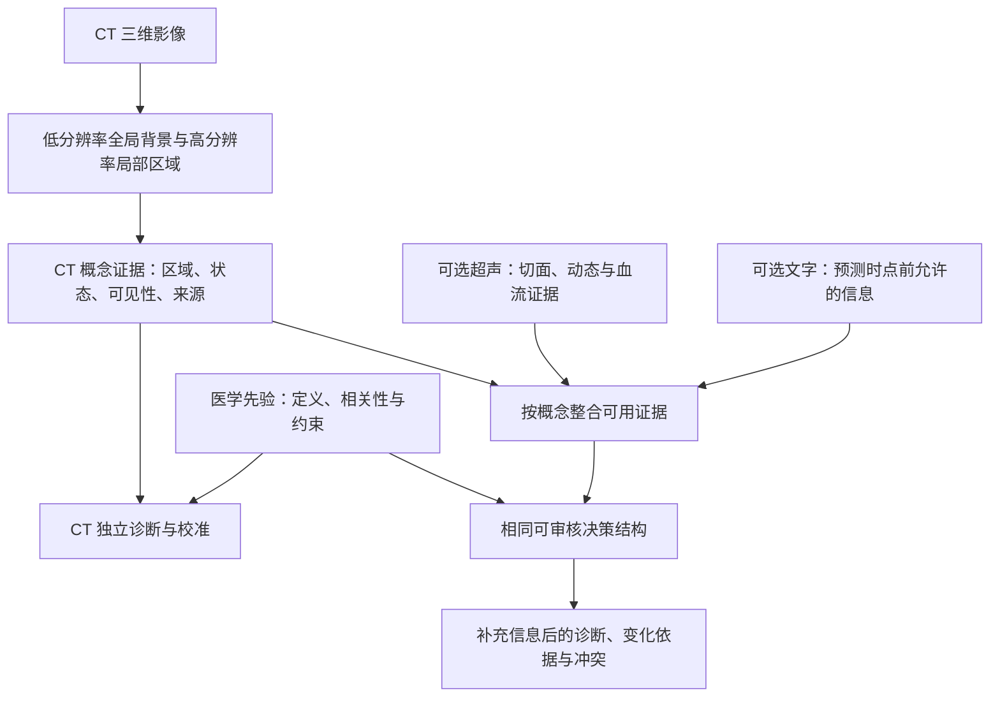

# 少标注、CT独立可用的先心病诊断：区域证据、知识约束与可选多模态

日期：2026-10-30。阶段：研究方案 v2；未训练、未新增患者像素检查、未做临床验证。此稿响应用户新的目标，取代“先完整分割、再做诊断”的默认顺序；原 A1 保留为局部标注和测量工具，不再是主线前置条件。

## 1. 目标与必须成立的条件

**核心问题：在没有病型特异的体素标注或仅有少量标注时，能否从 CT 学到可定位、可核查的诊断证据，并在超声/文字缺失时保留可用的多标签诊断能力？**

用户明确要求：以 CT 为基础；超声和文字可选；从 CT 获得相关区域与特征；模型表达可信度；先验知识指导不同病型自适应使用特征；不受当前已有队列和 A1 的结构标注路线限制。

本方案暂定输出为当前检查阶段的辅助解剖诊断，不直接扩展到疗效、预后或手术决策。CT-only 不等于每种疾病、每种严重程度都可由 CT 确诊；如果判断依赖未采集的血流/功能证据，输出候选与证据缺口。

三个标签层次不能混淆：
- 没有结构掩码，但有患者级可信诊断：可以开展弱监督诊断学习。
- 只有报告、无独立诊断：可以提取有噪声的弱标签，训练集须抽查；正式评价另建独立参考标准。
- 既无结构标注、也无可信诊断或报告：可以预训练表征、聚类和检索；不能据此直接证明疾病诊断准确。

模型不强制单一病名。先心病可合并多个缺陷，应采用多标签病型输出，必要时按解剖关系组织层次；支持证据不足或未知形态。正常、近邻鉴别病型及混合病变都应进入研究设计，不以两种已知疾病互分类代替普遍先心诊断。

## 2. 三个候选方案与推荐

| 方案 | 核心结构 | 需要的监督 | 优势与限制 |
|---|---|---|---|
| R1：多实例学习＋局部原型 | CT 多尺度区域 → 聚合 → 多标签诊断；展示相关区域和相似训练原型 | 患者级标签为主，少量区域核验 | 启动成本低，适合建立弱监督基线；区域注意力不自动成为结构或可靠临床概念 |
| R2：有区域证据的概念模型＋知识约束自适应决策 | CT → 可观察概念及区域 → 有限、可审核的病型评分；超声/文字补充概念 | 患者级标签、报告弱概念、少量概念/点/框审核 | 最贴近用户目标；需要验证概念含义与充分性，防止概念和权重成为隐藏分类器 |
| R3：概率解剖关系图 | CT/其他输入 → 不确定的结构、连接和观测 → 概率图推断 | 关系定义、专家知识及少量关系标签 | 缺失信息和多证据推理清楚；关系抽取较难，依赖假设多，相关证据不能当独立证据相乘 |

**推荐 R2 为研究主线，R1 为共同编码器的强基线。** R3 只在关系证据和概率假设可核实后扩展。多模态教师到 CT 学生的迁移是可选训练策略，可服务于 R1/R2，而非第四个必须同时开发的系统。

此推荐是待验证的研究判断。没有进行穷尽查新，不宣称全球首次；先验概念、跨模态概念学习、弱监督区域聚合分别已有工作。

## 3. 推荐架构



无超声/文字时，D 是完整且独立训练的路径；有补充信息时，同时保留 D 和 J 以显示结果变化。概念融合不要求 CT 与 US 逐像素配准，但必须核实患者、就诊、检查时间和术前术后状态。

### 3.1 CT 区域如何在没有掩码时得到

- 采用可复现的三维预训练编码器；先比较冻结表征和小范围适配，再决定训练成本。现成模型可能以成人、非增强胸部或腹部 CT 为主，不能假定适用于儿童心脏 CTA。
- 用多尺度三维区域覆盖影像，保留原坐标与相对位置。一般解剖模型可提供候选范围，但不得成为排除异常位置的唯一硬裁剪。
- 用病例级诊断和报告中的可观察描述监督区域聚合。保留全局背景和多个区域间的关系，避免把先心病简化成“某一个小块阳性就足够”。
- 区域证据可先是关键切面、点、框或粗区域。只有要测管径、体积、缺损大小或连续走行时，才追加局部边界/中心线/分割。
- 用少量专家点/框核验区域命中率；如果要声称精确分割，则仍需相应的像素级参考标准。分类正确不能证明区域正确。

### 3.2 临床概念怎样定义与获得

首版仅收纳足够明确、可观察、具有鉴别意义的有限概念，再逐步扩展。字典按四组组织：

1. 结构存在与局部形态：可辨认的间隔连续性、局部管腔变窄等。
2. 起源与连接：大动脉与心室的连接、肺静脉引流终点、冠脉起源等。
3. 空间关系与测量：走行关系、指定平面的尺寸或比例；需可靠尺度和局部定位。
4. 可选功能证据：超声中的动态、血流方向或有条件测得的速度；不默认能由单期 CT 直接观察。

每项概念保存：定义、来源文献与版本、允许模态、适用人群/术后状态、可见条件、值或状态、原图位置、文本原句、审核状态和预测时点可用性。疾病名称不作为其自身的“解释概念”。

概念训练来源：
- 指南/教材构建定义和病型—概念关联，由专家核对；不能把语言模型生成的数值直接当医学权重。
- 训练集报告提供阳性、明确阴性、不确定、未提及等弱标签。未提及不等于正常；否定、时间、推测、术后描述必须处理。
- 少量人工概念判断和关键点/框提供语义锚点；不必先做全心掩码。
- 无标签 CT 可用于训练折内自监督/一致性训练，但这种一致性不证明病理语义正确。

“零结构标注”与“零人工核验”不同。报告级监督通常不足以唯一确定证据所在位置；先心连接关系尤其需要少量核验。原型、热图或潜变量名称都不能自行升级为金标准。

### 3.3 按病型自适应权重，怎样避免先猜后证实

对每个候选病型同时计算分数；先验指定哪些概念具有相关性、证据方向或合理组合。**不先预测唯一病型，再只搜它的支持证据。**

一个拟议的可审核形式是：

```text
病型 d 的分数 = 基础项
             + Σ [受约束的可靠性调整 × 该概念对 d 的贡献]
             + 少量明确列出的概念组合贡献
```

- 病型差异来自概念—病型参数/关联先验。
- 个体调整来自概念可见性、可靠性、可用模态和少量明确定义的临床背景。
- 贡献可为支持或反对；缺失不是反对。
- 调整器只读取可展示的有限状态；若读取任意高维 CT 隐藏特征，就可能成为绕开概念的黑箱旁路。
- 概念之间的必要组合以少量显式交互项表示，不能把大 GNN 的注意力直接称透明权重。
- 先从固定权重、稀疏加性模型开始，再检验个体调整的增量。先验默认是软约束；不把未列出的关系一律硬置零，不强制正常解剖。
- 只在定义适用时使用单调/符号约束；直接证据与继发改变分开，不把非特异改变当定义性证据。

关键区分：**重要性、可靠性、诊断概率不是同一个量。** 权重大不意味着可靠，某特征清楚可见也不意味着它对所有病型都重要。部分概念消失时，不将剩余弱证据简单重新归一化到更高确定度。未知状态应按预设规则处理或在概率模型中边缘化，并显示覆盖不足。

所有候选病型可各自使用 sigmoid 或适当多标签推断，不采用强迫互斥病型竞争的单个 softmax。

### 3.4 超声和文字的两个用途

**训练期监督/教师。** 图像与报告可帮助 CT 学习概念；有同期配对超声时，可训练多模态教师，再把可从 CT 观察的共享概念和诊断表征迁移给 CT 路径。教师不可访问验证/测试数据。只有超声能观察到的血流指标不强制变成 CT“实测值”；不可识别的信息不能靠蒸馏补造。

**使用期可选补充。** 超声先做切面/模式与质量识别，再提供适合的概念。文字按预测时点和用途分为病史、检查所见与已知诊断。融合发生在概念证据层，记录每项证据来自 CT、超声还是文字。

四种输入组合必须独立可运行：
- CT；
- CT＋超声；
- CT＋允许使用的文字；
- CT＋超声＋允许使用的文字。

训练始终保留 CT 独立诊断损失，同时对真实可用组合训练，并使用模态随机缺失作补充。不能只在完整配对者训练后删输入，或生成一段虚构超声来“填齐”数据。训练与评价还要覆盖实际缺失，因为是否做超声/是否有报告可能与病情、医院和流程有关。

**防止文字泄漏和重复计证据。**
- 当前 CT 的最终诊断报告可作为训练弱监督或参考标准来源；CT-only 测试时不能作为输入。
- 若使用期确实允许含既知诊断的文字，该任务应明确称综合资料辅助诊断，另报结果，并与独立参考标准比较；不能用同一文本同时输入模型和自动生成测试标签，再宣称影像能力。
- 从 CT 生成的报告和 CT 本身同源，不能当两份独立证据重复增加确定度。
- 术后/出院/随访内容不能用于更早预测时点。训练阶段的教师辅助也不能改变这个任务定义。
- 删除诊断名称、仅留所见、文字打乱和文字单独输入的对照用于发现捷径，但删病名仍不等于彻底去除标签信息。

## 4. 可信度如何表达和验证

| 输出层 | 表达内容 | 核验方式 |
|---|---|---|
| 观测充分性 | 目标区域是否覆盖、质量是否足够、概念能否评价 | 少量独立可见性/质量标注 |
| 概念与定位 | 概念的概率/区间、候选区域及定位是否经过验证 | 概念准确性、点/框命中、必要时分割评价；定位与概念置信分开 |
| 病型诊断 | 经校准的病型概率及支持/反对贡献 | 留出校准集、可靠性图、Brier/NLL、逐病型/输入组合评价 |
| 系统适用性 | 模态冲突、未知形态、分布变化、需要复核 | 域外与困难亚组、风险—覆盖曲线、冲突检出率 |

可比较多次训练/小型集成的不一致与概念预测分布，用作不确定性信号；信号必须验证，不能把“采用 evidential/Bayesian”当作可信的证明。先以开发集划分的独立校准部分或交叉拟合做温度/其他简单校准，数据不足的病型不硬报精确保证。

校准概率是相似条件下的统计频率性质，不是某个患者正确率的保证。分布漂移和稀有病型会降低可靠性。若采用共形预测，需单独说明假设、边际与亚组覆盖的区别；不是首版必要模块。

输出可采用如下结构，数值均待真实训练和校准后填入：
- 候选病型与校准状态；
- 支持、反对、未知的关键概念；
- 每项证据的原图位置/超声片段/文本原句及来源；
- 当前实际使用的贡献；
- 缺失和冲突，以及补充信息前后变化。

## 5. 最小实验顺序

### 实验 0：标签与概念是否足够

先确定预测时点和多标签终点，核实病例级参考标准。对一小批有代表性的病例审核概念、可见性和区域，不要求全心分割。让透明决策模型先使用专家概念，判断这些概念能否支持目标。若失败，调整概念/任务，暂不扩大影像网络。

### 实验 1：CT 独立的弱监督基线

同一预训练 CT 编码器比较全局池化、多区域 MIL、概念模型固定权重。使用同患者划分、标签预算和合理匹配的容量/训练预算。区域是否有诊断意义由少量独立点/框/概念审核验证。

将模型架构收益与预训练收益分开：在可承担预算内比较预训练/随机初始化或统一编码器头部，不同时改变多个因素。CT-CLIP 与 Merlin 等作为范式与初始化候选，适用范围、分辨率和预训练重叠须核对，而非直接指定某个公开模型即能完成先心任务。

### 实验 2：先验与个体调整是否有真实增量

固定概念提取器，比较无先验、固定先验、学习的固定权重、先验约束的自适应权重。加入打乱先验、移除可见性/可靠性调整、少量错误先验敏感性分析。

核心检查：相同或相近诊断性能下，临床概念/区域更准确、错误时更愿意拒判，还是只是参数更多？检查软概念改为离散/人工概念后的表现，防止隐藏标签编码。

### 实验 3：额外模态究竟帮助哪里

独立比较：
1. 只用 CT 训练与测试；
2. 用训练集文字/超声辅助，测试仍只用 CT；
3. 使用时加入真实可用的超声/文字。

第二项检验训练期知识迁移，第三项检验新增观测价值。蒸馏只针对可识别的共享信息，并有不蒸馏对照；若教师独有信息造成过度自信或 CT-only 退化，则取消该项。

在同一批完整病例上模拟四种组合进行配对比较，同时在真实缺失人群上单独评价。只在完整病例上人工遮掉模态不足以证明真实缺失鲁棒。

### 实验 4：解释、校准与外部验证

- 先冻结模型、先验字典、阈值和校准，再评独立患者/时间/中心。所有检查、期相、区域、报告和原型都继承患者划分。
- 诊断：逐病型敏感度/特异度、AUROC、AUPRC及患病率、置信区间；多标签和罕见亚型分别报告。
- 区域和概念：盲审、定位、关键连接错误、人工纠正概念后结论是否合理变化。
- 忠实性：固定权重情况下改变概念、重新计算有限门控两种干预；模型/标签随机化、匹配扰动；不将任意遮挡造成的域外退化当解释成功。
- 校准与拒判：逐模态组合、疾病和质量组的校准、覆盖率和被接受病例风险，不用拒绝所有困难病例换漂亮准确率。
- 捷径：文字单独、文字移除/打乱、设备/机构/扫描协议及模态有无的对照。
- 参考标准与验证：若诊断依赖同一 CT 或超声报告，记录参考标准与输入的依赖；优先独立裁定并报告一致性。模型输出不能参与自身金标准。

## 6. 什么可能成为研究贡献，什么不能

有价值的待验证贡献：
1. 弱/少标注下，病型证据能定位到 CT 区域，并表示关系与可见性。
2. 先验约束的个体加权能够改善概念忠实性、迁移或选择性预测，且不依赖隐藏旁路。
3. 超声/文字缺失时保持 CT 独立能力，有额外信息时提供可追溯增量与冲突处理。
4. 以低成本的点、框、概念审核换取可靠的诊断证据，比全面体素标注更有效率。

“用了大模型、知识图谱、注意力、文本提示”本身不构成新颖性。跨模态训练后单影像推理与医学先验概念模型已有近邻。需要在先心的异常连接、多病共存、局部细结构和真实模态缺失中证明差异，不能仅换数据集后宣称新范式。

## 7. 继续与停止规则

- 若专家概念不能支持目标：修订概念/终点，而非扩大编码器。
- 若诊断分数好而区域/概念不可靠：降级为弱监督分类基线，不称已解释诊断；优先追加概念/区域审核。
- 若自适应权重没有超越固定权重：保留简单模型。
- 若融合收益主要来自报告直接含答案、设备或检查流程：纠正任务与验证，不作为多模态医学推理增益。
- 若 CT-only 无法识别某个功能终点：明确不可判或调整输出，不强迫教师学生一致。
- 每次只增加一个机制；给每个新增机制限定验证轮次，保存负结果。正式样本量依据主要终点精度和病型频率设计，不以切片数量替代独立患者数。

## 8. 文献依据与本轮范围

以下只支持方法起点，不证明本方案在先心 CT 已成立。

| 来源 | 本轮核读 | 可借鉴之处与边界 |
|---|---|---|
| [Attention-based MIL](https://proceedings.mlr.press/v80/ilse18a.html) | 原论文页摘要 | 病例标签监督区域聚合；原实验含病理图像，不是先心三维连接验证 |
| [CT-CLIP/CT-RATE](https://www.nature.com/articles/s41551-025-01599-y) | 出版社检索返回的方法/结果段；直接打开被重定向阻断 | CT—报告预训练；非增强胸部背景，不能直接等同心脏 CTA |
| [Merlin](https://www.nature.com/articles/s41586-026-10181-8) | 出版社摘要/元数据；本地 PDF 第1页腹部任务片段 | 三维 CT 与报告/EHR 预训练；腹部任务，非先心验证；本地版本与最终版细节不混用 |
| [Cross-Modal Conceptualization](https://aclanthology.org/2023.emnlp-main.318.pdf) | 摘要、PDF第1页及第5页跨模态一致性片段 | 训练用文字引导概念，推理仅视觉；不保证学到的潜变量已是先心临床概念 |
| [KnoBo](https://proceedings.neurips.cc/paper_files/paper/2024/file/a4e683f0ce6b91e7fbdae9d32642d88f-Paper-Conference.pdf) | PDF第1页及第4–5页检索片段 | 医学资料形成概念/参数先验；对象为胸片/皮肤，不是本项目结果 |
| [ProbCBM](https://proceedings.mlr.press/v202/kim23g.html) | 原论文页摘要 | 表达概念不确定性；不能替代本地校准 |
| [Guo等校准研究](https://proceedings.mlr.press/v70/guo17a.html) | 原论文页摘要 | 神经网络概率需校准、温度缩放基线；并不保证医学域外可靠 |
| [ASCI先心CT指南](https://kjronline.org/DOIx.php?id=10.3348/kjr.2020.1332) | 本轮检索相关应用段，沿用此前阅读范围 | 结构与连接的临床概念来源；具体概念适用性仍须专科审核 |

本地复核：CLEAR 第2页图中文字片段（观察描述与概念空间），CSR 第5页方法片段（局部原型），Mechanistic CBM 第2页概念泄漏段，REDNet 第1页摘要（可靠性折减；原为多模态分割），Merlin 第1页。只记录实际页段，不称全文重读。文件 SHA256、摘录和迁移边界见 evidence/diagnosis_v2_reading_log.json。

本轮资料路径与旧方案保持连续，但未把当前数据规模、两类疾病或现成模型作为设计上限。下一步是概念/标签/使用时点协议及最小 CT-only 实验定义，真正运行前再核实数据、算力和专家标注资源。
