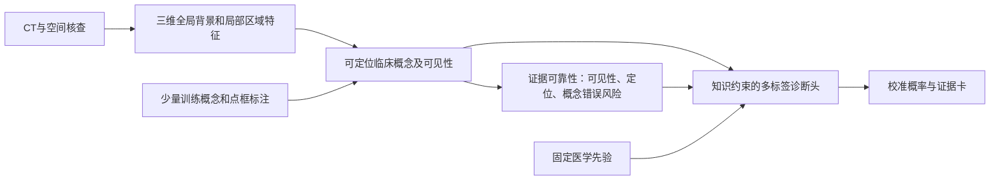

# 纯CT版本：少结构标注的区域概念与先心诊断

> **讨论草稿，尚未定稿，不作为正式方案。**

日期：2026-10-30。当前版本选择：只有 CT 的版本。状态：方案与输入约定已保存，未开始患者选择、标注、训练或推理。

## 版本范围

用户明确选择本轮做只有 CT 的版本。为使该版本能独立开展，我建议本项目训练与使用都以 CT 作为患者级模型输入，不设置超声/患者文字编码器、跨模态融合或多模态教师。这是本轮具体实现选择；用户尚未单独规定公开预训练权重的历史训练来源。

病型标签、概念/点/框标签是监督信息，不是使用时输入。既有临床报告、手术记录或专家综合裁定可以为参考标签提供依据，其原文与额外模态不能作为该 CT 模型的患者特征输入。来源依赖和标签裁定方法仍需披露。固定的指南/教材知识用于离线定义概念与约束，不是患者文字输入。

当前不要求超声配对、文字配对或其可用性；不会因这些资料缺失排除本可用的 CT 病例。以前的可选多模态方案保留为历史候选，不作为本版开发前提。

## 输入、监督与输出

| 类别 | 本版约定 |
|---|---|
| 使用时必需 | CT体积，以及解释图像所需的间距、方向等影像元信息 |
| 使用时不需 | 超声、报告、病史文本或人工概念输入 |
| 训练主监督 | 患者级多标签诊断；阳性/明确阴性/未知分开 |
| 少量附加监督 | CT中可观察的概念、可见性、点/框；必要的局部掩码 |
| 全局医学知识 | 离线审核的概念定义、病型—概念关系与适用条件 |
| 输出 | 多标签候选、区域位置、概念状态与贡献、校准状态及证据不足原因 |

“只有 CT”不等于没有训练标签。完全没有可信诊断或概念审核时，可学习表征，但不能据此验证病型或临床解释。没有全心精细掩码时仍可启动弱监督诊断。

患者年龄、临床背景或设备/机构信息本版不作为额外诊断特征输入；可以用于划分和亚组审核。需要适用年龄/术后范围时在研究协议中定义或分层验证，不让未知的临床背景偷偷进入权重调整器。公开预训练权重的训练模态与数据来源另行登记；若曾使用图文预训练，不把“本项目CT输入”夸大为所有历史训练均为纯视觉。

## 最小模型

1. 采用一个可复现的三维医学预训练编码器，先冻结主体训练轻量输出部分。
2. 低分辨率全局分支提供空间背景，高分辨率局部候选保留细节；区域保存原图坐标。
3. 概念头预测有限的起源、连接、局部形态和空间关系概念，并判断可见性。关系概念可同时指向多个区域；注意力区域不自动成为分割真值。
4. 诊断头只读取命名概念、CT可见性及经核验的CT质量/稳定性状态，不读取任意隐藏影像特征绕过概念。
5. 先训练固定知识约束权重，之后才比较基于CT证据可靠性的自适应权重。可靠性分支以独立审核和折外概念错误为依据训练/验证，不由分类注意力直接冒充；关键证据不足时允许不确定或复核。每个病型独立评分，允许并存，支持与反对贡献分别显示。具体机制见[可靠性模块与验证](12_可靠性模块与验证.md)。
6. 校准疾病与概念输出；定位是否可信独立评价。关键证据不足时说明原因，不因只剩少量证据就重新归一化出高确定度。

分割是为特定测量服务的可选支路。能用概念与点/框验证的问题先用低成本监督；要输出管径、体积、缺损尺寸或完整路径时，才加必要的局部边界/中心线标注。

## 实施步骤

### C1 病例与标签
建立患者—检查—序列/期相层级，按患者划分。病型为多标签并保留未知。训练、选模、校准与最终测试互相隔离；没有结构标签不排除病例。参考标签与输入分离，不把文件夹名当诊断。产物：CT清单、参考标签、划分与适用范围。

### C2 CT概念与少量语义锚点
从原方案挑选CT可观察的约10–20项概念，功能性概念按具体CT采集条件审查；普通单期CT不要求输出未直接观测的流速/压差。先约10例开发病例试标概念、可见性和点/框，检验定义一致性，再决定扩充。专家概念→简单诊断模型用开发留出/交叉验证检查充分性。产物：概念字典、先验表和审核标签。

### C3 CT全局/局部预处理
核查空间与强度，保留原始CT；按编码器约定处理。覆盖性候选防止漏掉异常位置；裁剪与重采样用少量点/框验证并可回投。实际间距、块数和显存通过训练数据与小批前向测试决定。产物：输入、区域与坐标配置。

### C4 CT弱监督与概念模型
同一个编码器先建立直接多区域分类基线，再训练有区域依据的概念模型。监督损失只作用于有效诊断/概念标签，未知不当阴性；少量点/框约束定位。概念模型严格通过概念诊断，直接分类模型保留为性能对照。产物：两种模型及分层错误。

### C5 知识约束与自适应
比较概念固定权重、知识约束固定权重、知识约束自适应权重。个体调整只读CT可见性、经过验证的质量/模型分歧等有限状态。先验为有来源的软约束；所有病型同时评分。加先验打乱、概念干预、离散概念等对照；自适应无增量时保留固定模型。产物：贡献表、权重依据和消融。

### C6 校准与独立验证
冻结模型后校准，按病型和CT质量/协议/人群分组验证。主指标含诊断错误、区域与概念正确、校准和风险—覆盖；只有掩码子集才评价精确分割。测试集保持独立，区间以患者计算。产物：冻结评估、证据卡和失败归因。

## 最小实验矩阵

| 实验 | 输入与区别 | 作用 |
|---|---|---|
| E0 | 专家概念，仅研究对照 | 概念是否足以支持目标，不是部署输入 |
| E1 | CT→多区域直接分类 | 弱监督性能基线 |
| E2 | CT→概念→固定诊断头 | 验证概念链是否成立 |
| E3 | E2加入医学先验约束 | 验证先验作用 |
| E4 | E3加入CT证据可靠性调整 | 验证个体权重作用 |

各实验共用患者划分和标签预算；E0的专家概念不会进入E1–E4的使用期输入。先通过概念和区域核验，再扩大数据/模型。未经核验的高置信预测不自动回填金标准。

## 与第09/10稿的变化

本版不执行患者文本弱标签自动抽取管线、图像—报告对齐、超声切面/视频建模、多模态教师、模态缺失训练及四组合评估。诊断参考标签可由既有资料人工审核形成，仍保留证据来源。多模态任务不作为当前待办。

原有病型定义、患者划分、CT区域与概念、有限权重调整、校准与错误归因继续有效；相关细节见[逐步实施与验收](10_逐步实施与验收.md)。其第7步及其他跨模态内容不适用于本版。

## 当前执行状态

已完成本版设计、输入约定、六步执行表及状态切换；未新增患者影像读取、未裁定病例标签、未启动模型推理/训练、未更改原始资料。当前第一个实际里程碑为CT病例与参考标签清单、CT概念字典草稿和首批概念/点框审核。
