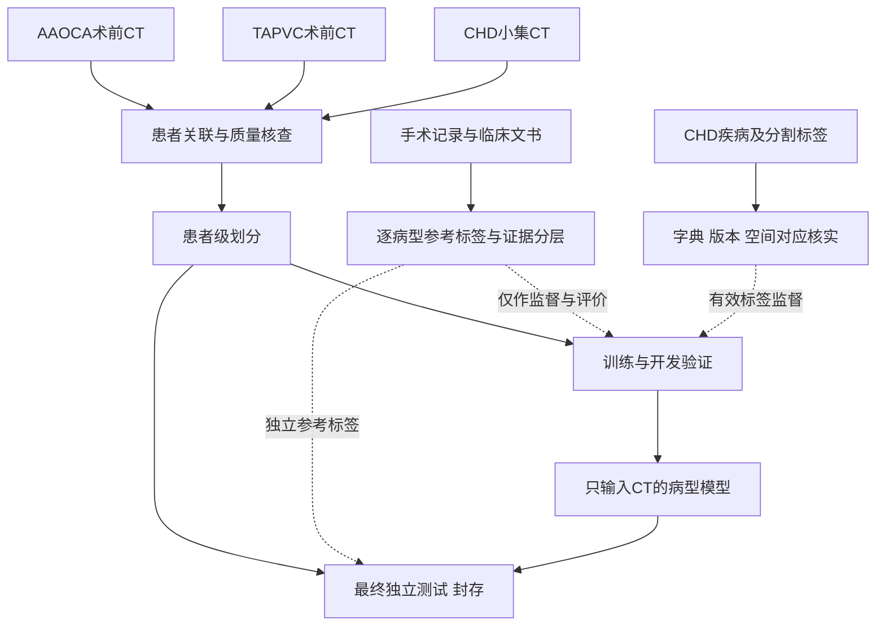
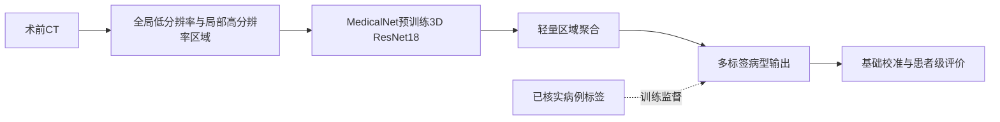
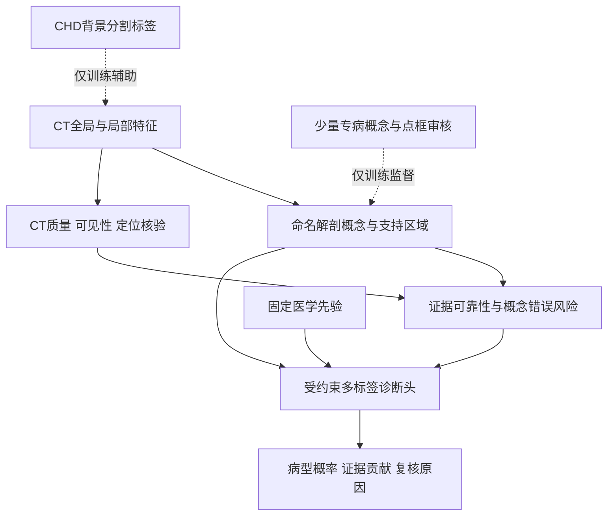

# AAOCA、TAPVC与CHD联合研究方案：手术证据确认标签，CT预测病型

日期：2026-10-30。最终任务澄清：**手术相关资料用于证明病型，模型预测病型；本版不建立手术必要性或手术建议预测终点。** 本轮交付详细方案、结构图和方案推敲记录；不编写实现程序，不运行训练，不筛选或发布真实患者资料。

## 一、研究目标与交付

拟题：**基于临床与手术证据确认标签的少标注CT先心病诊断：解剖迁移、概念推理及可靠性评价。**

总目标：将本地AAOCA/TAPVC的术前CT与经过核实的CHD小数据集结合，建立仅输入CT的多标签病型诊断方法。文书用于病例关联、参考标签与病型关键解剖核验。模型输出病型候选、CT证据位置、关键概念与不确定性，不预测是否应该手术。

分阶段目标：
1. 建立患者级、时间可追溯、按病型记录证据等级的研究队列。
2. 获得一个小样本可启动、无需全心掩码的B0分类baseline。
3. 在固定开发划分上分别检验CHD解剖迁移、概念解释、可靠性三轮增量。
4. 在冻结的独立患者测试上评价病型、证据与拒判，不以训练分数或漂亮三维图代替验证。

最终交付包括：研究队列流程、标签字典、baseline与逐轮对照、可核查证据卡、错误归因和结论适用范围。当前没有实际患者入组数、训练结果或性能承诺。

## 二、各类资料在研究中的用途

AAOCA、TAPVC 队列提供术前 CT 和经审核的诊断。手术与临床文书用于逐病型确认标签。CHD 小集的疾病标签或结构掩码，只有在版本、定义与空间对应关系经核实后才参加相应监督。

若小集为 ImageCHD，其七类结构包括左右心室、左右心房、心肌、主动脉和肺动脉，可以提供背景解剖监督。冠脉开口及肺静脉通路的专病结构另行审核。其他来源的分割结果必须确认输入、网格与人工质量评级后才能作为候选标签。[S1]

## 三、病例筛选：手术证明病型，而不是模型预测手术

### 1. 标签证据分层

分级针对“某患者的某个病型”，不是整位患者统一评级。

| 证据层 | 拟议定义 | 用法 |
|---|---|---|
| A：手术证据确认 | 已完成相关手术，手术/术中记录明确支持该病型，术前CT身份/日期匹配，经专家核对 | 建立高可信训练种子与严格证据测试亚组 |
| B：专家临床确认 | 明确诊断且专家综合资料确认，包括明确诊断后建议手术但尚无术中记录者 | 可纳入扩展队列，保留证据来源，独立分层评价 |
| U：未确定 | 仅“考虑/疑似/建议进一步检查/可考虑手术”，或记录冲突、无法关联 | 相应病型不作为确定阳性/阴性；可保留作未标注或待审样本 |

“做过心脏手术”本身不证明所有病型；术中记录未提及的其他缺陷也不能自动当阴性。“明确要求做手术”通常需要核对具体诊断依据，不能直接改写为术中证实。

本地Xu等2023论文第3–4页采用手术病例，并结合CT报告、手术记录、出院记录和专家审核形成诊断参考标准；手术记录被视为重要证据。这支持综合证据建标签的方式，但不证明只收手术病例可以代表所有先心患者。[S2]

### 2. 每例应核对的内容

- 脱敏患者键、就诊键、CT检查/序列与时间。
- 诊断标准名及所有合并病变；阳性、明确阴性、未知三态。
- 参考文书名称、日期、页码/原句和证据等级。
- 手术是否实际完成、与CT的时序、病型是否在术中描述支持范围内。
- CT是否在矫治前；初次原发病诊断主队列排除已矫治后的形态，术后研究另列。
- 目标结构是否在视野内、可见性和影响质量的原因。
- 初审、复核和冲突裁定。

先由一人提取，再由独立专科审核关键病型；不确定病例由第二位专家裁定。测试标签裁定不能参考模型输出。文书只形成结构化监督，不进入CT编码器或诊断头。

### 3. 入组与对照

A层是启动种子，不应成为唯一纳入渠道。训练扩展与最终测试还需适当覆盖较轻、形态不同、近邻病型及明确非目标病型病例，防止模型只识别“典型、重症、已手术”的影像。

对每个目标病型都需要经过适当核实的阴性。TAPVC患者不自动就是AAOCA阴性，CHD表格没有写AAOCA也不自动是阴性；反之亦然。只有在参考标准/原图审核适用且明确时赋阴性。某个输出只有阳性而无可信阴性时，不报告其稳定诊断分类指标，先补对照或降为描述性概念提取任务。

## 四、CHD与私有病例怎样一起训练

采用**共享CT表征＋逐任务有效监督**，不是把各目录直接当互斥类别。

1. 病例级标签统一命名，多标签保留共存。CHD的小类或父类不能强行映射成AAOCA/TAPVC细分型，例如“异常肺静脉回流”不能无条件等于TAPVC。
2. 标签可用的病型参加分类损失；未知病型跳过该项，不填0。
3. CHD分割标签仅在字典/几何核实后参加辅助解剖任务；没有掩码的私有病例仍参加病例级诊断。
4. CHD七类结构用于背景表征，不宣称已监督了冠脉或肺静脉关键连接；专病概念需少量私有病例审核补充。
5. 同患者的不同体积、期相、原片、预处理、分割和文书继承同一划分。查跨数据集重复；若CHD参与预训练/联合训练，就不能再把同一批CHD当外部测试。
6. 批次按数据来源与有效标签适度平衡，保留来源仅用于审核和评估，不作为模型输入。来源平衡不能消除“某病只在某来源出现”的混杂，须有同来源对照和跨来源同病型覆盖，或严格缩小结论范围。
7. 数据来源与病型完全绑定时，不能靠域适配损失宣称问题已解决。保留仅私有训练/联合训练对照，并优先检查私有未见病例上的增量。

## 五、结构图

### 图1：资料与标签进入训练的方式

### 图2：Baseline B0

### 图3：后续可解释与可靠性版本

虚线为训练/评价监督，不代表使用时需要文书、掩码或人工概念。后续概念版本的主诊断路径不保留任意影像隐藏特征旁路；直接影像分类保留为独立对照。

## 六、明确的Baseline B0

### 任务与输入
- 仅术前CT及解释CT必需的几何元数据。
- 输出可可靠监督的病型多标签，首轮优先AAOCA、TAPVC及CHD中可核实、拥有足够对照的标签。不是先承诺全部16/17类都能稳定估计。
- 使用期不输入文书、手术状态、数据来源、超声或手工选出的病变框。

### 模型
采用MedicalNet的3D ResNet-18预训练编码器，接轻量区域聚合与独立sigmoid分类输出。该项目公开了3D ResNet系列及18层预训练权重，适合作为可复现、小规模启动的候选；不能据预训练存在声称先心特异性能。[S3]

保留低分辨率全局背景与覆盖性高分辨率局部块，附带空间位置。局部选择不能依赖测试真值；若初次试点使用人工ROI，必须单列为人工辅助实验，不冒充自动流程。AAOCA细冠脉可能在粗尺度丢失，TAPVC通路也可能超出狭窄心脏裁剪，因此空间覆盖审核是必要步骤。

### 训练安排
- 起步冻结编码器，缓存训练/验证特征，先训练轻量聚合/分类层；所有特征提取遵守各自划分与固定预处理。
- 验证表明表征不足后，解冻末段、小学习率适配，与冻结版本比较。每轮只改变一项。
- 有效标签掩码下的多标签二元交叉熵；标签未知不计该损失。
- 预处理按权重接口及可信HU/空间处理，参数从训练集或预先规定的物理规则确定。避免文件来源可见的边框/填充/强度处理差异。
- 训练可调范围限制在冻结/末段适配、聚合方式和有限学习率范围；不首轮搜索大量架构。
- 每例记录输入版本、患者划分、权重与处理参数、预测和所选区域。

### 为什么先做B0
它不依赖完整分割，也不依赖VISTA3D已分对专病结构。通过明确的小模型与冻结特征，可以先判断联合数据是否有诊断信号。注意力聚合可参考MIL，但其区域热图不能直接称临床解释。[S4]

### B0必须配套的对照
- B0-P：仅私有队列训练，在相同私有测试上评价。
- B0-J：加入CHD中核实的有效病型监督，共享编码器。
- 公共数据未提供某主病型有效标签时，其加入不产生该输出的伪阴性；若没有任何可用疾病标签，则B0-J暂不进行，CHD留到结构辅助轮。
- 来源/质量/人群审核：检查模型能否轻易识别数据来源及与病型的耦合，不以这个审计分类器替代诊断。

B0通过标准是流程、标签、泛化和错误可解释，而非预填AUC目标。若某输出缺乏可信正负样本，先修队列；若CT关键结构不可见，则缩小该输出适用范围。

## 七、三轮主要迭代与一项候选扩展

所有迭代使用固定开发划分，最终测试封存。每轮只验证一个主要假设，最多两次有理由的受控修改；没有收益保存负结果，不无限换模型。

| 阶段 | 主要改变 | 需要增加的标注 | 判定增量的对照 | 未通过时 |
|---|---|---|---|---|
| R0 / B0 | 预训练CT编码＋区域聚合分类 | 病例级可信标签 | 仅私有 vs 有效CHD联合；冻结 vs 末段适配 | 先解决标签、来源或可见性 |
| R1 解剖辅助 | 在共享编码器训练阶段加入CHD背景结构分割任务 | 已有CHD掩码；需先核实字典/网格 | B0-J vs 加结构辅助，同划分、相近训练预算 | 无收益或迁移损害则撤去辅助任务 |
| R2 专病概念 | 加少量局部概念/关系监督，固定先验诊断头 | 概念判断、关键点/框；必要时局部边界 | 直接分类 vs 概念头；无先验 vs 固定先验 | 概念不准则定向补标；充分性失败则修定义 |
| R3 可靠性与自适应 | 基于可见性/定位/折外概念错误学习可靠性，调整贡献并校准 | 独立审核的概念正确性、质量和定位 | 固定权重 vs 自适应；无可靠性/固定规则/学习可靠性 | 不改善同覆盖率风险或校准则保留简单版 |
| 可选R4 | 仅当表征确为瓶颈时，换一个3D基础编码器（例如VISTA3D） | 沿用相同标签 | 与B0/R2同输入和标签预算，不同时新增多项机制 | 无稳定增量则终止模型替换 |

R1的分割头可在训练阶段辅助表征，使用时不要求人工掩码。它不强迫所有病例完成分割，也不把真畸形纠成正常拓扑。CHD标签不合格时跳过R1，不阻断B0与专病点/框试验。

R2建议首批约8–12个能明确核验的专病概念，扩展按实际可见性决定。例如AAOCA的起源位置、近端走行、开口/近端形态，TAPVC的汇合与引流终点、与左房连接证据、局部狭窄形态。间动脉走行不等同壁内走行；CT形态狭窄不等同已证实血流动力学梗阻；概念适用条件需专家定义。少量概念/点框以覆盖错误类型为目标，不先追求全心每个体素。

R3可靠性不是分类注意力：先用未训练该病例的模型预测与人工参考比较，形成概念/定位错误目标，再拟合有限信号的风险预测器。可靠性低时折减相应证据；关键证据不足则保留不确定，不靠重分配其他弱证据制造确定结论。最终概念与病型校准、拒判率和被接受病例错误一起报告。[S5][S6]

### 专病概念如何定义、怎样获得

下面是待专科审核的候选概念定义，不是已经存在的标注。

| 病型 | 优先概念 | 最小监督与升级条件 |
|---|---|---|
| AAOCA | 冠脉开口与主动脉窦的对应关系、异常起源的冠脉身份 | 开口点、局部框、概念标签；必须记录是否实际看清 |
| AAOCA | 冠脉近端与主动脉/肺动脉的相对走行 | 路径关键点或短段中心线；背景大血管可利用CHD结构监督 |
| AAOCA | 开口及近端形态，必要时的局部测量 | 先概念审核；若报告直径/狭窄率则补局部边界、中心线及测量一致性核验 |
| TAPVC | 肺静脉回流与左房连接关系、异常回流终点 | 关键连接点、局部框及通路审核，避免仅见一条异常静脉便判为完全型 |
| TAPVC | 汇合、垂直静脉等通路结构及分型所需连接 | 沿实际异常通路稀疏标点，完整视野核验；不能假定所有病例具有同一种汇合形态 |
| TAPVC | 通路局部狭窄形态 | 局部边界/中心线用于必要测量；血流动力学梗阻另需相应参考证据 |

概念参考状态至少区分“存在、明确不存在、无法评价”。未显影、运动伪影或扫描未覆盖不能当作结构不存在。点/框可以监督定位，但不能据此宣称像素级分割正确。只有诊断确实需要管径或连接边界时，才追加相应结构的局部掩码。

### 病型先验与自适应权重的具体形式

每个候选病型均有事先制定的概念相关性表：哪些概念必要、哪些支持、哪些矛盾、哪些无关。先训练固定或强约束的小型诊断头，再让“该病例、该概念”的可见性和错误风险调节贡献，限制可训练参数量。

诊断时同时评估各病型候选，不先取得真实病型再选择权重；也不让模型仅凭自己的初始分类结果无限放大支持证据。病型先验给出相对重要性，可靠性给出本次证据是否值得采用，两者分别验证。关键必要概念无法评价时允许输出证据不足；不能用其他弱证据归一化后补出确定结论。

先做一个“人工确认概念→固定诊断头”的开发集实验，估计当前概念集合是否足以区分目标病型。它只是概念定义的参考上限，必须与“CT预测概念→诊断”的自动结果分开报告，不能作为CT模型性能。如果人工概念本身仍不能区分，先修订概念和任务定义；若人工概念有效而自动概念失败，再优先补定位/测量监督。

## 八、可行性与数据分配

### 首轮可行性检查
建议先审核12–18个病例（AAOCA、TAPVC、CHD来源各约4–6例），仅用于发现身份/时序、图像质量、标签字典、裁剪与语义问题；不是正式训练样本量，也不证明临床性能。

随后在开发池组织少量概念/区域审核，先约10例试规程，再根据分歧和形态覆盖扩充。记录医生分钟/例；不自动认为“几十例足够做全部病型”。没有医生审核支持的概念，降为候选区域或暂停该概念输出。

### 数据划分
- 首先预留独立患者的最终测试，优先使用较晚时间或真正独立来源；测试中保留手术证据与其他明确诊断亚组。
- 开发集内按患者分组交叉验证，折数由每病型可用正负例决定。样本太少时减少正式终点，避免机械切成多个空类折。
- 模型选择和概率校准需要相互隔离的数据或适当交叉拟合；正式测试只在冻结后运行。
- 若全部病例都来自手术证实人群，研究结论首先限于该人群；不能直接称适用于所有疑似先心筛查。
- 来源完全不同的公共数据只有在没参与任何训练/调参、与训练无患者重叠且标签对应时，才可能作为外部评价；不能“先联合训练再外测同一套”。

### 资源与时间
先核实目标服务器实际可用GPU、显存、单例体积和权重接口。B0冻结编码器与缓存特征用于降低试错成本；R1/R2再需要反向更新编码器。当前未登录服务器，不估算训练小时或声称已有显卡可用。

进度按门槛而非日期锁定：
- M0：病例—文书对应和标签规则通过；
- M1：B0在固定划分上可复现，来源捷径已审计；
- M2：至少一轮解剖/概念改进有可解释增量；
- M3：可靠性与冻结测试完成。

文书核对和专科审核是最可能的时间瓶颈。只有这些资源确认后，再给实际周计划。

## 九、评价与继续/停止条件

### 病型诊断
主评价只针对事先确认可估计的标签集合。报告逐病型AUPRC及阳性率、AUROC、敏感度/特异度、患者级区间与合并病变表现；宏平均不掩盖AAOCA或TAPVC某一类失败。不采用以未知填阴性得到的总体准确率。

### CHD是否真正帮助
在同一私有留出上比较私有训练、联合训练、解剖辅助；单独报告跨来源泛化。检查模型是否只学会“公共 vs 私有”。如果联合训练无增量或损害局部结构，保留私有baseline，CHD只作独立结构研究或停止使用。

### 解释与可靠性
评点/框定位、概念正确性、关键连接错误、医生纠正概念后的合理变化。只有带真实掩码的子集才评精细分割。可靠性看校准和相同覆盖率的关键错误，不只看分数排序；被拒判的病例及原因必须显示。

### 统计与临床范围
固定训练/验证/测试和病例选择规则；区间按患者重采样，不按切片。多个阶段只在开发集选择，最终测试不能每轮追分。正式样本量按主要终点精度与病例频率设计，不预填“需要XX例就一定足够”。

手术病例富集会影响病型频率和概率校准；概率只对相应采样条件解释，推广到常规就诊人群需代表性验证或重新校准。无手术病例可用经过明确专家裁定的参考标准，但分层披露参考标准差异及验证偏倚。

## 十、本轮三次方案检查

本轮已完成的是设计层面的推敲，不是模型训练迭代。

1. **检查一：终点与标签。** 初始“选要求手术病例”容易被理解成手术预测。依据用户澄清，改为手术/临床证据支持病型参考标签；建议手术与已术确认分开，术前CT匹配。
2. **检查二：混合训练。** 直接合并目录会混入未知负标签和来源捷径。改为逐病型三态标签、共享表征及有效监督；CHD背景掩码与私有专病概念职责分开。
3. **检查三：可行性与可靠性。** 一次堆叠大模型、分割、图推理和不确定性成本高且无法归因。改为B0＋R1/R2/R3逐轮对照，少量概念/定位审核先行，可靠性必须基于独立错误目标，测试封存。

结构图另存于 diagrams，筛选协议另存于 protocols。本轮不新增实现代码，不运行旧的研究脚本或实验。

## 来源与阅读边界

- S1 [ImageCHD原论文](https://arxiv.org/abs/2101.10799)：官方摘要/版本信息；此前本地第3–4页数据/标签核查。说明公开110例数据及诊断信息曾更新，不证明本地小集版本已正确。
- S2 [Xu等2023 CHD CT诊断](https://doi.org/10.1016/j.media.2023.102953)：本轮核读本地PDF物理第3–4页的数据与Clinical labeling段。没有将论文的全标注分割方案或性能直接复制为本计划结果。
- S3 [MedicalNet](https://github.com/Tencent/MedicalNet)：官方README核对3D ResNet-18等预训练权重；本轮未下载或实测。
- S4 [Attention-based MIL](https://proceedings.mlr.press/v80/ilse18a.html)：原始论文摘要；用于病例级弱监督聚合方法起点，不保证CHD定位。
- S5 [概率校准](https://proceedings.mlr.press/v70/guo17a.html)、S6 [SelectiveNet](https://proceedings.mlr.press/v97/geifman19a.html)：沿用此前原论文页阅读，作为校准/风险覆盖设计参考。
- [联合队列核查规程](01_数据与文献核查.md)、[纯CT范围](11_纯CT版本研究与实施方案.md)、[可靠性细则](12_可靠性模块与验证.md)。
