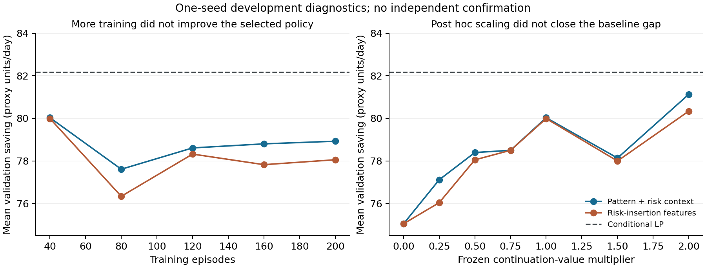

# 第三轮：共同扰动假设被证伪，新风险特征尚无优势

实验于2026-10-04完成；2026-10-22核对源码哈希与保存结果后整理。研究目标继续进行，未达到创新和强基线优势标准。本文保留负面结果，不把开发验证当独立确认。

## 公开飞行数据审计

CMU数据及归属见 [PUBLIC_FLIGHT_DATA.md](PUBLIC_FLIGHT_DATA.md)，许可证为CC BY 4.0。对全部209份日志作哈希、字段、单位和时间轴检查；官方路线标记R开头的196份完整飞行单独统计，另有9份地面记录和4份悬停记录。没有因异常值而删除记录；重复/倒退时间和非有限值检查未发现问题。两个高度字段为多高度字符串，保留原标记，不强制转单一数值。

| 整段完整飞行日志的描述量 | 中位数 | 5%–95%分位 |
|---|---:|---:|
| 日志持续时间，秒 | 184.00 | 135.88–252.85 |
| 水平速度积分路径，米 | 458.06 | 445.01–480.94 |
| GPS增量路径，米 | 472.51 | 464.91–486.84 |
| 电压×电流积分，Wh | 20.73 | 14.21–29.00 |

这些是整段日志量，含起飞前后记录，并非分割后的空中飞行时间或纯巡航能耗。196份完整日志的速度路径合计91.69公里、GPS路径94.72公里，均与论文约65公里的描述不一致；差异尚未解释，不能强行缩放使其吻合。全部209条日志总时长10.75485小时接近论文约10小时45分钟。路线类别计数也与预印本195次完整/14次其他的描述有一条差异，以原始表和逐条审计为当前计算依据。

**这些测量尚不能校准现有派单环境。** 短三角测试航线不能直接验证公里级配送；未记录站点充电和同时运行的多机，不能据此识别全天共同扰动或独立残差比例。相对气流读数不等于无偏环境风速。记录及限制保存在 `results/flight_audit_001/summary.json` 和209行派生表 `flights.csv`。

## 完全相关鲁棒保证的脆弱性

共同标签Z的先验q=(0.7,0.3)。任务i的标签在Z条件下独立，满足

`P(Y_i=y | Z=z) = (1−δ) 1[y=z] + δ q_y`。

任意δ下单机边际仍是q，二元标签的两两相关系数为(1−δ)²。δ>0且q为正时，所有标签组合都有正概率。因此“覆盖所有正概率结果”的鲁棒容量约束，严格等价于逐任务坐标最大占用的包络约束；共同情景相对包络的宽松空间在任何正的独立重抽样概率下都会消失。这是支持集的基本推论，不宣称一般鲁棒优化定理创新。

原两任务例中，唯一坏组合的概率为0.21δ(2−δ)。δ=0.001时，相关系数仍为0.998001，但已有0.041979%的冲突概率；δ=0.01时为0.4179%，δ=0.05时为2.0475%。不能再把原“逐共同情景检查通过”表述为部分相关扰动下的可靠保证。

## 联合机会约束与计算验证

新候选问题保留公共情景硬约束，在不可撤销接单时另要求**整个预约集合、全部资源及时间格点中发生任一容量冲突**的概率不超过α。它不是每个格点各允许α，也不是每次接单允许重新用掉α。固定合成参数δ=0.01、α=0.01，任务结果不向策略透露。

`risk_oracle.py`按时间消去已不再占资源的任务标签，保留公共因素的两列概率质量，计算有限二元分布下的联合成功概率。成功概率下界使用向外舍入和非负求和误差界，接单依照风险上界。状态规模超限时返回未决、风险上界1并拒绝该动作，不当作0风险。此处“精确”指有限分布的变量消去，不是对现实天气分布或航空安全的认证。

原7项计算器检查及独立审查补充的120组Fraction有理数全枚举均通过。审查发现未决概率会使诊断汇总报错，已用两个先失败后通过的检查修复；汇总现在保留未决数量、仅已解记录的条件均值以及全体记录的风险上界均值。后续诊断同时保存实际加载检查点的哈希。旧 `policy_risk_001` 仍保留，修复后记录在 `policy_risk_002`。

当δ=0.01且未加概率筛选时，原模式策略的165个种子/日记录中39个超过1%风险阈值，贪心为4/33，价格为3/33。这里165=5种子×33个相同需求日，不是165个独立需求样本。冻结策略追加筛选后全部满足当前有限分布风险上界；这并非新学习方法的优势证据。

## 首个风险特征试验：不支持方法改善

预先登记见 [risk_method_plan.md](risk_method_plan.md)。给定公共因素，计算每个资源时刻恰好满载的泊松二项概率。对单位占用的新增模板p，新增容量违例概率有并集上界

`B(A,p) = Σ_z q_z Σ_rt P(L_rt=C_rt | z) P(U_p,rt=1 | z)`。

证明：新增全局违例、而旧集合无违例的事件，包含在“某格点原先满载且新增任务占用它”的事件并集中；新旧任务在z条件下独立，逐格求概率并使用并集界即可。界可能重复计算同一失败路径。使用剩余风险额度除以B构造连续插入机会特征，再由非负权重网络学习后续价值。浮点特征不用于认证；实际动作仍由上述联合计算器筛选。与只加风险上下文的原模式网络参数量相同（12,425），均为种子11、200个训练日回合、每40回合选验证检查点。抽样流受动作随机数影响，两个变体实际训练步数10,898与10,720不同；不能声称逐步完全配对。

| 同一机会约束下的策略 | 验证日均模拟节省 | 日均决策耗时均值，ms |
|---|---:|---:|
| 贪心 | 75.05 | 0.176 |
| 重调资源价格 | 79.90 | 0.211 |
| 原模式+风险上下文TD | 80.03 | 0.566 |
| 风险插入特征TD | 79.99 | 0.933 |
| 条件训练日LP前瞻 | **82.17** | 4.803 |

价格从8个候选中选2，前瞻从0.25/0.5/1三个权重中选0.5；所有调参结果保留。LP的当前动作遵循同一风险约束，未来部分松弛整数性并忽略未来联合风险，因此只是乐观前瞻。所有存储的策略/日最终审计通过、未遇状态超限；最大计算风险上界约0.008358。全部仍是合成扰动下的模拟广义工时节省，没有尾部冲突的处置成本，不代表真实运营利润。

两个学习变体都在第40回合取得最佳验证均值，之后并未持续提升。风险插入特征较原模式−0.0375、较前瞻−2.1844（约−2.66%），目前不支持该方法假设。验证集同时用于选型，且只有1个新训练种子，不进行确认性显著性解释，也暂不扩大为5种子主实验。先前5种子共同情景试验和本次风险问题的结果不能混为一组。

## 10月22日追加诊断与审查

后续价值乘数按事先登记网格0/0.25/0.5/0.75/1/1.5/2评估冻结检查点。β=0逐日重现贪心，β=1逐日重现原学习策略。原模式最佳为81.13，风险插入最佳为80.34，均在网格端点β=2，仍低于前瞻82.17。所有网格及462个策略/日记录保存在 `results/value_scale_001/experiment.json`；这是失败后追加的开发调参，不能作为独立改善，也不能把网格端点当全局最优尺度。结果不支持“简单缩放就足以解决问题”的假设。

新TD管道独立审查重放了两个检查点的66个验证日，所有奖励、接单数、风险上界及计算器计数与保存结果一致。审查发现：原 `fit()`没有对训练日作最终独立审计，中间选型验证只保留均值而丢弃超限计数。旧结果的最终策略审计没有因此失效，但不能据它声称整个训练过程从未超限。修复采用新的 `run_risk_development_audited.py` 入口，保持历史源码和身份文件原样，逐训练日及每次选型验证保存完整审计摘要；两个回归检查先失败后通过。补充重放使用独立目录，不能冒充原始运行的既有日志。

补充重放 `risk_pilot_audit_001` 已完成：两个变体合计400个训练回合、330个选型验证回合全部通过最终审计，超限数为0，最大风险上界约0.008358。两个保存检查点的每一个张量与原试验逐项相同，所有选型验证日志及最终均值也完全重现。当前13项Agent检查与35项研究检查通过，核验记录见 `results/verification_03.json`。公开包中的两个大型冻结策略诊断JSON以无损 `.json.gz` 保存，解压后字节与本地原记录一致。

论文源文件已原位更新；2026-10-22的内置编译检查因启动编译器时Windows拒绝访问而失败，不能宣称PDF或排版已经验证。旧配置对整数值浮点参数的输入校验小问题仍保留，当前整数配置不受影响。

## 下一步判断

继续保留“建模创新、方法创新、可靠强基线优势”三项验收目标。优先区分两类失败：值函数目标的自举误差与风险特征的保守压缩。下一开发实验应固定外生训练日序列，并用精确小例或独立采样的后续回报诊断价值排序，避免仅增加训练回合追逐验证集。对机会约束UAM、部分联合机会约束无人机配送和动作筛选RL的近邻全文核对仍未完成；不得把这些成熟概念本身当创新。新确认集保持未启用。
