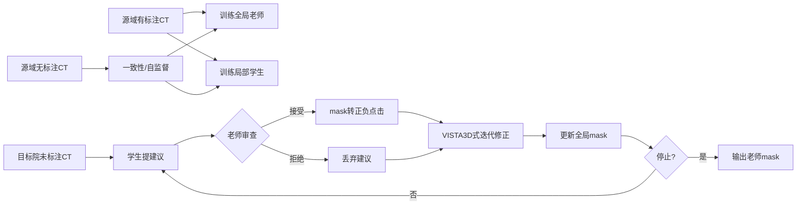

# 请用中文完成一个医学3D CT分割研究构想的定向近邻综述与可行性分析。核心意图必须准确：训练时全局老师和多个局部学生学习相同来源中心材料；老师学习整体解剖/全局

**Question:** 请用中文完成一个医学3D CT分割研究构想的定向近邻综述与可行性分析。核心意图必须准确：训练时全局老师和多个局部学生学习相同来源中心材料；老师学习整体解剖/全局上下文，学生分别专长于不同解剖结构、局部区域或细节。测试时面对新医院未标注CT，各局部学生产生其擅长区域的标注建议；全局老师根据图像和全局证据审查这些不同意见，只将认可的局部意见转换为正负点击，驱动VISTA3D或类似交互式3D分割老师逐轮修改自己的全局mask。最终输出是修正后的老师结果。所有参数测试时冻结，仅更新mask和prompt，不使用目标中心真值。目标是少量来源中心标注（另有来源中心未标注CT）下改善跨中心预测。这不是只在训练时用SAM造伪标签后单独部署学生，也不是目标域参数微调。用户已有公共文献：VISTA3D: A Unified Segmentation Foundation Model For 3D Medical Imaging; REDNet: Reliable Evidential Discounting Network for Multi-Modality Medical Image Segmentation; Learned iterative segmentation of highly variable anatomy from limited data: Applications to whole heart segmentation for congenital heart disease (Pace et al 2022); Deep Closing; SDF4CHD; NETracer; Structure-aware Semantic Discrepancy and Consistency for 3D Medical Image Self-supervised Learning; Hierarchical Semantic Concept Modeling for Generalizable Myocardial Pathology Segmentation on Multisequence CMR Images; Unsupervised Domain Adaptation with Variational Approximation for Cardiac Segmentation.请以这些文献为锚点，1)核对有没有已经实现global-local specialist协同、自动mask-to-click、teacher接受/拒绝local advice、测试时3D迭代纠错的论文，优先原始论文和可查方法；2)筛最接近5篇并分解哪些部件相同、哪些差异真实、哪些只是换模型；3)提出有标注源域上如何监督训练局部专家及老师的点击意见审查，如何使用源域无标签数据但保持目标域只预测，训练和推理各自的因果数据流；4)指出需要证明的互补性、错误建议拒绝、罕见病理不过度正常化、域迁移及计算开销，设计最便宜的否定性实验和基线。明确已读全文/仅摘要，区分原文事实与拟议方法，不声称全新或保证跨中心改善，不编性能。报告按原理综合而非论文长清单；文献检索截至2026-10-24。不要保存到任何已有文献集合。

# 该设想**可行但尚无完整先例**

这个研究问题可拆成三部分：**是否已有完整先例**、**与最接近方法的真实距离**、以及**在只做目标域预测前提下的可行训练/推理设计**。现有文献已经分别覆盖了3D交互式老师、迭代纠错、可靠性折扣/证据审查、形状先验与跨域泛化中的若干部件，但没有检索到一篇已明确实现“global teacher + multiple local specialists + advice acceptance/rejection + mask-to-click + frozen test-time iterative correction”这一整链条的方法 [[1.1]](https://consensus.app/papers/vista3d-a-unified-segmentation-foundation-model-for-3d-he-guo/9f9130fa6d6a524e9b0f264933f82a6a/) [[1.2]](https://consensus.app/papers/vista3d-a-unified-segmentation-foundation-model-for-3d-he-guo/9f9130fa6d6a524e9b0f264933f82a6a/) [[2.1]](https://consensus.app/papers/learned-iterative-segmentation-of-highly-variable-pace-dalca/f84b5fa77b115c5881daaf3d17bc3b63/) [[3.1]](https://consensus.app/papers/rednet-reliable-evidential-discounting-network-for-sun-chen/8861fb43596755bf91ab3df0ab444244/) [[4.1]](https://consensus.app/papers/deep-closing-enhancing-topological-connectivity-in-wu-chen/0e552baab05254c6a1e5cf9302fdc63c/).

## 先例核对

最接近“**测试时3D迭代纠错**”的是Pace系列，而不是global-local协同框架。Pace 2022把分割建模为从单个用户点击出发、递归演化到停止点的序列，并且训练时显式让网络学习纠正自己先前的不完美分割，因此证明了“冻结参数、只靠当前mask状态递归修正”的思想在3D心脏分割中是成立的 [[2.1]](https://consensus.app/papers/learned-iterative-segmentation-of-highly-variable-pace-dalca/f84b5fa77b115c5881daaf3d17bc3b63/) [[2.2]](https://consensus.app/papers/learned-iterative-segmentation-of-highly-variable-pace-dalca/f84b5fa77b115c5881daaf3d17bc3b63/) [[2.3]](https://consensus.app/papers/learned-iterative-segmentation-of-highly-variable-pace-dalca/f84b5fa77b115c5881daaf3d17bc3b63/). 但该路线的点击来自用户或模拟用户点击，不是由多个局部专家自动提出后再由全局老师审查 [[2.4]](https://consensus.app/papers/learned-iterative-segmentation-of-highly-variable-pace-dalca/f84b5fa77b115c5881daaf3d17bc3b63/) [[2.5]](https://consensus.app/papers/learned-iterative-segmentation-of-highly-variable-pace-dalca/f84b5fa77b115c5881daaf3d17bc3b63/).

VISTA3D最接近“**老师作为交互式3D修正器**”这一角色。它明确把高精度自动分割、3D交互式修正、以及零样本/迁移能力纳入同一工作流，并强调3D交互设计用于高效修正已有结果 [[1.3]](https://consensus.app/papers/vista3d-a-unified-segmentation-foundation-model-for-3d-he-guo/9f9130fa6d6a524e9b0f264933f82a6a/) [[1.4]](https://consensus.app/papers/vista3d-a-unified-segmentation-foundation-model-for-3d-he-guo/9f9130fa6d6a524e9b0f264933f82a6a/) [[1.5]](https://consensus.app/papers/vista3d-a-unified-segmentation-foundation-model-for-3d-he-guo/9f9130fa6d6a524e9b0f264933f82a6a/) [[1.6]](https://consensus.app/papers/vista3d-a-unified-segmentation-foundation-model-for-3d-he-guo/9f9130fa6d6a524e9b0f264933f82a6a/). 但提供的证据没有显示VISTA3D已实现“自动把其他模型的mask建议转成正负点击，并由老师接受/拒绝建议”的机制 [[1.1]](https://consensus.app/papers/vista3d-a-unified-segmentation-foundation-model-for-3d-he-guo/9f9130fa6d6a524e9b0f264933f82a6a/) [[1.7]](https://consensus.app/papers/vista3d-a-unified-segmentation-foundation-model-for-3d-he-guo/9f9130fa6d6a524e9b0f264933f82a6a/).

“**接受/拒绝局部建议**”最接近的不是交互分割论文，而是证据折扣融合论文。REDNet、CDE-Net和更早的contextual discounting工作都把不同来源的证据按可靠性打折，再融合成最终决策；这与“老师只采纳可信学生意见”的逻辑同构，但这些工作处理的是多模态证据或多源证据融合，不是把局部分割建议转换为点击来驱动3D交互老师 [[3.2]](https://consensus.app/papers/rednet-reliable-evidential-discounting-network-for-sun-chen/8861fb43596755bf91ab3df0ab444244/) [[3.1]](https://consensus.app/papers/rednet-reliable-evidential-discounting-network-for-sun-chen/8861fb43596755bf91ab3df0ab444244/) [[5.1]](https://consensus.app/papers/evidence-modeling-for-reliability-learning-and-zhao-li/9606b761c67157bd9a8526c23c787084/) [[5.2]](https://consensus.app/papers/evidence-modeling-for-reliability-learning-and-zhao-li/9606b761c67157bd9a8526c23c787084/) [[6.1]](https://consensus.app/papers/evidence-fusion-with-contextual-discounting-for-huang-denoeux/612dcbbd2c7854d7af6519961fe842f1/).

- **结论1：** 未见已公开方法完整实现四件套：global-local specialist协同、自动mask-to-click、老师接受/拒绝建议、测试时冻结参数的3D迭代纠错 [[1.1]](https://consensus.app/papers/vista3d-a-unified-segmentation-foundation-model-for-3d-he-guo/9f9130fa6d6a524e9b0f264933f82a6a/) [[2.1]](https://consensus.app/papers/learned-iterative-segmentation-of-highly-variable-pace-dalca/f84b5fa77b115c5881daaf3d17bc3b63/) [[3.1]](https://consensus.app/papers/rednet-reliable-evidential-discounting-network-for-sun-chen/8861fb43596755bf91ab3df0ab444244/).
- **结论2：** 现有文献已分别证明交互修正、递归纠错、可靠性折扣、形状约束都可单独成立，因此该设想更像**部件级组合创新**而非凭空假设 [[1.5]](https://consensus.app/papers/vista3d-a-unified-segmentation-foundation-model-for-3d-he-guo/9f9130fa6d6a524e9b0f264933f82a6a/) [[2.6]](https://consensus.app/papers/learned-iterative-segmentation-of-highly-variable-pace-dalca/f84b5fa77b115c5881daaf3d17bc3b63/) [[4.2]](https://consensus.app/papers/deep-closing-enhancing-topological-connectivity-in-wu-chen/0e552baab05254c6a1e5cf9302fdc63c/).
- **结论3：** “自动mask-to-click”在给定材料中没有现成原始论文直接命中，只能由模拟点击与交互式分割文献外推为拟议模块，而不能当作文献事实陈述 [[2.4]](https://consensus.app/papers/learned-iterative-segmentation-of-highly-variable-pace-dalca/f84b5fa77b115c5881daaf3d17bc3b63/) [[7.1]](https://consensus.app/papers/promise-promptdriven-3d-medical-image-segmentation-using-li-liu/2c18a4ac2eb95d069958ea4d20b48e6b/).

## 最近邻五篇

下表按“与您的设想的结构相似度”而非单篇性能排序，并区分**原文事实**与**真实差异**。

与设想最接近的五篇

| 论文 | 与设想相同的部件 | 真实差异 | 更像“换模型”还是“换问题” |
|---|---|---|---|
| VISTA3D | 3D交互式老师；支持结果编辑；全流程工作流 [[1.4]](https://consensus.app/papers/vista3d-a-unified-segmentation-foundation-model-for-3d-he-guo/9f9130fa6d6a524e9b0f264933f82a6a/) | 无多局部学生；无建议审查；无mask-to-click仲裁 [[1.1]](https://consensus.app/papers/vista3d-a-unified-segmentation-foundation-model-for-3d-he-guo/9f9130fa6d6a524e9b0f264933f82a6a/) | **换问题** |
| Pace 2022 | 测试时递归修正当前mask；模拟点击；小样本稳健性 [[2.2]](https://consensus.app/papers/learned-iterative-segmentation-of-highly-variable-pace-dalca/f84b5fa77b115c5881daaf3d17bc3b63/) [[2.4]](https://consensus.app/papers/learned-iterative-segmentation-of-highly-variable-pace-dalca/f84b5fa77b115c5881daaf3d17bc3b63/) | 单结构/单交互链；无多专家协同；非跨中心CT设定 [[2.7]](https://consensus.app/papers/learned-iterative-segmentation-of-highly-variable-pace-dalca/f84b5fa77b115c5881daaf3d17bc3b63/) [[2.6]](https://consensus.app/papers/learned-iterative-segmentation-of-highly-variable-pace-dalca/f84b5fa77b115c5881daaf3d17bc3b63/) | **换问题** |
| REDNet | 对不可靠证据做折扣；融合前先评估一致性/差异 [[3.3]](https://consensus.app/papers/rednet-reliable-evidential-discounting-network-for-sun-chen/8861fb43596755bf91ab3df0ab444244/) [[3.2]](https://consensus.app/papers/rednet-reliable-evidential-discounting-network-for-sun-chen/8861fb43596755bf91ab3df0ab444244/) | 处理多模态而非多局部专家；输出直接融合，不是点击驱动修正 [[3.1]](https://consensus.app/papers/rednet-reliable-evidential-discounting-network-for-sun-chen/8861fb43596755bf91ab3df0ab444244/) | **换问题** |
| Deep Closing | 用形状/拓扑先验修正前一阶段分割；关注断裂区域 [[4.3]](https://consensus.app/papers/deep-closing-enhancing-topological-connectivity-in-wu-chen/0e552baab05254c6a1e5cf9302fdc63c/) [[4.4]](https://consensus.app/papers/deep-closing-enhancing-topological-connectivity-in-wu-chen/0e552baab05254c6a1e5cf9302fdc63c/) | 不是交互老师；不是多专家仲裁；更偏后处理拓扑修复 [[4.1]](https://consensus.app/papers/deep-closing-enhancing-topological-connectivity-in-wu-chen/0e552baab05254c6a1e5cf9302fdc63c/) | **部分换模型** |
| PROMISE / FATE-SAM | 利用点提示或少样本支持实现3D分割；强调不必再训练或少训练 [[7.1]](https://consensus.app/papers/promise-promptdriven-3d-medical-image-segmentation-using-li-liu/2c18a4ac2eb95d069958ea4d20b48e6b/) [[8.1]](https://consensus.app/papers/fewshot-adaptation-of-trainingfree-foundation-model-for-he-hu/e021b9049e0a5c31a50b111aebb4aa9f/) [[8.2]](https://consensus.app/papers/fewshot-adaptation-of-trainingfree-foundation-model-for-he-hu/e021b9049e0a5c31a50b111aebb4aa9f/) | 没有老师审查学生意见；没有局部专家协作；不是测试时闭环纠错系统 [[8.3]](https://consensus.app/papers/fewshot-adaptation-of-trainingfree-foundation-model-for-he-hu/e021b9049e0a5c31a50b111aebb4aa9f/) [[8.4]](https://consensus.app/papers/fewshot-adaptation-of-trainingfree-foundation-model-for-he-hu/e021b9049e0a5c31a50b111aebb4aa9f/) | **多为换模型** |

**Figure 1:** Five nearest methods and their real gaps

更细一点看，VISTA3D提供了最像“老师”的操作界面，Pace提供了最像“递归改mask”的动力学，REDNet/CDE-Net提供了最像“审查学生意见”的可靠性逻辑，Deep Closing提供了最像“局部错误由全局形状先验纠偏”的修复目标，而PROMISE、ENSAM、FATE-SAM说明3D提示式分割与有限数据训练是可操作的工程底座 [[1.5]](https://consensus.app/papers/vista3d-a-unified-segmentation-foundation-model-for-3d-he-guo/9f9130fa6d6a524e9b0f264933f82a6a/) [[2.8]](https://consensus.app/papers/learned-iterative-segmentation-of-highly-variable-pace-dalca/f84b5fa77b115c5881daaf3d17bc3b63/) [[3.4]](https://consensus.app/papers/rednet-reliable-evidential-discounting-network-for-sun-chen/8861fb43596755bf91ab3df0ab444244/) [[4.2]](https://consensus.app/papers/deep-closing-enhancing-topological-connectivity-in-wu-chen/0e552baab05254c6a1e5cf9302fdc63c/) [[9.1]](https://consensus.app/papers/ensam-an-efficient-foundation-model-for-interactive-stenhede-bjørnstad/ceaf189786705841b9466fefa8d25aad/) [[9.2]](https://consensus.app/papers/ensam-an-efficient-foundation-model-for-interactive-stenhede-bjørnstad/ceaf189786705841b9466fefa8d25aad/).

## 因果数据流

较合理的**拟议方法**是把老师和学生都训练在同一来源中心分布上，但职责分开。老师学全局CT解剖与交互修正；学生按结构、子区域或误差类型分工；训练时用有标注源域把学生建议与真值误差对齐，生成“该建议应被接受还是拒绝”的监督标签。Pace已经证明可用不完整/错误输入mask训练递归修正器，且可通过模拟点击构造监督；这为老师端“从当前mask到下一步mask”的监督提供了直接模板 [[2.9]](https://consensus.app/papers/learned-iterative-segmentation-of-highly-variable-pace-dalca/f84b5fa77b115c5881daaf3d17bc3b63/) [[2.2]](https://consensus.app/papers/learned-iterative-segmentation-of-highly-variable-pace-dalca/f84b5fa77b115c5881daaf3d17bc3b63/) [[10.1]](https://consensus.app/papers/iterative-segmentation-from-limited-training-data-pace-dalca/ea1806b56b1b5989b5804173b381998d/).

源域无标签CT更适合只用于**不触碰目标域**的表征稳健化和一致性约束，而不是伪装成目标域适配。用户列出的自监督/语义一致性方向虽未给出全文摘句，但现有证据已表明在标注稀缺时，通用预训练特征、有限数据下的3D foundation式训练、以及外部数据知识迁移都能作为更强的generalist baseline；同时VISTA3D本身也是在大规模、异质标签与伪标签/超体素混合配方上建立能力 [[1.8]](https://consensus.app/papers/vista3d-a-unified-segmentation-foundation-model-for-3d-he-guo/9f9130fa6d6a524e9b0f264933f82a6a/) [[11.1]](https://consensus.app/papers/adaptability-of-vision-foundation-models-for-3d-medical-ahn-lee/856185a20c4757dcbeb2611be2ff8209/) [[11.2]](https://consensus.app/papers/adaptability-of-vision-foundation-models-for-3d-medical-ahn-lee/856185a20c4757dcbeb2611be2ff8209/) [[11.3]](https://consensus.app/papers/adaptability-of-vision-foundation-models-for-3d-medical-ahn-lee/856185a20c4757dcbeb2611be2ff8209/).

**训练与测试因果流**

**Figure 2:** Frozen test-time correction with reviewed local advice

- **训练流：** 源域有标注CT监督学生的结构专长、老师的全局mask更新、以及“建议是否有助于纠错”的审查器标签。
- **无标注源域：** 只做源域内一致性、自训练或形状先验约束，不接触目标中心真值，也不在目标中心更新参数 [[1.8]](https://consensus.app/papers/vista3d-a-unified-segmentation-foundation-model-for-3d-he-guo/9f9130fa6d6a524e9b0f264933f82a6a/) [[8.1]](https://consensus.app/papers/fewshot-adaptation-of-trainingfree-foundation-model-for-he-hu/e021b9049e0a5c31a50b111aebb4aa9f/).
- **推理流：** 目标CT上全部参数冻结，学生仅产出建议，老师只更新prompt与mask状态，符合您要求的**目标域只预测**设定 [[1.9]](https://consensus.app/papers/vista3d-a-unified-segmentation-foundation-model-for-3d-he-guo/9f9130fa6d6a524e9b0f264933f82a6a/) [[8.1]](https://consensus.app/papers/fewshot-adaptation-of-trainingfree-foundation-model-for-he-hu/e021b9049e0a5c31a50b111aebb4aa9f/).

## 关键证明与最便宜实验

必须证明的不是“又一个teacher-student”，而是四个更具体命题。第一，学生之间确有**互补性**，而不是同质冗余；第二，老师的审查器能拒绝坏建议，否则多学生只会放大错误；第三，在严重畸形或罕见病理中，全局先验不会把异常结构过度拉回“正常心脏/正常器官”；HVSMR-2.0已明确指出 severe 病例、左右混淆、异常连接是分割难点，且小数据训练的网络在 severe 组明显更差，这正是应优先做否定性验证的人群 [[12.1]](https://consensus.app/papers/hvsmr20-a-3d-cardiovascular-mr-dataset-for-wholeheart-pace-contreras/1c041af7a4475909b46d5bd32385654e/) [[12.2]](https://consensus.app/papers/hvsmr20-a-3d-cardiovascular-mr-dataset-for-wholeheart-pace-contreras/1c041af7a4475909b46d5bd32385654e/) [[12.3]](https://consensus.app/papers/hvsmr20-a-3d-cardiovascular-mr-dataset-for-wholeheart-pace-contreras/1c041af7a4475909b46d5bd32385654e/).

最便宜的实验设计应先做**拆件否定**，而不是直接追求SOTA。先比较：单老师自动分割、单老师+随机点击、单老师+自动mask-to-click、老师+多学生但无审查、老师+多学生+审查。再做拒绝率-收益曲线，观察审查器拒绝越多是否真正减少灾难性错误。再按常见/罕见解剖、连接性结构/实体器官、轻中重域偏移分层。Deep Closing提示连接性指标必须单列；Pace提示严重解剖变异应单列；交互模型则应用AUC式多轮指标而非只看最终Dice [[4.1]](https://consensus.app/papers/deep-closing-enhancing-topological-connectivity-in-wu-chen/0e552baab05254c6a1e5cf9302fdc63c/) [[12.4]](https://consensus.app/papers/hvsmr20-a-3d-cardiovascular-mr-dataset-for-wholeheart-pace-contreras/1c041af7a4475909b46d5bd32385654e/) [[9.3]](https://consensus.app/papers/ensam-an-efficient-foundation-model-for-interactive-stenhede-bjørnstad/ceaf189786705841b9466fefa8d25aad/) [[9.4]](https://consensus.app/papers/ensam-an-efficient-foundation-model-for-interactive-stenhede-bjørnstad/ceaf189786705841b9466fefa8d25aad/).

- **最低成本基线：** VISTA3D或同类老师单独运行，作为零协同基线 [[1.1]](https://consensus.app/papers/vista3d-a-unified-segmentation-foundation-model-for-3d-he-guo/9f9130fa6d6a524e9b0f264933f82a6a/).
- **关键否定实验：** 把审查器换成“全收”与“全拒”，检验收益是否来自**审查**而非仅来自多提示数量 [[3.1]](https://consensus.app/papers/rednet-reliable-evidential-discounting-network-for-sun-chen/8861fb43596755bf91ab3df0ab444244/) [[5.1]](https://consensus.app/papers/evidence-modeling-for-reliability-learning-and-zhao-li/9606b761c67157bd9a8526c23c787084/).
- **计算开销对照：** 比较1名老师、老师+1学生、老师+多学生的时延与显存；ENSAM与VFM适配研究都强调计算预算是实际约束，不应只报精度 [[9.2]](https://consensus.app/papers/ensam-an-efficient-foundation-model-for-interactive-stenhede-bjørnstad/ceaf189786705841b9466fefa8d25aad/) [[11.2]](https://consensus.app/papers/adaptability-of-vision-foundation-models-for-3d-medical-ahn-lee/856185a20c4757dcbeb2611be2ff8209/).

总体判断是：这个设想**有文献部件支撑，缺少完整先例，具备研究可行性，但新意主要在闭环协同机制而非单个网络本身**。最稳妥的写法应把它表述为“基于已知交互式3D老师、递归纠错和可靠性折扣的组合性研究假说”，并把跨中心改善当作待验证结果，而不是预设结论。
 
_These search results were found and analyzed using Consensus, an AI-powered search engine for research. Try it at https://consensus.app. © 2026 Consensus NLP, Inc. Personal, non-commercial use only; redistribution requires copyright holders’ consent._
 
## References
 
`1.` He Y, Guo P, Tang Y, et al. VISTA3D: A Unified Segmentation Foundation Model For 3D Medical Imaging. *2025 IEEE/CVF Conference on Computer Vision and Pattern Recognition (CVPR).* 2024. doi:10.1109/cvpr52734.2025.01943
 
> [1.1] The first unified foundation model that supports a full annotation workflow, and achieves state-of-the-art 3D promptable automatic segmentation and interactive editing, benchmarked over 14 challenging datasets with 127 classes and compared with well-established baselines. (Introduction)
 
> [1.2] All the components of VISTA3D are designed to fulfill our proposed humanin-the-loop workflow, such that VISTA3D can be used outof-the-box to save human effort. (Conclusion)
 
> [1.3] We envision that a foundation model for 3D medical image segmentation should support a full workflow (Fig. (Introduction)
 
> [1.4] 2) Ability to interact with human experts, allowing for effective refinements of existing segmentation results; (Introduction)
 
> [1.5] It achieved highly accurate segmentation comparable with specialized expert models for each dataset, state-of-the-art interactive segmentation for both zero-shot and results editing, and strong transfer learning ability. (Conclusion)
 
> [1.6] Additionally, VISTA3D’s 3D interactive design allows efficient human correction, and a novel 3D supervoxel method that distills 2D pre-trained backbones grants VISTA3D top 3D zero-shot performance. (Abstract)
 
> [1.7] In this paper, we introduced VISTA3D, the first unified 3D CT foundation segmentation model. (Conclusion)
 
> [1.8] We curated a large CT dataset with 11454 scans, paired it with partial manual labels, pseudo labels, and supervoxels, and proposed a novel four-stage training recipe to tackle the challenges to achieve state-of-the-art performances and editing experiences. (Introduction)
 
> [1.9] This seems like an optimal case because it does not require model finetuning or time-consuming human input. (Introduction)
 
`2.` Pace DF, Dalca AV, Brosch T, et al. Learned iterative segmentation of highly variable anatomy from limited data: Applications to whole heart segmentation for congenital heart disease. *Medical image analysis.* 2022;80:102469 - 102469. doi:10.1016/j.media.2022.102469
 
> [2.1] Implemented as a recurrent neural network, the model evolves a segmentation over multiple steps, from a single user click until reaching an automatically determined stopping point. (Abstract)
 
> [2.2] During training, the network must learn to correct errors in its input while simultaneously growing the segmentation appropriately. (Body)
 
> [2.3] Hence, the trained model will be more robust when it operates recursively. (Body)
 
> [2.4] For each cardiac structure, a simulated user click was created using morphological and center-of-mass calculations. (Body)
 
> [2.5] The user can easily refine the final segmentation by examining those that are earlier or later in the output sequence. (Abstract)
 
> [2.6] Using a dataset of 3D cardiac MR scans from patients with a wide range of CHD types, we show that our iterative model offers better generalization to patients with the most severe heart malformations. (Abstract)
 
> [2.7] Binary iterative segmentation can learn spatial correlations between subparts of a single anatomical structure, while multiclass iterative segmentation can learn correlations between them. (Body)
 
> [2.8] Iterative segmentation also implicitly expands the model’s field of view without increasing its complexity. (Body)
 
> [2.9] We address this by corrupting each label of yin using random nonrigid deformations and also add random foreground blobs that vary in number, location and size (Fig. 7). (Body)
 
`3.` Sun S, Chen Y, Yue X,  C, Zhuang X. REDNet: Reliable Evidential Discounting Network for Multi-Modality Medical Image Segmentation. *IEEE Transactions on Medical Imaging.* 2025;45:16-27. doi:10.1109/tmi.2025.3591124
 
> [3.1] This approach maintains segmentation accuracy by effectively integrating multi-modality evidence, while discounting the influence of lower-quality data, ensuring reliable results despite the presence of image imperfections. (Abstract)
 
> [3.2] 3) the Discounting Fusion Module (DFM) processing the multi-modality evidence by applying discounting strategies to fuse the data. (Abstract)
 
> [3.3] 1) the Intra-modality Consistency Evaluation Module (ICEM) measuring the data cohesion within the same modality; (Abstract)
 
> [3.4] REDNet outperforms other methods, particularly in scenarios with imperfect image sources, and achieves reliable results in multi-modality tumor segmentation. (Abstract)
 
`4.` Wu Q, Chen Y, Liu W, Yue X, Zhuang X. Deep Closing: Enhancing Topological Connectivity in Medical Tubular Segmentation. *IEEE Transactions on Medical Imaging.* 2024;43:3990-4003. doi:10.1109/tmi.2024.3405982
 
> [4.1] The results demonstrate that our approach yields considerable improvements in topological performance compared with existing methods. (Abstract)
 
> [4.2] Furthermore, Deep Closing exhibits the ability to generalize and transfer knowledge from external datasets, showcasing its robustness and adaptability. (Abstract)
 
> [4.3] Deep Closing first leverages an AutoEncoder trained in the Masked Image Modeling (MIM) paradigm, enhanced with digital topology knowledge, to effectively learn the inherent shape prior of tubular structures and indicate potential disconnected regions. (Abstract)
 
> [4.4] Subsequently, a Simple Components Erosion module is employed to generate topology-focused outcomes, which refines the preceding segmentation results, ensuring all the generated regions are topologically significant. (Abstract)
 
`5.` Zhao J, Li S. Evidence modeling for reliability learning and interpretable decision-making under multi-modality medical image segmentation. *Computerized medical imaging and graphics : the official journal of the Computerized Medical Imaging Society.* 2024;116:102422. doi:10.1016/j.compmedimag.2024.102422
 
> [5.1] Then, it leverages the contextual discounted fusion layer to learn the reliability provided by each modality. (Abstract)
 
> [5.2] Moreover, this study elaborates on the framework interpretability by discussing the consistency between pixel attribution maps and the learned reliability coefficients. (Abstract)
 
`6.` Huang L, Denoeux T, Vera P, Ruan S. Evidence fusion with contextual discounting for multi-modality medical image segmentation. 2022. doi:10.48550/arxiv.2206.11739
 
> [6.1] The framework is composed of an encoder-decoder feature extraction module, an evidential segmentation module that computes a belief function at each voxel for each modality, and a multi-modality evidence fusion module, which assigns a vector of discount rates to each modality evidence and combines the discounted evidence using Dempster's rule. (Abstract)
 
`7.` Li H, Liu H, Hu D, Wang J, Oguz I. PROMISE: PROMPT-DRIVEN 3D MEDICAL IMAGE SEGMENTATION USING PRETRAINED IMAGE FOUNDATION MODELS. *Proceedings. IEEE International Symposium on Biomedical Imaging.* 2023;2024. doi:10.1109/isbi56570.2024.10635207
 
> [7.1] In this paper, we propose ProMISe, a prompt-driven 3D medical image segmentation model using only a single point prompt to leverage knowledge from a pretrained 2D image foundation model. (Abstract)
 
`8.` He X, Hu Y, Zhou Z, Jarraya M, Liu F. Few-Shot Adaptation of Training-Free Foundation Model for 3D Medical Image Segmentation. *ArXiv.* 2025;abs/2501.09138. doi:10.48550/arxiv.2501.09138
 
> [8.1] The primary contributions of this study are as follows: - Training-Free Adaptation: We adapted SAM2 for medical image segmentation without requiring model finetuning. (Introduction)
 
> [8.2] - Prompt-Free Segmentation: We designed a few-shot adaptation pipeline that leverages a limited number of support examples to capture anatomical knowledge and eliminate the need for manual prompts. (Introduction)
 
> [8.3] - Volumetric Consistency: We introduced a volumetric mechanism to enforce 3D spatial consistency within a 3D medical volume. (Introduction)
 
> [8.4] To handle the volumetric nature of medical images, we incorporate a Volumetric Consistency mechanism that enhances spatial coherence across 3D slices. (Abstract)
 
`9.` Stenhede E, Bjørnstad AM, Ranjbar A. ENSAM: an efficient foundation model for interactive segmentation of 3D medical images. 2025. doi:10.1007/978-3-032-23496-4_2
 
> [9.1] As part of the CVPR 2025 Foundation Models for Interactive 3D Biomedical Image Segmentation Challenge, ENSAM was evaluated on hidden test set with multimodal 3D medical images, obtaining a DSC AUC of 2.404, NSD AUC of 2.266, final DSC of 0.627, and final NSD of 0.597, outperforming two previously published baseline models (VISTA3D, SAM-Med3D) and matching the third (SegVol), surpassing its performance in final DSC but trailing behind in the other three metrics. (Abstract)
 
> [9.2] ENSAM is designed to achieve good performance under limited data and computational budgets, and is trained from scratch on under 5,000 volumes from multiple modalities (CT, MRI, PET, ultrasound, microscopy) on a single 32 GB GPU in 6 hours. (Abstract)
 
> [9.3] Each interactive segmentation is evaluated using the Dice Similarity Coefficient (DSC) and Normalized Surface Distance (NSD), which measure segmentation region overlap and boundary accuracy, respectively. (Body)
 
> [9.4] [1 A complete list is available at https://medsam-datasetlist.github.io/](https://medsam-datasetlist.github.io/) Ranking of participants is performed using four metrics: Area Under the Curve (AUC) for DSC and NSD, as well as final AUC and NSD. (Body)
 
`10.` Pace DF, Dalca AV, Brosch T, et al. Iterative Segmentation from Limited Training Data: Applications to Congenital Heart Disease. *Deep learning in medical image analysis and multimodal learning for clinical decision support : 4th International Workshop, DLMIA 2018, and 8th International Workshop, ML-CDS 2018, held in conjunction with MICCAI 2018, Granada, Spain, S..* 2018;11045:334 - 342. doi:10.1007/978-3-030-00889-5_38
 
> [10.1] To this end, we train our segmentation propagation model by presenting incomplete and/or inaccurate input segmentations paired with a recommended next step. (Abstract)
 
`11.` Ahn S, Lee D, Park J. Adaptability of Vision Foundation Models for 3D Medical Image Segmentation. *IEEE Open Journal of Signal Processing.* 2026;7:82-90. doi:10.1109/ojsp.2025.3650437
 
> [11.1] Our findings are as follows: r Adapted VFMs consistently outperform non-pretrained and full 3D ViT-based and Swin-based architectures, and even the pretrained SwinUNETR model, despite the substantial domain shift from natural to medical images. (Body)
 
> [11.2] This establishes VFMs as a powerful and cost-effective generalist baseline for 3D medical segmentation, especially with limited available data. (Body)
 
> [11.3] Our results establish VFMs as a powerful and cost-effective generalist baseline, consistently outperforming non-pretrained and standard 3D ViT architectures despite the substantial domain shift. (Abstract)
 
`12.` Pace DF, Contreras HTM, Romanowicz J, et al. HVSMR-2.0: A 3D cardiovascular MR dataset for whole-heart segmentation in congenital heart disease. *Scientific Data.* 2024;11. doi:10.1038/s41597-024-03469-9
 
> [12.1] Our previous work31 found that segmentation neural networks typically perform well on both “mild” and “moderate” cases but are significantly challenged by the “severe” cases. (Body)
 
> [12.2] In particular, networks may encounter challenges in distinguishing between left and right in severe cases with heterotaxy, dextrocardia, single ventricle, or common atrium. (Body)
 
> [12.3] For example, a subsequent study31 found that, using a similar model architecture and training scheme, the accuracy after training on segmentations of the 20 HVSMR whole-heart segmentations and testing on the 40 new subjects yielded an average dice score of 87.7±14.6 for “mild”/“moderate” test subjects but only 64.6±31.9 for “severe” test subjects. (Body)
 
> [12.4] We encourage authors to similarly report their results on “mild”/“moderate” and “severe” cases separately. (Body)

