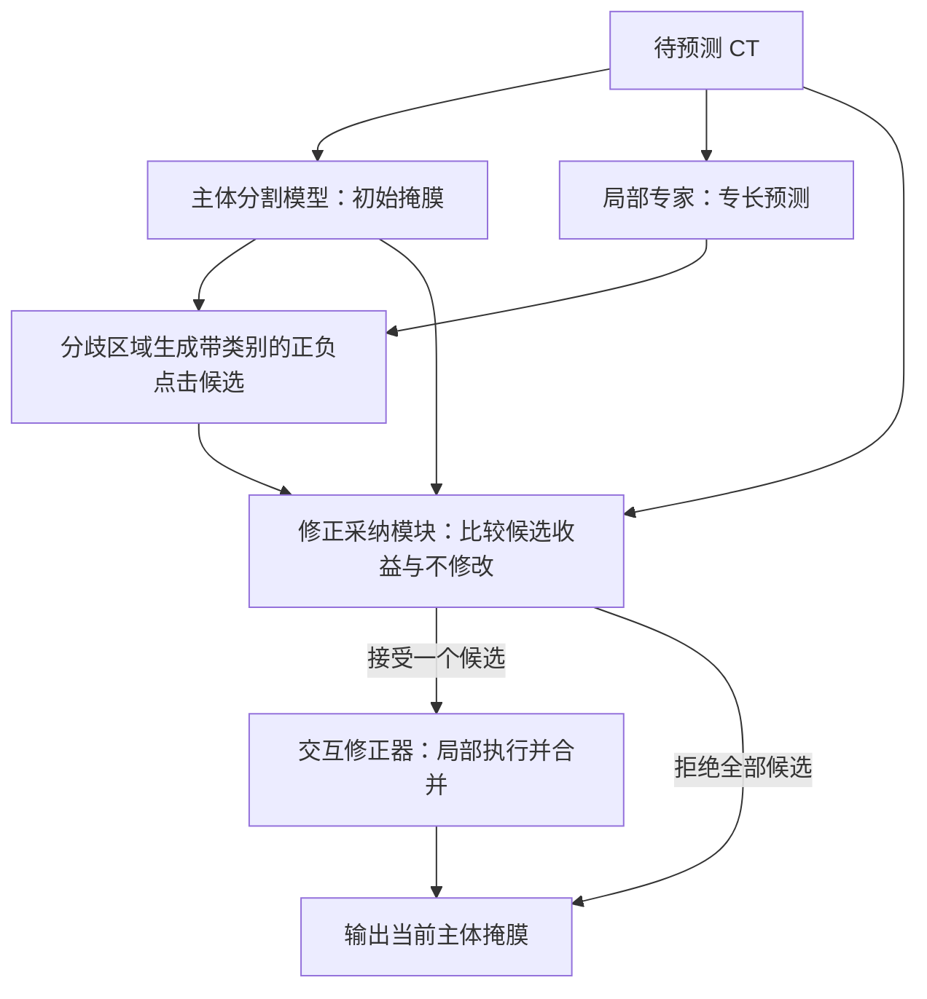

# 项目评估与角色命名

日期：2026-10-25。结论类型：研究设计评估与助手建议。未实现模型、未加载权重、未读取患者 CT、未运行分割实验。本轮没有重新运行 Academic Agent；已有快照与本轮核查范围分列。

## 总体判断

值得推进一个受控的机制验证实验，当前还不足以支撑完整方法有效或跨中心有效的结论。研究价值集中在：**同源少标注下形成的局部专家，能否通过可预测收益的点击动作，改善主体分割模型在外部中心的结果。**

文献与交接整理较完整，但数据可行性仍未审计。下一笔主要投入应购买“是否存在可执行修正收益”的证据，随后再决定是否训练采纳模块。先搭完整多专家系统会把训练、候选、交互执行和域偏移的问题混在一起，失败后难以定位。

## 角色命名

项目标题采用：**局部专家协同的 VISTA3D 选择性分割修正**。这是本轮编辑采用的名称，用户授权调整称呼；具体措辞由助手选择，可继续修改。

| 原称呼 | 当前称呼 | 英文 | 职责与边界 |
|---|---|---|---|
| 老师、全局老师 | 主体分割模型 | Primary segmenter | 产生初始整体分割，承载最终被修正的结果；称为主体不承诺编码器能同时看到完整 CT |
| 学生、局部学生 | 局部专家 | Local specialist | 强化已标注结构，在推理时继续提出意见；不预设参数量更小或处处弱于主体 |
| 老师判断、采纳头 | 修正采纳模块 | Refinement selector | 比较候选动作与不修改，预测执行后收益和损害；属于待训练的附加模块 |
| 点击分支、执行器 | 交互修正器 | Interactive refiner | VISTA3D 的点交互分支及局部合并流程，将选中动作作用到当前掩膜 |

主体分割模型和交互修正器可以是同一个 VISTA3D 的不同分支，不需要因此复制两套基础模型。训练用的 EMA teacher 若采用，仍应按其实际算法含义命名，不能与上述系统角色混淆。

“主模型／子模型”不能表达局部专长；“通才／专才”适合介绍文献，但容易将系统理解为已有 CGS 的直接复现。当前采用的名称更便于把分割、提议、判断和执行四项职责分清。历史用户原话、原始讨论、论文笔记与固定 Agent 快照保留原称呼。

## 对系统的理解

来源中心提供少量有标注 CT 集合 L 和额外未标注集合 U。主体与专家使用相同的当前病例池；通过专长采样、分辨率和目标权重产生不同能力。不能把“相同病例池”写成“历史预训练资源相同”。目标中心 CT 当前用于预测。

图示为单步机制验证。扩展多步时，每步都要从更新后的状态重建候选并判断停止。把专家预测压缩为点击是一种信息瓶颈：它可能保留主体的整体组织，也可能丢失专家已经预测好的边界。哪种效应占优，需要与直接融合实测比较。

## 证据与新颖性边界

本轮阅读范围：本项目当前方案、交接与实验计划；固定 Agent 导出中 VISTA3D、CGS、NeuroRefiner、DeferredSeg 的阅读卡；另在线核对以下一手来源。已有阅读卡为历史模型分析，本轮没有重新人工复核其中全部实验表格。

1. **VISTA3D 的接口基础成立。** 原文区分自动与点交互分支，并用局部合并控制修改范围；这支持用它承载候选动作，但不证明模型能识别不可靠的专家建议。原文 §4 的“单点”是每个滑窗 patch 一个点，且模拟纠错点来自真值错误区；不能直接解释为“全病例只用一个自动点即可获得同等改善”。[VISTA3D 原文 v3，§3.2、§4](https://arxiv.org/html/2406.05285v3)
2. **同源通才与专才训练已经有直接近邻。** CGS 通过类别专长头处理多目标半监督分割，§III-F 在推理时丢弃专长头。本项目保留专家参与推理的设计有区别；该区别本身仍须带来收益。[CGS 原文，§III-C、§III-F](https://arxiv.org/html/2504.00862v1)
3. **权重选择会决定链路能否落地。** 官方当前说明将 VISTA3D/NV-Segment-CT 标为自动与交互，NV-Segment-CTMR 标为仅自动。文档中的交互入口每次处理一个类别，并将未处理区域编码为 255。需要冻结具体版本、坐标变换与合并规则，不能把未处理区域当背景，也不能直接用更多类别的自动模型替代交互执行器。[作者仓库说明](https://github.com/Project-MONAI/VISTA/blob/main/vista3d/README.md)
4. **CT-PromptSAM 仍是待补核近邻。** 本轮检查了作者 README 和测试入口，未取得论文全文，不能据此认定其完整提示、筛选和训练机制。它仍影响新颖性判断，但当前证据不支持宣称本项目与它等价或已排除重合。[作者仓库](https://github.com/WangXin81/CT-PromptSAM/)

既有方案列出的 DnR、SegAgent、NeuroRefiner、DeferredSeg 分别覆盖专家反馈、点击轨迹、检查—修正—验证与空间路由。它们的具体结果本轮沿用已有阅读范围，未做全面更新检索。因此，**“全局加局部”“专家协作”“自动点击”不能单独承担创新主张**。较有研究价值的区别是：针对相关专家错误，学习当前执行器实际产生的增益，并在域偏移下评估收益—损害取舍。其新颖性和有效性都仍待验证。

## 可行性粗评

0 表示关键条件未满足或未核定，1 表示有条件支持，2 表示已有较强设计依据。此表是助手的主观投入排序，不是成功概率，不计算总分。

| 维度 | 评价 | 理由 |
|---|---|---|
| 临床／任务相关性 | 1/2 | 少标注与外部中心误差值得研究，但尚未锁定具体结构、下游用途和参考标准 |
| 文献机制支撑 | 2/2 | 专长训练、点击修正和建议筛选各有基础；组合效果没有证据 |
| 数据可得性 | 0/2 | 仅对话确认有数据，标签清单、患者数、划分和外部真值均未核定 |
| 可检验性 | 2/2 | 互补性、点击上界、采纳能力可以分开验证，并有明确的负结果解释 |
| 实现工作量 | 1/2 | 可复用三维分割与交互代码；少样本采纳训练、接口适配和反事实执行仍有成本 |
| 增量贡献 | 1/2 | 执行器相关的收益选择有潜力；需要胜过同预算融合、自修正与普通集成 |

## 六个关键问题

### 1. 专家有没有独立价值

同源数据既有利于控制标注预算，也会让主体与专家犯相关错误。专家在专长区域的平均 Dice 更高并不足够，关键是能否纠正主体实际出错的部分。

按患者和结构统计：主体错而专家对、主体对而专家错、两者共同错误、候选覆盖的可纠正错误。局部高分辨率的收益必须与“主体使用同样局部计算”的对照区分。若仅更换模型种子就有同样效果，证据支持普通集成，尚不支持专长机制。

### 2. 正确意见能否变成有益动作

点击体素正确不等于修改区域正确。交互修正可能忽略该点、过度扩张，或改变邻近结构。对每个候选，都应从同一个初始掩膜单独执行后评价。

建议先用固定候选池估计包含“不修改”的单步上界：

`G_exec(x) = max(0, max_a [Q(E(x, M, a), Y) - Q(M, Y)])`。

真值只用于来源开发数据上的事后分析；此上界包含真值辅助挑选的乐观性，不能作为部署成绩。若上界都很小，先修候选或执行器。若上界明显而学习策略取不到，才说明值得投入采纳学习。候选数必须固定报告，上界会随搜索预算改变。

### 3. 少标注条件下能否训练采纳模块

这是原方案容易低估的额外样本需求。一名患者产生很多点击，并不会产生同样多的独立患者。模型可能记住来源病例和某一执行器的错误模式。

先比较低维收益模型与简单置信度阈值，再考虑高容量编码器。采用患者级交叉拟合：用于产生收益样本的患者，不应进入对应主体与专家的拟合；采纳阈值与最终评价还需独立控制。交叉拟合各折应记录自己的模型版本与收益标签。最终若重新训练或更换主体、专家或执行器，需重新验证采纳模块，不能假定旧收益分布不变。病例过少无法支持这些层次时，应缩小研究主张或补标注，不能用 patch 数掩盖缺口。

收益首先报告原始质量变化 `ΔQ`，再按事先约定加入损害和成本惩罚。质量指标本身已包含一部分误改影响，额外损害项应解释其临床权重，避免无法解释的重复惩罚。所谓“风险分数”也不自动成为安全保证。

### 4. 点击通道是否值得保留

专家已经输出完整概率图。将它转成稀疏点击再重新生成边界，会损失一部分信息并增加执行成本。点击的潜在好处是限制修改范围、保留主体输出的一致性，但这必须实证。

必要对照依次加入：同一专家概率融合／局部替换、同预算主体局部细化、无专长的同容量集成、由主体自身生成的自动点击。不能只比较“主体”与“主体加全部新模块”，然后把增益都归因于专家选择。

### 5. 跨中心是第二层难题

需要同时检验专家能力能否迁移，以及采纳模块对收益的预测是否迁移。来源中心校准良好，不代表在外部中心仍可信。只测试未标注外院 CT，可以记录动作和输出，不能验证准确率或有害修改率。

首版建议来源中心训练、目标预测时固定参数。将来若使用目标未标注数据适配，应单列适配协议。先心病存在真实异常连接，不能靠“更正常”或连通块更少判断修改正确；拓扑评价必须依据实际标签和病型定义。

### 6. 工程预算与类别冲突尚未闭合

若候选数为 K，离线收益监督往往要为每例执行 K 次临时修正；多状态、交叉拟合与多种子还会继续增加成本。点击前预测可减少部署时试点次数，但不会免除专家前向和离线标签生成的开销。此处没有真实耗时或显存测量，不给出天数与 GPU 配置承诺。

另需确定类别互斥／重叠约定：按类别执行的二值修正合回多类结果时，重叠、空洞、未处理区域和负点移除区域应如何处理。正负点击必须绑定目标类别；“不是类别 c”不等于已知它属于另一个类别。评价必须在最终合并结果上完成，覆盖相邻类别的误改。

## 建议的投入顺序

以下是对已有 E1—E5 的优先级建议，没有启动任何实验，也未固定病例数或成功阈值。

| 阶段 | 最小交付 | 继续条件／改向解释 |
|---|---|---|
| 前置核对 | 真实标签与参考标准、患者／中心划分、可用标注预算；冻结带交互的检查点与接口 | 数据或自动初始化不支持任务时，先解决前置条件 |
| E1：互补性 | 一个主体与一个真实标签支持的局部专家；现有“两个专家”作为后续扩展建议 | 没有稳定可纠正错误则调整专长训练，不扩大专家数量 |
| E2：可执行收益 | 固定候选池、来源患者留出、真实执行后的单步上界与损害分布 | 直接融合有收益而点击没有时，优先检查点击信息损失与执行语义 |
| E3：选择能力 | 不修改、全部接受、简单阈值、轻量采纳模块 | 需要同时改善净收益和覆盖，不能以全拒绝获得零损害冒充有效 |
| E4：机制与成本 | 对最有希望的设置加入匹配计算预算的强对照 | 额外收益需区别于容量、分辨率和搜索次数 |
| E5：外部评价 | 锁定策略后在独立标注中心评价；报告患者级区间与病型分层 | 仅来源改善支持内部机制；外部不改善则跨中心假设尚未成立 |

每阶段保留逐患者配对结果，至少报告逐类 Dice／NSD、变差患者比例、相邻结构误改、修改覆盖、接受／停止率、点击数与实测计算成本。空掩膜规则与表面容忍距离应提前确定。小结构收益应单列，避免被总体均值稀释。

## 本轮结论与接续

当前最适合的研究定位是“局部专家驱动的选择性分割修正机制验证”。值得继续，优先证明有用意见确实存在且能经点击兑现；采纳模块与跨中心能力随后逐层检验。现阶段不宜将其描述为已成立的跨中心解决方案，也没有依据预测投稿级别或性能提升。

本轮已更新当前角色称呼、方案入口和交接状态；原始资料与固定 Agent 快照未改写。本机工作目录为 `D:/code_project/vista3d_local_expert_refinement`，历史记录中的 `D:/projects/...` 属于来源机器。当前原方案的详细设计仍见 [research_framework.md](research_framework.md)，本评估的新增建议尚未成为已执行协议。
