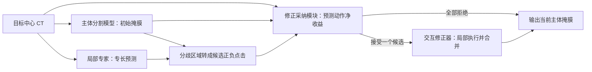

# 当前称呼与评估

数据集已按本轮用户请求具体化为 wholeheart，详细数据、标注预算和阶段计划见 [wholeheart 初步方案](wholeheart_initial_plan_2026-10-25.md)。该文档的 CT 优先、单专家、来源/目标划分和数值预算为待审阅建议；下文保留通用研究框架及历史研究记录。

当前采用主体分割模型（Primary segmenter）、局部专家（Local specialist）、修正采纳模块（Refinement selector）、交互修正器（Interactive refiner）。主体与交互修正器可以共享同一个 VISTA3D；局部专家在预测时保留。历史角色比喻不代表知识蒸馏或参数规模关系。完整评估、证据核查与分阶段投入建议见 [2026-10-25 项目评估](assessment-2026-10-25.md)。本文件保留原方案，评估中的单专家先行等内容仍是新增建议。

# 判断

这条思路有可借鉴的研究基础，值得做一个有明确失败判据的小实验。但“通才与专才协作”“判断是否采纳专家”“自动点击”“全局检查与局部修正”分别已有直接先例，不能把这些概念的组合本身当作已经成立的创新。

更具体的研究问题是：**同一来源中心、同一有限标注预算下训练出来的局部专家，能否提出主体分割模型遗漏的正确建议；修正采纳模块能否预测这些建议经交互修正器执行后的实际收益，并在外部中心选择性采纳？**

最终输出是经过修正的主体分割模型掩膜。局部专家在预测时继续工作。这里“主体分割模型”“局部专家”描述的是全局与局部的职责，不要求局部专家在所有位置都弱于主体分割模型，也不等于最终只部署局部专家的知识蒸馏。

# 原研究的工具运行记录

本节记录归档前的研究运行。当前评估没有重新调用 Academic Agent，旧绝对路径属于来源机器；本机入口见根 README。

运行的是 `D:/projects/testing_tools/academic_agent` 的 **Academic Agent 0.4.0**，不是 `academic_tools` 中的 ARS，也不是 Consensus。研究项目保存在：

`D:/projects/testing_tools/academic_agent/projects/vista_expert_clicks_20261025`

通过应用的真实检索接口调用 OpenAlex、Semantic Scholar 和 arXiv，执行五条定向查询，每来源每查询最多八条候选；原始响应、查询和筛选理由保留在项目数据库。OpenAlex 与 arXiv 成功；Semantic Scholar 五次查询均返回 429，未据此声称检索完整。书目年份可能是预印本年份，正式发表年份需另查。

主会话补充浏览一手论文、会议页面和作者仓库，核对关键机制。应用对全文文本进行阅读与独立 Codex 会话复核；“独立会话”不是不同模型的交叉验证，也不是人工学术准确率。最终运行数量、复核状态、失败恢复和导出目录见[归档运行记录](../archive/discussion/通用学术Agent运行记录_2026-10-25.json)。

文献材料与运行记录保留在本地，本轮没有运行分割实验或读取患者 CT。

执行完成：库内 61 条书目记录，选取 12 篇全文（4 篇本地、8 篇在线取得）完成阅读与复核。195 条提取陈述中，模型复核判为 193 条支持、2 条部分支持；这是工具复核结果，不是 98.97% 的人工准确率。两次运行中的结果因补充文献触发版本保护被丢弃，固定语料后重跑成功，失败尝试仍保留。以下链接指向本次固定导出版本：

- [应用阅读卡](../research/academic_agent_snapshot/exports/v-2026-10-25T054638-996790-0000-0128989e/reading-cards.md)
- [应用比较表](../research/academic_agent_snapshot/exports/v-2026-10-25T054638-996790-0000-0128989e/comparison.md)
- [证据台账](../research/academic_agent_snapshot/exports/v-2026-10-25T054638-996790-0000-0128989e/evidence-ledger.json)

本轮完成了应用的检索、阅读、复核和导出；框架比较由主会话综合原文形成，没有把它写成应用自动创新评估或实际模型实验的结果。

# 最值得借鉴的近邻

| 工作 | 原文支持的相似做法 | 与你的方案的关键区别 | 对模型搭建的作用 |
|---|---|---|---|
| **CGS：Balancing Multi-Target Semi-Supervised Medical Image Segmentation with Collaborative Generalist and Specialists**，2025 预印本 | 同一标注/未标注集合中训练通才分支和类别专长头；每个专长头区分目标类、其他前景和背景；跨分支一致性与头间冲突筛查 | 专长头主要用于训练，III-F 明确测试时可以丢弃；没有局部专家建议转点击后修正主体分割模型的过程 | 最直接的局部专家训练参照；不要把 CGS 的 EMA teacher 与你定义的主体分割模型混为一谈 |
| **Draft and Refine with Visual Experts（DnR）**，2026 v3 | 主视觉语言模型先给答案；外部专家输出转成视觉提示，再由主模型修正；没有提高视觉利用度则保留原稿 | 任务是视觉问答等，指标是视觉利用度代理，不是真实分割改善；专家也不是同源 CT 局部专家 | 支持“专家意见—提示接口—主模型更新—选择性采纳”的结构 |
| **SegAgent**，CVPR 2025 | 学习正负点击轨迹；执行候选动作后用过程质量模型评价；选择候选并可返回历史评分最佳结果 | 自然图像与多模态语言模型；没有同源局部专家；不能把训练时真值奖励带到测试 | 点击轨迹监督、动作评价和试点后选择的直接参照 |
| **Two-Stage Learning to Defer with Multiple Experts**，NeurIPS 2023 | 先训练预测器，再学习分配给专家的决策函数 | 原理论和实验针对分类与其代价；不提供跨中心 3D 点击安全性保证 | 支持先训练主体分割模型/局部专家、后训练修正采纳模块的分阶段设计 |
| **DeferredSeg**，2026 v2 | 按像素决定保留模型输出或使用某个专家输出，有空间一致性和负载约束 | 实验中的专家是合成掩膜或已有医生标注；最终按路由融合像素，不是训练出的局部专家驱动点击；不能把它的专家信息条件直接搬到无标注测试 CT | 必须比较的局部路由/掩膜融合基线 |
| **NeuroRefiner**，2026 预印本（作者注明 ECCV 2026） | 三维神经元分割中已有全局检查、局部修正建议、修改后验证；验证不通过就不合并并重试 | 专家角色是视觉语言模型；执行器是文本指令驱动的 TopoRefineNet；依赖稀疏神经元形态，不能直接假设适用于畸形心脏 | 是整体流程很强的近邻；单说“全局审查局部修正”不足以区分 |
| **U-CFR**，2026 预印本 | 交互后根据边界不确定性产生内部伪点击；规则可跳过不明确候选 | 建议来自模型自身而非不同局部专家；启发式置信度不等于点击后的净收益 | 必须有的低成本伪点击基线 |
| **Improving Policy Optimization with Generalist-Specialist Learning**，ICML 2022 | 先训练通才，再让专才学习选定环境子集，最后用专才示范继续改善通才 | 原方法主要在训练阶段回馈通才，不是测试期局部专家建议和点击；环境子集不等于解剖部位 | 非医疗领域支持“专才局部优于通才”，但不能据此保证你的系统有效 |

一手链接：[CGS](https://arxiv.org/html/2504.00862v1)、[DnR v3](https://arxiv.org/html/2511.11005v3)、[SegAgent](https://arxiv.org/html/2503.08625v1)、[Two-Stage L2D](https://papers.neurips.cc/paper_files/paper/2023/hash/0b17d256cf1fe1cc084922a8c6b565b7-Abstract-Conference.html)、[DeferredSeg v2](https://arxiv.org/html/2604.12411v2)、[NeuroRefiner](https://arxiv.org/html/2608.09636v1)、[U-CFR](https://arxiv.org/html/2607.20705v1)、[GSL](https://arxiv.org/abs/2206.12984)。

补充边界：**PseudoClick（ECCV 2022）**已经自动预测候选点击，不能把“让模型自己点击”作为新概念。本轮主会话核查会议摘要及论文索引中的方法段，未计入应用十二篇全文分析。[会议原页](https://www.ecva.net/papers/eccv_2022/papers_ECCV/html/2903_ECCV_2022_paper.php)

另发现遥感 **CT-PromptSAM**，来源摘要描述专长网络与 SAM 协作，作者仓库可访问；未取得论文全文并核实具体提示与筛选流程，因此列为后续必须核查的近邻，不据摘要补全其机制。[作者仓库](https://github.com/WangXin81/CT-PromptSAM/)

# 与你已有文献的连接

本轮将以下四篇本地原始 PDF 导入应用，并提供全文文本作为分析输入。文件哈希与页码证据见应用导出的 evidence-ledger 和本轮 document-audit。

| 你的文献 | 可以支持什么 | 不能直接推导什么 |
|---|---|---|
| VISTA3D | 自动分支、交互分支和局部点击合并可作为执行器 | 原生 VISTA3D 不会自动判断局部专家是否值得信任；“主体”是系统职责，不表示滑窗编码器一次看见完整 CT |
| REDNet | 根据可靠性降低不可信信息的影响 | 多模态证据折扣不等于同一 CT 上多个相关局部专家的可靠性；一致错误仍可能发生 |
| Learned iterative segmentation…CHD | 从有限数据学习分割状态转移和停止，监督可来自已有分割标签 | 原任务主要是心脏 MR，且不是局部专家建议筛选 |
| SDF4CHD | 心脏畸形包含真实的拓扑变化 | 不能把“更像正常心脏”或“连通块更少”当作正确修正的定义 |

既有本地证据中的 Deep Closing、NETracer 等仍可启发断裂候选构造，但本轮没有重新进行应用全文分析，不与上述四篇混计。

# 原框架的扩展配置：一个主体分割模型、两个局部专家、一个修正采纳模块

本轮评估建议先以一个专家检验 E1/E2，有空间再扩展此配置。专家数量尚未成为已执行的实验条件。

上图展示单步版本；多步扩展需在每次更新后重建候选与停止判断。上图是待验证的建议，不是已经实现或获得结果的网络。第一版在测试时冻结参数，仅更新当前病例的掩膜和点击历史；这是为隔离机制而提出的实验协议。目标中心影像用于预测，若后续引入目标域训练或测试时参数适配，应作为另一实验协议单独报告。

**主体分割模型**：保留支持自动分割和点交互的 VISTA3D 检查点。在来源数据上适配所需类别，同时检查点分支是否仍有效。若某结构不在自动类别表中，先解决类别映射或自动初始化，不能在测试时偷偷用真值框/点启动。

**局部专家**：第一版选两个已经有标注、且主体分割模型常出错的局部结构或结构组。可以用两套小型 3D U-Net，也可共享编码器、保留独立解码头；两种实现需要比较互补性。所有局部专家都可访问相同来源病例，差别通过局部采样、高分辨率裁块和类别损失权重产生。具体解剖分工待现有标签清单确定，不先假定已有冠脉开口、肺静脉连接等细标签。

**修正采纳模块**：作为分割系统的附加模块，输入局部 CT、主体分割模型与局部专家概率、候选点/类别/正负属性、专家身份和历史动作。可从冻结编码器提取特征，接一个小型 3D 编码器或 MLP。若主张全局判断，需要额外输入低分辨率全体积上下文或多尺度汇总特征。它输出预计净收益及有害编辑风险；VISTA3D 的原生 mask 置信度不能直接替代这个目标。

**候选点**：针对类别 c，局部专家认为属于 c、主体分割模型不认为属于 c 的区域给出正点候选，反向分歧给出负点候选。先按三维连通域和物理距离去重，再选域内代表点。它们是疑似错误，不是真值错误。ROI 定位不能仅依赖主体分割模型前景，否则主体分割模型完全漏掉的结构也会被局部专家漏掉。候选支持区、类别、物理坐标与重采样变换必须保留。

# 如何训练

## 第一阶段：形成可验证的局部专长

记来源中心已标注数据为 L，未标注数据为 U。主体分割模型和局部专家使用同一个 L、U，不额外给予局部专家私有标注。预训练检查点原本看过的数据可能不同，需要披露；“当前适配数据相同”不意味着历史预训练数据完全相同。

对局部专家 i，建议从以下目标开始：

\[
\mathcal L_i=\mathcal L_{Dice+CE}^{\mathrm{specialty}}+
\lambda_u\mathcal L_{\mathrm{consistency}}^{U}+
\lambda_b\mathcal L_{\mathrm{boundary}}.
\]

其中专长项重视该局部专家负责的结构，保留其他前景与背景的辨别能力；边界项是可选消融，不同时堆入所有结构损失。未标注一致性可采用各局部专家自身的 EMA/弱强增强，或经验证的伪标签筛选。这里的 EMA 辅助网络与主体分割模型职责不同。

不要强迫局部专家每个体素都复制主体分割模型，也不要奖励“故意不同”。目标是**在局部更准确、错误有互补性**。CGS 的类别专长设计可作为起点，但其强一致性与测试时丢弃专长头的做法不必照搬。首先测量“主体分割模型错而某局部专家对”的区域是否稳定存在。

## 第二阶段：用已有标注生成点击收益监督

先固定主体分割模型、局部专家和点击执行器。对来源中心留出患者生成初始预测与候选动作 a。候选生成只看模型预测，不用真值找最大错误区域；真值只用于事后评价。

分别执行候选点击，得到临时掩膜 \(M^a=E(X,M,H\cup\{a\})\)，构造监督：

\[
r(a)=Q(M^a,Y)-Q(M,Y)-\lambda_h H_{damage}(M^a,M,Y)-\lambda_c C(a).
\]

Q 可以由预先指定的按类 Dice 和表面指标构成；损伤项记录原本正确、修改后变错的区域，特别是相邻结构；C 计实际执行成本。各权重和容忍阈值在来源验证集选定。无动作的收益固定为零。

修正采纳模块用回归损失学习 r，并可辅助分类“收益是否大于预设最小值”。同一点上局部专家标签正确，并不能保证交互分支传播后的整个修改有益；所以收益标签必须在真实执行后计算。正确与错误局部专家建议都应进入训练，不能只保留成功样本。

这一步不需要另请医生逐个标点击：来源中心已有分割真值可以生成离线试验的监督。U 没有真值，因此不能声称从 U 直接得到真实收益标签；U 用于表征和一致性训练。

划分按患者进行。可使用交叉拟合增加少标注利用率，但同一患者的切片、候选点、增强和轨迹不能跨训练/验证集合。应保留外层验证集给采纳阈值和最终策略；如果训练完修正采纳模块后又更新执行器，原收益标签可能失效，需要重新生成或验证。

## 第三阶段：从单次点击扩展到短轨迹

先验证一轮采纳。通过后，再在来源训练数据上由当前策略滚动产生后续状态，训练每一步的收益/停止决策。每次修改后重新计算分歧，不能拿第一轮的旧候选连续执行。

无正收益候选、点击重复或达到预算时停止。第一版可测试每例最多 1/3/5 次点击，作为预算消融而非已确定最优值。若观察到需要先做短期无收益动作才能获得长期改善，再研究强化学习；最初不必承担整套 RL 的训练复杂度。

# 三种实现要怎样取舍

| 方案 | 决策依据 | 优点 | 代价与定位 |
|---|---|---|---|
| **A：点击前预测收益，推荐起点** | 看当前状态与建议，预测执行后相对不点击的净改善 | 保留你的“主体分割模型先判断、再点击”语义；测试调用少 | 对执行器和域漂移敏感，需要真实点击收益训练 |
| B：试点后比较 | 给少量候选各生成临时结果，评价新旧掩膜，保留不修改候选 | 评价器直接看变化，接近 SegAgent/DnR/NeuroRefiner 的部分做法 | 每轮需多次执行；学到的评价器仍会错；应作为强基线 |
| C：直接融合或局部替换 | 学习或固定规则融合主体分割模型与局部专家概率/掩膜 | 实现简单、可能同样有效 | 是必要对照；若同预算下已优于点击，点击接口的价值没有成立 |

推荐 A 是本次分析建议，具体实现应由最小实验结果决定。不能只让复杂模型胜过没有任何额外计算的主体分割模型，就声称局部专家协作机制有效。

# 最小实验与失败判据

| 问题 | 最小比较 | 若结果不支持，说明什么 |
|---|---|---|
| 局部专家确实有局部专长吗？ | 主体分割模型 vs 单局部专家；统计主体分割模型错/局部专家对和主体分割模型对/局部专家错，按结构和患者报告 | 同源数据和当前分工未形成有用互补，先改局部专家训练 |
| 这些建议能通过点击传给主体分割模型吗？ | 固定候选池，对每个候选实际执行；用来源验证真值分析最佳可达单步改善与损伤 | 若连真值辅助选择的候选上限也很低，问题在候选/执行器，先不训练复杂修正采纳模块 |
| 修正采纳模块能筛掉坏建议吗？ | 全不采纳、全采纳、置信度/分歧阈值、学习收益头 | 只提高平均指标但严重误修正增加，不足以支持可靠采纳 |
| 为什么必须使用点击？ | A vs B vs 直接融合、局部高分辨率再分割、非专长同容量集成 | 融合或增加主体分割模型局部计算更好时，点击设计的增量不成立 |
| 是否解决少标注和跨中心？ | 相同来源标注预算的学习曲线；锁定策略后外部中心评价 | 源中心改善不能推出外部中心改善；仅无标注预测不能测出准确率 |

主要记录：按类 Dice/NSD、每患者变化、变差患者比例、相邻结构误改、每接受点击的净收益、无动作率、GPU 时间和峰值显存。小结构/连接评价需与实际标注定义一致，不能以“更连通”为万能正确标准。用患者级重采样给出不确定性，不把体素数量当作独立样本数。

测试目标中心不参与本轮模型、阈值或收益标签拟合。若来源只有一个中心，强度、分辨率、噪声等增强仅是稳健性措施，不能模拟所有跨中心变化。需要一个独立标注的外部评价子集才能验证跨中心收益；现在只有未标注 CT 时，可以输出预测和行为日志，但不能给出跨中心 Dice 的有效结论。

# 可主张与不可主张

较有价值的假设是：**针对同源少标注训练产生的相关专家错误，学习执行器相关的点击增益，而非仅评估专家置信度；在保持异常解剖的前提下，用有限交互预算改善外部中心分割。**

这里仍有三项待证：局部专长是否能迁移、修正采纳模块能否在域偏移后拒绝有害动作、点击是否胜过同计算量的融合。文献支持这些环节值得研究，尚不能替你验证整个系统。可以围绕这一具体假设开展工作；不宜声称首次通才专才协作、首次自动点击、首次全局局部验证，或已解决跨中心问题。
