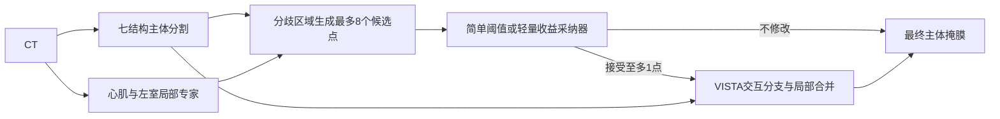

# wholeheart 局部专家选择性修正初步方案

日期：2026-10-25。状态：待审阅的研究计划，尚未实现或运行模型。用户本轮确定使用 wholeheart 并先出计划；下文的 CT 优先、专长结构、标注预算和模型配置均为建议。

建议第一轮只回答一个问题：**在相同来源病例和标注预算下，一个心肌与左心室局部专家，能否通过一次自动生成、选择性接受的点击，改善 VISTA3D 的七结构分割？** 先在来源数据验证专家互补性与真实点击收益，再训练采纳模块，最后锁定方案评价目标中心。

## 1 项目现状与可复用内容

本机工作目录为 `D:/code_project/vista3d_local_expert_refinement`。用户提供的 `D:/projects/...` 是历史来源路径。2026-10-25 已在线核对 `tianwuasd/project` 的 main 为 `25fae29f78f40d1e8ac95f3cd5e3d38b060ce87b`。该子目录的 173 个远端文件均在本机；160 个内容一致，13 个已有本地文档更新予以保留。本轮无需重复覆盖下载。

现有项目是研究归档：研究框架、最小实验计划、17 篇 PDF、文献笔记和 Academic Agent 固定研究快照，没有分割模型实现或训练结果。保留原目标：主体与专家学习相同来源材料；专家预测时继续提出建议；采纳模块选择动作；最终输出经点击修正的主体掩膜。

另一个工程 `whole_heart/project1` 已有病例清单、中心划分、标签转换、物理空间指标和 nnU-Net 训练入口。可参考数据与评估代码；原实验使用的标注数和训练目标不同，旧 checkpoint、来源指纹与成绩不能直接充当本方案的公平对照。原工程继续独立保存，本项目建立自己的配置和运行目录。

## 2 数据范围

依据现有完整质控报告和病例清单，本轮重新检查了所有 106 组影像与标签文件的存在性，缺失为 0；没有重新读取全部 NIfTI 体素或重新完成空间质控。[本地数据说明](../../whole_heart/数据探索工具/results/完整数据探索_已验证/数据说明书.md)

| 模态与中心组 | 原记录数 | 沿用隔离后的记录数 | 本计划用途 |
|---|---:|---:|---|
| CT A | 20 | 20 | 首轮来源 |
| CT B | 20 | 18 | 首轮来源 |
| CT G | 20 | 20 | 首轮锁定目标组 |
| MRI C&D | 20 | 19 | 后续独立扩展 |
| MRI E | 26 | 24 | 后续独立扩展 |
| 合计 | 106 | 101 | CT 58，MRI 43 |

继续隔离 B 的两例无效空间矩阵、C&D 的一例未知标签 421，以及 E 的两例相同影像而标签不同的记录。不猜测修复、不覆盖原件。数量目前是影像记录数；病例号和不同文件哈希不能证明患者独立性。运行前需核对患者/重复检查关联，不能让同患者的影像、patch、候选或轨迹跨集合。若身份资料无法取得，只能说明按可识别记录与重复簇划分，保留独立性局限。

七类训练编号延用原工程：

| 结构 | 原始编号 | 训练编号 |
|---|---:|---:|
| 背景 | 0 | 0 |
| 左室心肌 Myo | 205 | 1 |
| 左心房血池 LA | 420 | 2 |
| 左心室血池 LV | 500 | 3 |
| 右心房血池 RA | 550 | 4 |
| 右心室血池 RV | 600 | 5 |
| 升主动脉 AO | 820 | 6 |
| 肺动脉 PA | 850 | 7 |

这些是任务标签编号，不是 VISTA 类别提示编号。wholeheart 没有可直接支持冠脉开口、瓣膜、肺静脉连接点等监督的细标签。官方还限定 AO/PA 的评估范围，因此本地全标注范围指标不能冒称官方排行榜复现。[官方任务定义](https://zmic.org.cn/care_2026/track_wholeheart/)

## 3 路线选择

| 路线 | 价值 | 代价与位置 |
|---|---|---|
| A 单专家、单次点击、逐步加入采纳器 | 能分别识别专长、点击执行和筛选的贡献 | **推荐首轮**，最接近现有研究目标 |
| B 同时训练多专家、多轮交互、复杂策略 | 可覆盖更多结构和长轨迹 | 变量及运行成本多，留到 A 有收益后 |
| C 专家概率融合或局部替换 | 成本较低，信息损失少 | 必须保留的强对照；若更优，应承认点击的必要性未成立 |

首轮 CT 优先：原项目研究对象是 CT，现有可交互模型也是 CT。官方 NV-Segment-CT 支持自动与点交互；NV-Segment-CTMR 的已训练分支仅自动，不能直接把它当 MRI 交互执行器。[官方模型说明](https://github.com/Project-MONAI/VISTA/blob/main/vista3d/README.md)

## 4 数据划分与真实标注预算

建议先做 **A+B → G**：来源 38 例，目标 20 例。沿用旧 `ct_holdG` 的外层划分和 30/8 来源边界，另建本项目的少标注子划分；不修改旧清单。

首个完整机制试验的建议预算为 **16 例来源标注**，具体分配如下。所有病例抽样在看本实验模型输出前完成，并保存固定清单。

| 集合 | 数量与来源 | 标签使用权限 |
|---|---|---|
| L_fit | 8，A/B 各 4，从原 30 例训练池选 | 主体与专家的监督学习 |
| U_fit | 22，原训练池剩余 A 12/B 10 | 只读影像；隐藏现有标签，模拟未标注训练 |
| L_selector | 4，原 8 例开发池中 A/B 各 2 | 固定主体/专家/执行器后的动作收益监督与机制分析 |
| L_cal | 4，开发池其余 A/B 各 2 | 来源检查点、有限阈值校准；不用于采纳器拟合 |
| T_G | 20，G 全部合格记录 | 模型与规则冻结后，仅供独立评价 |

预算口径是 `8+4+4=16`，不能写成“只用了 8 例标注”。U_fit 的真值不能用于 ROI、伪标签过滤、前景强度统计、点击生成、模型选择或收益标签。L_selector/L_cal 的影像也不加入主体/专家的一致性拟合，保证收益样本相对基础模型是留出数据。G 影像不参与本地训练、群体统计和参数适配。

L_cal 同时承担检查点选择和阈值校准，因此不是独立来源测试集；只做小范围预先声明的选择，不在四例上反复搜索大量超参数。L_selector 只有四个独立记录，大量点不能抵消样本量不足：采纳器首轮只做低维可行性验证，不能据此声称可靠域外校准。若选择不稳定，保留简单阈值，下一版再比较患者级交叉拟合或扩大标注预算；不能直接把四例结果包装成正式有效性证据。

后续来源标注预算可设为 12/16/24/32 例，固定 8 例 selector+cal，L_fit 分别为 4/8/16/24，U_fit 为 26/22/14/6；使用嵌套训练子集。此曲线检验增加分割训练标注的作用，不单独证明采纳器样本效率。当前数据没有已核实的额外真实未标注来源库，此处是隐藏标签的受控模拟。

后续轮换目标 A/B，分别为 B+G→A、A+G→B；各折重新拟合和生成收益标签。若看过 G 的结果再修改方法，G 就成为开发过的中心，该改版需新增独立评价，不能继续称 G 完全未见。预训练数据与 CARE 的潜在重复须另审计；未排除时，主张限于“本轮适配训练留出中心”，不能声称对基础模型预训练完全未见。

## 5 首版模型和点击流程

### 主体与交互执行器

采用带点分支的 VISTA3D/NV-Segment-CT 预训练权重，在来源数据上完成七类自动分割适配。官方当前类别表只有整体 heart、aorta 等相关项，并没有 wholeheart 七类的一一对应关系；尤其整体心脏不能替代四腔和心肌、全主动脉不能直接等同升主动脉标签。[官方类别表](https://github.com/NVIDIA-Medtech/NV-Segment-CTMR/blob/main/NV-Segment-CT/configs/label_dict.json)

首选沿官方少样本微调入口，明确任务标签到类别提示/任务头的映射，使用七类监督学习语义；类别槽位初始化只是训练实现选择，不构成语义已经匹配。研究代码说明支持设置 `label_set`/`mapped_label_set`，具体使用新版 bundle 还是研究版，需要在接口预检后冻结代码版本、权重哈希及 MONAI 版本，不混用不同命名的权重。[官方微调说明](https://github.com/Project-MONAI/VISTA/blob/main/vista3d/README_research.md)

初始工程选择：先冻编码器训练任务相关自动分支/类别参数；若来源数据明显欠拟合，再按预先记录的方案解冻末端层。若更新共享编码器，需加入来源 L_fit 上的模拟点击监督，验证交互能力是否被破坏。进入收益采集后，主体、专家、交互分支和多类合并器全部冻结；任何改变都需要重建或重新验证收益标签。

**前置验收必须证明可以从当前七类主体状态执行一次纠错。** 需要实测已有掩膜/概率状态如何传入或由模型重建、正负点如何作用、处理区域如何返回。只得到一个从零生成的二值物体掩膜，不能当作已经实现原框架的主体纠错。若官方接口不直接支持所需状态，明确补一个状态/合并适配器并验证；不能悄悄更换研究问题。

### 一个心肌与左室专家

建议首个专家专注 **Myo+LV**，采用小型 3D U-Net，预测背景、Myo、LV、其他心脏前景四类。选择理由是现有标签可直接监督相邻内外边界，而非已发现它们一定有最高收益。与主体使用相同 L_fit/U_fit，以局部高分辨率采样和 Myo/LV 权重形成专长，不强迫它逐体素复制主体。

先用 Dice+CE 完成监督版定位问题，再给主体和专家对称加入各自的 EMA 弱强增强一致性，权重与阈值只在来源数据确定；不得让研究方法独享未标注数据而基线没有。边界损失、拓扑损失先不叠加。

推理 ROI 不能由真值确定，也不能只取某个目标结构的主体掩膜。采用全心前景加物理边距，并保留覆盖整幅影像的粗扫描/滑窗回退；发生完全漏检时仍应允许专家提出候选。ROI 和回退计算纳入总耗时。专家的初始权重与 VISTA 预训练资源不同，必须披露，不能将收益一概归因于专长；扩展阶段增加同容量、同初始化的一般分割专家对照。

### 候选与多类合并

对 Myo/LV 各产生正、负候选：专家认定属于该类而主体不认定的区域给正点，反向分歧给负点。按三维连通区域、区域内部距离和物理距离去重，每类每种极性至多 2 点，**每例候选上限 K=8，最终执行至多 1 点**；无分歧可为零。不能把八个候选全部执行后仍称一次点击。

候选完全来自影像和模型输出。正点是否真正确、哪点收益最高，仅用于来源数据事后分析。点击携带目标类、极性、原图物理坐标和模型网格坐标；验证轴顺序、方向、spacing、重采样、裁剪偏移和往返映射。

首版局部合并约定：只更新执行器有效区域内的目标类概率；有效区外、包括输出 255 所指的未处理区，保留当前全部概率。有效区内其他类分数保持原值，连同显式背景按冻结规则归一化并竞争输出；负点删除目标类后由其余类竞争，不能直接把整片置为背景。若接口只有二值结果，必须先补齐分数/背景处理契约并通过预检，不临时写任意类别优先级。实际收益必须在最终八类互斥掩膜上计算，包含被挤占结构的损害。

## 6 收益监督与采纳

第一轮质量函数固定为七前景类宏平均 Dice：`Q(M,Y)=mean_c Dice_c(M,Y)`。对每个候选 a 从同一初始状态独立执行，记录 `r(a)=Q(M_after,Y)-Q(M_before,Y)`；不修改的收益为 0。首轮不额外拟合多种损害/成本权重，邻类损害、HD95 和耗时单独报告，避免用四例开发样本调一组复杂目标。

L_selector 上最多 `4×8=32` 个单步收益样本，来自四个独立病例。先比较按区域置信度/分歧排序的固定规则，再尝试低维正则化线性收益模型。特征限于候选类/极性、主体与专家置信度、熵、分歧体积、点到边界的距离等预测时可得信息，不以病例 ID 为特征。样本按病例等权，不能让候选多的病例支配训练。

采纳器拟合只用 L_selector；L_cal 用于少量预先固定阈值的选择，例如预测 Dice 增益大于 0 或 0.002 时接受最高分点，否则不修改。阈值是初步工程候选，不是临床安全标准。训练、阈值选择后不把全部来源数据合并重训基础模型，以免收益分布被改变。

来源诊断同时报告含“不修改”的候选最佳可达收益 `max(0,max_a r(a))`，这是依赖真值选点的诊断上界；禁止作为自动系统表现。测试阶段只能使用预测分数选择，不能借目标标签挑点或回滚。失败/无效候选及执行错误也必须记录，不能只保留成功动作。

## 7 实验顺序与继续条件

| 阶段 | 具体工作 | 交付与继续条件 |
|---|---|---|
| P0 数据和接口预检 | 固定清单、预算、标签、预训练来源；用 L_fit 的少量病例核对七类输出与正负点击；检查当前掩膜状态传递和坐标 | 标签和空间检查通过，点击能影响正确类/正确位置，有效区外保持一致；否则先停在接口阶段 |
| P1 主体与单专家 | 先监督训练，再接入相同 U_fit 的一致性；用 L_selector 分析主体错/专家对、反向错误和误差相关性 | 能找到有用互补，且不是纯容量/分辨率收益的结论仍待对照 |
| P2 实际点击收益 | L_selector 每例最多 8 个候选，每次从相同初始状态执行 | 若所有病例的可达收益均为 0，停止采纳训练；若仅个别病例可达收益为正，先补证据而不扩大系统 |
| P3 选择性采纳 | 固定阈值与低维收益模型；L_cal 校准；比较收益、接受率和变差病例 | 若全部拒绝或持续不如简单阈值，保留负结果，不将复杂采纳器作为默认 |
| P4 锁定外部评价 | 冻结模型、阈值、候选数和合并规则，一次性评价 G | 报逐例配对变化与成本；如外部无增益，不能声称跨中心问题已解决 |
| P5 扩展验证 | 固定设计后轮换 A/B、增加种子和标签预算，再考虑第二专家与 3/5 点击轨迹 | 每一扩展独立核算；多步必须基于新状态重新生成候选 |

是否进入下一阶段由来源证据和预先声明的判据决定，不根据 G 的结果临时挑结构、阈值或模型。

## 8 对照与指标

首轮最小对照：主体不修改；最高置信候选无条件执行一次；置信阈值筛选；学习收益筛选；同一专家直接融合。所谓“无条件”也只执行一个预先排序候选，保持最终点击预算一致。直接融合仅用专家的 Myo/LV 概率补充对应类，其他类来自主体；融合系数只在来源校准，不能从真值选择区域。

扩展前增加：同标注预算 nnU-Net、主体自身生成点击、相同额外耗时的主体局部再分割、同容量无专长专家、试执行后选择。后者每例试执行 K 次，单独报告计算成本；不能把它与点击前采纳器当成等成本系统。对照使用相同病例划分、L/U 访问权限、评价网格；新增模型的预训练、参数量、分辨率、训练更新数和推理成本分别报告。旧 project1 的 B0/B1 只作工程参考，不直接比较成绩。

主终点：G 组逐例七类宏平均 Dice 的配对变化，保留未后处理预测；同时列每类 Dice、Myo/LV 改善和其余五类误改。报告下降病例数/比例、明显下降（例如宏 Dice 下降超过 0.01）的病例数；0.01 是需冻结的工程报告阈值，不是临床损害阈值。

次终点：HD95 与 HD（mm）、接受率、停止率、平均实际点击数、每例总耗时、峰值显存和离线收益采集成本。NSD 可作补充，但表面容忍距离未冻结前不列为首轮主指标。空预测且真值非空按 Dice=0、距离=∞并保留失败数；双空记 N/A 并公布分母，不删除难例美化均值。

预测恢复原始网格后评价；不以目标标签生成裁剪或重采样参数。采用患者/已知重复簇级配对 bootstrap 描述区间，身份未核实时称病例记录级区间。20 个目标记录只支持初步证据，不能将体素或候选数当样本量。宏平均和全范围血管评估与官方体积加权、血管截断口径不同，明确标为本地研究指标。

## 9 算力预算与文件交付

当前未核实可用 GPU、没有 VISTA 实测显存/耗时；不沿用旧工程的设备记录来保证本方案能运行。后续先做 2 例来源数据的前向与单点预检，再做约 100 个训练更新的短测，记录加载、缓存、专家前向、交互与合并的分别成本。运行平台与 patch/batch 在预检后确定，保持各组比较口径。

一个设置的最低成本包括一套主体、一套专家，约 32 次 L_selector 候选试执行、至多 32 次 L_cal 诊断/校准试执行，以及 G 20 例的各组推理；基线新增训练另外计算。耗时估算为 `训练更新数×实测步耗时 + 验证/缓存 + 病例数×候选数×交互耗时 + 最终评价`，不能在未短测前承诺几小时或几天完成。

| 后续产物 | 用途 |
|---|---|
| 独立数据访问清单与标签预算清单 | 明确每例属于 fit/U/selector/cal/target；标签权限可检查 |
| checkpoint 和交互接口记录 | 权重/代码版本、类别提示映射、当前掩膜状态、坐标与合并约定 |
| 主体与专家预测缓存 | 便于同初始状态对照、复现候选 |
| 动作收益表与动作日志 | 类别、极性、坐标、版本、预测收益、实际收益、拒绝/停止原因 |
| 逐例指标与成本报告 | 保留失败、无收益和相邻结构损害 |

本轮只交付本计划、数据条件摘要和交接更新。未复制影像、未读取目标标签体素、未安装训练环境、未下载模型权重、未启动训练或推理；没有新的性能数值。

## 10 下一步建议

先按 **CT、A+B→G、16 例来源标注总预算、一个 Myo/LV 专家、K≤8 且最终至多一次点击** 审阅方案。进入实施后，第一个交付应是数据权限与 VISTA 七类/点接口预检报告。只有预检和来源点击收益成立，才投入采纳学习与外部评价。

后续仍需明确的条件是：可用运行设备、患者关联能否核实、具体 checkpoint 与预训练重叠证据、七类适配后点击状态接口是否可用。它们不妨碍先确定研究计划，但会决定实施配置与能够支持的结论范围。
